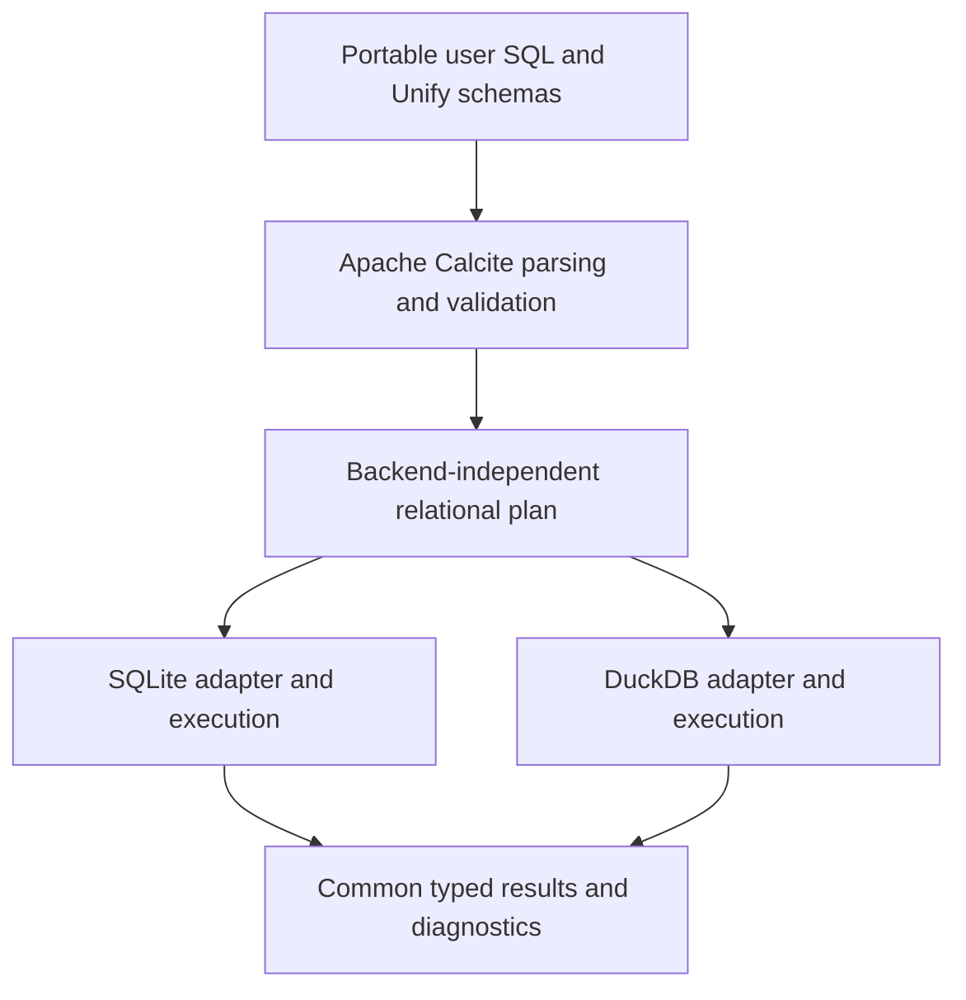

© Mark Andrew Ray-Smith Cityline Ltd 2025\
Version 0.14

# Unify Functional Design

Status: Draft for review  
Date: 2026-11-23

Companion: [Unify Technical Design](TECHNICAL_DESIGN.md)

The technical draft remains based on version 0.1. Its revision is deferred until the functional review is complete.

## Purpose and authority

Unify enables applications to read tabular data from different sources, process it through any number of declared transformation stages, join sources wherever required in that processing, and write the resulting records to a supported destination. Applications should receive consistent values, validation results, and failure information regardless of the source format.

This design defines the proposed first functional baseline. It specifies externally observable behavior rather than classes, frameworks, or algorithms. Requirements describe intended behavior; they do not imply that the current implementation already satisfies it. The technical design must implement these requirements and must identify any requirement it cannot satisfy. A technical limitation must not silently change the functional contract.

Unify is delivered as a service with an HTTP API and its own user interface, built on an embedded Java library that applications can also use directly (D01). Both designs remain drafts until their scope and behavior have been reviewed.

## Problem and intended outcomes

Applications currently need format-specific logic for reading records, interpreting values, renaming fields, and handling failures. Small differences in these rules can corrupt data or make a failed transfer appear successful.

Unify should let an application define the meaning of its data once and reuse that definition across supported formats. Users must be able to store input and output schemas, input and output mappings, and transformation definitions independently of an individual execution, then select them again for later operations. A caller should be able to determine what was read, what was accepted or rejected, what was written, and whether destination changes were committed.

Success means that a CSV-to-database transfer and a JSON-to-XML transfer use the same rules for types, missing values, validation, and operation results. Unsupported behavior must be reported explicitly.

## Users and responsibilities

| User                                  | Needs                                                                                               | Responsibility outside Unify                                   |
| ------------------------------------- | --------------------------------------------------------------------------------------------------- | -------------------------------------------------------------- |
| Application developer                 | Construct tables, configure transfers, inspect results, and handle failures                         | Application orchestration and presentation                     |
| Integration maintainer                | Store, find, version, and reuse input/output schemas, mappings, transformations, and format options | Review data contracts and coordinate source changes            |
| Operator through the host application | Diagnose rejected records and failed transfers                                                      | Schedule jobs, manage credentials, and decide whether to rerun |
| Connector implementer                 | Add a source or destination with the same behavioral contract                                       | Establish compatibility with the external product              |
| Unify administrator                   | Configure organisations, namespaces, and the identity-provider groups granted each role             | Operate the service, its PostgreSQL database, and the identity provider |

These are usage roles. In the Unify service, permissions come from Unify roles granted to identity-provider groups (FR044, FR045). An application embedding the library supplies its own access policy (FR038). Access to files, databases, and network endpoints is further limited by the credentials each connection uses.

## Scope of the first functional baseline

### Included capabilities

- Programmatic creation, inspection, and editing of typed tables.
- Reading and writing local CSV, JSON, and XML files.
- Reading JDBC tables or parameterized queries and appending records to an existing JDBC table.
- Verified JDBC compatibility for H2 and SQLite.
- Reading a single HTTP GET response containing JSON records.
- Explicit schemas, bounded schema inference, column projection and renaming, defaults, and declarative validation.
- Any number of ordered transformation stages, with explicit dependencies and intermediate schemas.
- Read-only SQL query stages over sources and earlier results, using a documented portable profile with SQLite-style syntax.
- Apache Calcite for parsing, validating, and planning portable SQL queries before backend-specific execution.
- Joins across multiple sources from any supported readable connector or supplied table, at input, output, or any intermediate transformation stage.
- Durable storage and reuse of named schemas, mappings, transformation definitions, join plans, stages, and complete pipelines.
- Discovery and registration of versioned provider contracts, with parameters, declared or binding-time schemas, capabilities, and host-supplied availability.
- Publication and reuse of read-only views with pinned query, schema, preparation, and provider dependencies.
- Separate provider discovery, operation-scoped data bindings, reusable-definition storage, and connection settings.
- Organisation and namespace ownership of configuration resources, with separate organisation-owned design workspaces for configuration sessions.
- PostgreSQL 19 as the required backing database for the reusable definition store.
- SQLite and DuckDB as selectable execution backends behind common pipeline and data contracts, qualified against the same functional baseline.
- Reusable configuration, validation before execution, and a preview that does not write to a destination.
- Explicit operation results, rejection reporting, cancellation, and bounded resource use.
- The Unify service: an HTTP API described by OpenAPI, and a user interface built only on that API.
- Sign-in through an external OpenID Connect identity provider, and Unify roles granted to identity-provider groups.
- Background execution of operations, with live progress, cancellation, and run history.
- An embedded library offering the same capabilities to applications that use Unify directly.

### Deferred capabilities

The first baseline excludes a scheduler for recurring operations, Unify-managed user accounts, distributed processing, continuous synchronization, change capture, arbitrary transformation scripts, and datasets that require processing beyond configured materialization limits. Filtering, expressions, aggregation, and sorting are included through the SQL query profile in FR032. Non-equality joins, unrestricted cross joins, recursive queries, and window functions remain outside the proposed portable query baseline.

MongoDB and other NoSQL integrations are deferred. HTTP writes, pagination, automatic retries, OAuth token acquisition, remote file destinations, file append, database upsert, table replacement, and automatic database schema creation or migration are also deferred. Existing experimental APIs do not expand this baseline.

### Connector capability matrix

| Connector           | Read      | Write     | Baseline shape and limits                                                  |
| ------------------- | --------- | --------- | -------------------------------------------------------------------------- |
| Local CSV           | Required  | Required  | Delimited records with configurable header, delimiter, quote, and encoding |
| Local JSON          | Required  | Required  | Array of flat objects, optionally beneath a selected object member         |
| Local XML           | Required  | Required  | One root containing repeated row elements with scalar child elements       |
| JDBC H2 and SQLite  | Required  | Required  | Query or table read; transactional append to an existing compatible table  |
| HTTP JSON           | Required  | Deferred  | One GET response using the same record shape as local JSON                 |
| Other JDBC products | Extension | Extension | Advertised only after product-specific compatibility verification          |
| NoSQL               | Deferred  | Deferred  | No production support claim in the first baseline                          |

Join eligibility depends on a connector's read capability, independently of its write capability. Sources in one join can use different formats, locations, and credentials; they need not share a database or connector. Supplied in-memory tables can also participate. Joining a source does not enable an otherwise unsupported connector.

## Functional information model

| Concept               | Meaning                                                                                                                                                                                |
| --------------------- | -------------------------------------------------------------------------------------------------------------------------------------------------------------------------------------- |
| Table                 | An ordered schema and an ordered collection of records                                                                                                                                 |
| Column                | A unique name, logical type, nullability, optional default, and optional validation rules                                                                                              |
| Record                | One value for each column after mapping and validation                                                                                                                                 |
| Missing value         | A source field is absent; this is resolved before a record enters a table                                                                                                              |
| Null value            | A field explicitly has no value                                                                                                                                                        |
| Empty string          | A present text value containing zero characters                                                                                                                                        |
| Mapping               | Ordered rules selecting source fields and defining their destination names and types                                                                                                   |
| Input schema          | Source field names, types, and value rules used by an input mapping                                                                                                                    |
| Output schema         | Destination field names, types, and value rules that mapped and transformed output must satisfy                                                                                        |
| Transformation        | A named declarative rule or ordered sequence of supported operations that changes field values                                                                                         |
| SQL query definition  | Reusable query text with its dialect-profile version, logical dataset bindings, typed parameter declarations, and result schema                                                        |
| Provider              | A named, versioned contract exposing an approved read or write connector operation, or a published read-only view                                                                      |
| Organisation          | Parent owner of namespaces and design workspaces                                                                                                                                       |
| Namespace             | Organisation-owned scope containing catalogue entries, connections, definitions, pipelines, execution settings, and run history                                                        |
| Design workspace      | Organisation-owned configuration session that references namespace resources and holds drafts without owning them                                                                      |
| Provider catalogue    | Registered providers and published views in a namespace, discoverable through the host's access policy                                                                                 |
| Published view        | A registered read-only provider exposing a saved query, typed parameters, result contract, and pinned dependencies for reuse                                                           |
| Transformation stage  | A named processing unit with declared input bindings, transformation rules, and a named result with a schema                                                                           |
| Pipeline              | A reusable, versioned composition of any number of stages and their declared dependencies                                                                                              |
| Intermediate schema   | The contract for a stage result consumed by later stages                                                                                                                               |
| Source binding        | A uniquely named input identifying a pinned readable provider, an inline endpoint, or a supplied table, with parameter values and schema/mapping/transformation references             |
| Join plan             | An ordered set of join steps naming their inputs, keys, join types, projected fields, and stage                                                                                        |
| Joined record         | A generated record with fields and lineage from its contributing source records                                                                                                        |
| Stored definition     | An independently reusable schema, mapping, transformation, SQL query, join plan, stage, pipeline, provider registration, or published view with a stable identifier, name, and version |
| Definition store      | PostgreSQL 19-backed durable storage through which the host can save, find, load, and revise reusable definitions                                                                      |
| Execution backend     | SQLite or DuckDB processing of operation data behind a common pipeline contract                                                                                                        |
| Endpoint              | A source or destination plus its connector settings and credential reference                                                                                                           |
| Connection definition | Host-managed endpoint settings and credential references selected independently of a provider's logical contract                                                                       |
| Operation             | One read, write, preview, or source-to-destination transfer                                                                                                                            |
| Rejection             | A complete record excluded by an explicitly selected validation policy                                                                                                                 |
| Result                | Completion status, record counts, diagnostics, and destination outcome                                                                                                                 |
| Run record            | The stored result of one execution or preview in a namespace's run history, without business records, samples, or secrets                                                              |
| Design-time sample    | Records supplied by upload, paste, or example while configuring; bounded, session-scoped, and never persisted                                                                          |
| Configuration bundle  | An export of selected saved resources with the exact versions they depend on, without records, samples, credentials, or run history                                                    |
| Access policy         | The decisions about which principal may discover, inspect, bind, save, publish, execute, use a connection, or administer structure; in the service, derived from role grants             |
| Role grant            | One Unify role given to one identity-provider group in an organisation or namespace                                                                                                    |
| Execution job         | A submitted execution waiting for or running on a service worker, visible as a queued, running, or abandoned run                                                                       |

A table contains scalar values. Nested objects, collections, and binary values are outside the baseline. Null, empty, and missing values have distinct meanings even when a source format needs explicit settings to distinguish them.

## Catalogue and workspace concepts

The host-facing model distinguishes the following areas. The Unify UI provides these interactions through the service API (FR043). The HTML mockup is its design reference and relies only on capabilities of the configuration interface (FR038).

| Area               | Contents and purpose                                                                                                         |
| ------------------ | ---------------------------------------------------------------------------------------------------------------------------- |
| Catalogue          | Discover registered provider capabilities, exposed datasets, and published views; inspect metadata before creating a binding |
| Pipeline data      | The selected operation's declared input bindings, parameter values, and named earlier-stage results                          |
| Definition library | Independently reusable, versioned schemas, mappings, transformations, queries, joins, stages, and pipelines                  |
| Connections        | Physical endpoint settings and credential references supplied or selected by the host                                        |

A provider is an operation contract rather than a file, a sample of records, a runtime SQL alias, or an execution backend. Categories organise discoverable entries within a namespace, for example `Files.Holdings`, `Reference.Instruments`, and `Views.PortfolioExposure`. `Files`, `Reference`, and `Views` are catalogue categories; the owning namespace starts as `default`. Category notation in discovery does not prescribe additional SQL syntax: FR032 continues to resolve explicitly bound logical datasets.

The owning structure is **Organisation → Namespace → resources**. Design workspaces are separate organisation-owned configuration sessions. They reference namespace resources and retain drafts; they do not own namespaces, catalogues, or saved definitions. Multiple design workspaces can edit resources in the same namespace without sharing mutable drafts. The host application supplies the selected organisation, namespace, session, and access policy under FR037. These configuration sessions are also distinct from temporary engine execution workspaces under FR021.

The principal discovery flow is inspect a provider version, review its parameters and result contract, select compatible connection settings, supply values, and add an explicit input or output binding. This creates operation configuration without reading business records. A separate bounded preview reads sample data. Provider registration, connection creation, and input binding are distinct actions.

Saving query text creates a reusable definition. Publishing a view additionally creates a discoverable read-only provider contract. Saving a schema, mapping, or pipeline does not automatically expose it as a queryable catalogue entry. Earlier-stage results remain local to their operation unless deliberately incorporated into a complete published-view definition.

This model takes inspiration from Luminesce's [provider architecture](https://support.lusid.com/docs/understanding-the-luminesce-platform-architecture), [provider registration metadata](https://support.lusid.com/docs/sysregistration), [field and parameter metadata](https://support.lusid.com/docs/sysfield), and [custom views](https://support.lusid.com/docs/creating-custom-views-sysadminsetupview). Luminesce supports writer providers in query workflows. Unify retains its approved read-only query profile and explicit output publication boundary.

## Backing database requirement

PostgreSQL 19 is the required backing database for the definition store. It stores reusable schemas, mappings, transformation definitions, SQL queries, join plans, stages, pipelines, provider contracts, and published views, including their identifiers, versions, dependency references, and host-supplied ownership metadata. Connection definitions may be managed through the host; persisted connection metadata contains credential references rather than secret values.

Definition-store persistence and operation data endpoints are separate concerns. The connector capability matrix governs where business data can be read and written. JSON and YAML remain configuration exchange formats; the durable definition store is stored in PostgreSQL 19. Database connection settings and credentials are supplied by the host.

The supported definition-store server major version is 19. Compatibility must be verified against a real PostgreSQL 19 instance. Definition-store database structure, migrations, connection management, and driver selection belong to the technical design after functional review.

## Selectable execution backends

SQLite and DuckDB are supported execution backends behind a common Unify contract. PostgreSQL 19 remains the durable definition store. Users define schemas, mappings, transformations, joins, and stages without depending on an execution engine's SQL dialect or native data representation.

| Component                         | Required role                                                                                                                                 |
| --------------------------------- | --------------------------------------------------------------------------------------------------------------------------------------------- |
| PostgreSQL 19                     | Persist and version schemas, mappings, transformations, joins, stages, pipelines, provider contracts, published views, and their dependencies |
| Common Unify contracts            | Describe logical data and pipelines; define validation, execution results, diagnostics, cancellation, and resource ownership                  |
| Apache Calcite                    | Parse and validate the public SQL profile and build a backend-independent relational plan                                                     |
| SQLite execution backend          | Execute portable pipelines for use cases prioritizing lightweight local processing                                                            |
| DuckDB execution backend          | Execute portable pipelines for analytical and join-heavy processing, including supported disk-backed intermediate work                        |
| Source and destination connectors | Read and write business data independently of the chosen execution backend                                                                    |

The host selects SQLite or DuckDB per operation in one of three ways: directly, through an explicitly configured default, or through automatic selection. Automatic selection applies a versioned selection profile derived from detailed testing of both backends across many integration use cases, each measured on every metric in FR030; it never relies on an unmeasured threshold. Its inputs are known before any source records are read: the pipeline's shape from its validated definition, the size of every source, the operation's resource budgets, and which backends are installed. Source size is never unknown: every source reports its size before selection, and a source that cannot report it is staged to temporary storage first. Selection is resolved before source records are read, recorded in the result with the actual engine version, and fixed for the operation. A portable saved pipeline can run on either backend without rewriting its business rules, so automatic selection changes performance and resource use but never logical results. Execution must not silently switch engines.

This workload guidance reflects [SQLite's emphasis on lightweight local storage](https://www.sqlite.org/whentouse.html) and DuckDB's [analytical execution design](https://duckdb.org/why_duckdb) and [larger-than-memory processing](https://duckdb.org/docs/2.0/guides/performance/how_to_tune_workloads). Actual performance, startup, memory, and temporary-disk use must be measured against representative Unify workloads. Neither backend has a universal performance advantage.

The public data and pipeline interfaces expose Unify schemas, logical values, source/result bindings, stage definitions, and operation results. Users can also supply portable SQL query definitions under FR032. Portable definitions do not require engine-specific SQL, connection handles, result sets, native relation objects, or database-specific type names. Backend-specific preparation, query translation, execution, type adaptation, and resource handling are implementation responsibilities behind those contracts. Using JDBC internally does not by itself establish equivalent behavior across engines.

Each backend must implement the shared portable baseline, including stage dependencies, strict conversions, null/default rules, join cardinality and ordering, rejection policies, diagnostics, cancellation, and ownership. Differences in physical plans, timing, and resource consumption are expected; differences in the defined logical result require correction or explicit capability rejection. Extensions outside the portable baseline must be named and validated rather than silently changing semantics.

SQLite's role as an execution backend is separate from its role as a source/destination connector. For example, a pipeline can read a SQLite source while executing its stages on DuckDB, or execute on SQLite with file and HTTP sources. PostgreSQL definition-store persistence is independent of both choices. Native file readers are permitted only where they preserve the same format contracts as other connectors.

Backend implementation interfaces, SQL translation, type adaptation, version selection, packaging, lifecycle, and concurrency management belong to the technical design after functional review.

## SQL query mechanism

SQL is a first-class way to query operation data and define a transformation stage. Queries address named source bindings, supplied tables, or earlier stage results. Their tabular results can be returned, previewed, joined, transformed by later stages, or selected for export.

The proposed public dialect uses familiar SQLite SELECT syntax within a documented, versioned portable profile. This is a Unify query contract rather than a promise to reproduce every SQLite extension or permissive behavior. DuckDB's [native dialect is PostgreSQL-based](https://duckdb.org/docs/2.0/sql/dialect/overview), so backend implementations must validate or translate the supported profile and verify equivalent results on both engines.

SQL query definitions are stored and versioned in PostgreSQL 19 with the other reusable definitions. A query's logical source names remain separate from physical connection settings and from the chosen execution backend. JDBC source-native queries under FR017 remain a separate mechanism using the source product's dialect.

Apache Calcite is the required parsing, validation, and logical planning layer for portable SQL. Its [relational planning model](https://calcite.apache.org/docs/algebra.html) and [configurable query conformance and SQL dialect generation](https://calcite.apache.org/docs/adapter.html#customizing-sql-dialect-accepted-and-generated) support the selected separation of responsibilities. Backend adapters translate the validated plan and execute it on SQLite or DuckDB while preserving the Unify query contract.



Calcite adoption does not imply that the full SQLite dialect or all required semantics work without configuration or adaptation. The supported profile, strict type behavior, ordering, and diagnostic contracts remain defined by Unify. Calcite version selection, conformance settings, schema integration, optimizer rules, and backend dialect adapters belong to the technical design after functional review.

## User workflows

### UC01 Construct and edit a table

The developer declares ordered columns, adds records, reads values by column name, and updates values. Each mutation is checked against the schema. An invalid mutation leaves the table unchanged. Export can then use the same table without depending on its original source.

### UC02 Configure and preview an import

The maintainer selects one or more source bindings and stored versions of their schemas, mappings, and processing pipeline, or creates new definitions. An inferred schema can be reviewed and explicitly saved for future use. Configuration validation checks local consistency and compatibility between every stage and its dependencies. Preview reads bounded samples and returns the final or selected intermediate schema, sample records, and diagnostics without writing to a destination. Preview is an observation of those samples, not a promise that later records, join matches, or a later source version will be valid.

### UC03 Import and inspect data

The application starts a read. Unify resolves the schema, reads and validates records, and returns a complete table and result. The default policy fails on the first invalid record. An explicitly configured rejection policy can exclude invalid records within a stated limit. A failed read does not publish a partial table as a successful result.

### UC04 Export an existing table

The application selects a destination, the pipeline result to export, and stored versions of its output schema and mapping, or supplies new definitions. Any number of preparation stages can transform that result and join additional source bindings or supplied tables before final output mapping. Unify checks that the stages are compatible and that the destination can represent all resulting values before making destination changes. It then writes the records and reports the destination outcome. File replacement requires an explicit choice.

### UC05 Transfer between endpoints

Unify resolves and validates the selected definition versions before reading source data. It prepares source bindings and executes the declared stages in dependency order, validating each result before it is consumed. Stages can alternate transformations and joins and introduce further declared sources as needed. The operation selects a final result and completes destination mapping and validation before publication. Input and output are processing roles at the boundaries, not a restriction to two transformation stages. The operation returns one result covering all sources and stages and identifies the definition versions it used.

### UC06 Diagnose and rerun

The caller uses the operation identifier, phase, counts, and record or field locations to diagnose a failure. Unify performs no automatic write retry. A rerun is a new operation; callers must assess duplicate risk when a previous commit outcome is unknown or already committed.

### UC07 Add a connector

A connector declares its supported operations, types, shapes, limits, and publication guarantees. Unsupported settings fail validation. A connector is advertised as supported only after its compatibility and failure behavior have been verified.

### UC08 Save and reuse definitions

Through the host application, a user saves a schema, mapping, transformation, join plan, stage, or complete pipeline under a name. The user can find and load that definition in a later session and bind it to another compatible operation without recreating its rules. Connection locations and credentials can change without copying the reusable definition. Editing a saved definition creates a new version; existing saved operations continue to use their selected versions until explicitly changed. The host supplies the owning organisation and namespace, the editing session, and access policy; Unify does not introduce its own user accounts.

### UC09 Join sources at any processing stage

The user gives each participating source or earlier stage result an alias and selects a join type and one or more matching key pairs. A join may occur near input, near output, or between any other transformation stages. Multiple explicitly ordered steps can join three or more sources, including a mixture of connector types. Later stages may transform a joined result and join it again without changing a caller's original tables.

### UC10 Compose a pipeline of transformation stages

The user adds named stages, selects their input aliases and reusable transformation or join definitions, and declares the schema of each result. Each stage can consume prepared sources or earlier results. The user can insert further stages wherever dependencies allow, then select the final result for return or export. A direct transfer may have no optional transformation stages; other operations may have one or any number. The user can save stages separately and save their complete composition as a reusable pipeline.

### UC11 Query datasets using SQL

The user selects named datasets, writes or loads a saved SQL query, supplies typed parameter values, and previews or executes it. The query can be an initial processing stage or consume any earlier stage results. Its named result can feed later stages or become the operation's final output. The same portable query definition is reusable with SQLite or DuckDB execution.

### UC12 Discover and bind a provider

The user browses the available provider catalogue, selects a namespace, filters by category or capability, and inspects an exact version's parameters, columns or schema-resolution mode, documentation, and dependencies. The user selects connection settings, supplies typed values, and adds a uniquely named input binding to a pipeline. The host shows this binding separately from catalogue entries and from earlier-stage results. A separate preview reads bounded samples. Selecting a writer instead configures the output operation and its explicit publication behavior.

### UC13 Publish and reuse a view

The user selects a saved read-only query or preparation composition and explicitly publishes a named view with its scalar parameters, result contract, and complete pinned dependencies. Another compatible operation discovers the view and binds it without copying the underlying SQL. Republishing creates a new version; previous bound views and pipelines retain their selected versions. A dependency inspection identifies the exact referenced definitions. Publication of a view's metadata is separate from publication of business data to a destination.

## Functional requirements

### FR001 Table structure and mutation

Column names must be nonblank, unique, and case-sensitive. Column order is explicit and stable. Ordinary table operations retain record encounter order. Declarative join-generated ordering follows FR028; SQL queries require explicit ordering under FR032. A database source query must also specify ordering if the caller requires a particular source order. Applications can read and update cells and append records. Each mutation is atomic. The schema cannot change while records exist; schema conversion creates a new table. Zero-record tables are valid when their schema is known. Export requires at least one column.

### FR002 Schema selection and inference

An explicit schema takes precedence and is recommended for repeatable transfers. When inference is requested, a bounded sample determines and freezes the schema before the full read proceeds. The default sample is the first 1,000 records, subject to the operation limits. A later incompatible value is a validation error; it must not cause silent schema changes.

Inference recognizes the supported scalar types. Integers outside the supported integer range and numeric identifiers with significant leading zeros remain strings. Mixed integer and fractional numeric samples infer a double. Other incompatible mixtures infer a string. An all-null sampled column infers a nullable string. Empty sources need an explicit schema; CSV headers alone can establish nullable string columns. JSON and XML object or element order in the first sampled record establishes inferred column order. Fields appearing only later in the sample are appended in encounter order. Later fields outside the frozen schema are errors unless an explicit mapping has intentionally excluded them.

### FR003 Logical types and conversion

The baseline types are string, signed 32-bit integer, finite double, boolean, date, time, and local datetime. Double is approximate and is unsuitable for an exact-decimal contract; exact decimal and larger integer values can be carried as strings. Booleans accept only the tokens true and false, ignoring letter case. Numeric overflow, non-finite numbers, invalid booleans, and invalid dates fail conversion.

The default date is year-month-day, time is hour-minute-second with optional fractional seconds, and local datetime combines these with a T separator. These values carry no timezone, and Unify must not invent or convert one. Alternative input patterns or locale-sensitive formats require explicit settings. Whitespace is preserved unless trimming is explicitly enabled for that column. Fractional output digits and source lexical formatting are not guaranteed to be preserved for typed numeric values.

### FR004 Missing null and empty values

Missing fields use their explicitly configured default. If no default exists, a nullable column receives null and a non-nullable column fails validation. Explicit null remains null and fails for a non-nullable column. Empty string remains empty for a string column and fails conversion for other types. An explicit empty-as-null option changes empty string to null before the nullability check. Defaults do not silently replace null, empty, or invalid values. No implicit zero, false, current date, or current time is generated.

### FR005 Mapping and projection

Mappings select, order, and rename source fields and declare their resulting types. A field is selected by name, or by a zero-based position for positional sources such as CSV. Each rule uses exactly one selector. When multiple sources participate, selectors qualify fields by their source or join-result alias. Destination names must be unique. One source field may be copied to multiple differently named destination fields. Unmapped fields are ignored when a mapping explicitly selects a subset. Invalid selectors and defaults are configuration errors. Supported computed expressions can be authored in SQL query stages under FR032. Executable scripts and expressions outside the declared query profile are excluded.

### FR006 Record validation

Validation includes field presence, conversion, nullability, and configured inclusive numeric bounds, string length bounds, or permitted values. Defaults are validated against the same rules. All checks on a record finish before that record is accepted. Unify must not insert a partially valid record or silently truncate a value. Apart from explicitly configured join-cardinality checks under FR028, cross-record uniqueness and referential integrity remain destination or host responsibilities.

### FR007 Import isolation

A successful read returns a complete table and its result. A failed or cancelled read does not alter a caller's existing table or expose an incomplete table as completed data. Decodable rejected records may be returned as diagnostics according to FR010, but are not accepted table records.

### FR008 File destination modes

The default write mode creates a new file and fails if the destination already exists. Explicit replacement publishes the complete new content only after successful writing; failure before publication leaves the previous file unchanged. If a destination cannot provide that guarantee, the requested mode is rejected before changing the destination. File append is excluded. An empty table writes a valid empty representation, preserving the configured header or document structure.

### FR009 Transfer publication

All required sources, transformation stages, joins, and final result records must complete materialization and validation, including output conversion, before destination publication begins. Configuration, source, stage, join, validation, and cancellation failures before publication leave the destination unchanged. Completion of an intermediate stage does not publish a partial destination result. The operation must not claim a transaction or common point-in-time snapshot spanning independent sources and the destination. Publication guarantees apply to one destination only and follow the connector capability contract.

Prepared intermediate and final results may use engine-managed memory or temporary disk within the configured budgets. Completion before publication does not require copying the entire working dataset into Java memory. Temporary execution storage is not a committed business destination or a substitute for the PostgreSQL definition store.

### FR010 Rejection policy

Fail-fast is the default. An optional skip-record policy requires an explicit positive maximum rejected-record count. Only a complete record with known boundaries can be skipped. Unrecoverable syntax, transport, authorization, cancellation, resource-limit, configuration, and destination errors fail the operation. Exceeding the rejection limit fails the operation before publication. Rejection diagnostics retain the first 100 issues by default and disclose truncation; counts cover every encountered rejection. No malformed data is silently skipped.

For join operations, this policy applies to record-local failures while preparing source records or validating generated records. The rejection budget covers both categories, counting each rejected record instance once. Unmatched records excluded by the selected join type are not rejections. A failed source, invalid join definition, or violated join-cardinality assertion fails the operation; it must not be treated as an empty source or a skippable record.

### FR011 Operation result and counts

Every completed or failed invocation has a unique operation identifier and a result available to the caller. Completion is success, success with rejections, failed, or cancelled. A write separately reports destination outcome as not started, committed, rolled back, or unknown. A successful read or preview has no destination outcome.

Results include phase, start and end time, records read, accepted, rejected, and confirmed written, plus warnings and located errors. Read counts exclude headers and count complete records; incomplete terminal input is reported separately. When all stages preserve one candidate per input record, read equals accepted plus rejected after all records have been classified. Joins and SQL result shaping follow their separate counts below. Output records are counted only when publication is confirmed. A lost commit acknowledgement produces an unknown outcome and no invented confirmed count. Batches sent or records attempted must not be described as committed records.

When stored definitions are used, results identify the exact schema, mapping, transformation, SQL query, join-plan, stage, and pipeline identifiers and versions resolved for the operation. A later edit to the definition store must not change that execution record.

Executed operations also identify the resolved SQLite or DuckDB backend and its actual version, independently of source and destination connector identities. They record how the backend was selected (explicit, configured default, or automatic). For automatic selection they also record the selection profile and version, the matched use case, and the inputs used: pipeline shape, each source's reported size and how it was determined, the applicable resource budgets, and the installed backends.

For a transfer, a final result record is accepted only after all its required processing stages and final validation have succeeded. A record instance rejected at a stage counts once as rejected and does not continue to dependent stages, so later transformation failures cannot leave an accepted final result record silently unwritten.

Join operations report separate read, accepted, and rejected counts for each source binding; each join step reports matched and unmatched left/right record counts and generated result counts. Final accepted and rejected result counts describe the final candidate records, separately from earlier source or intermediate rejections. One source record can contribute to several result records, and an inner join can exclude unmatched records without rejecting them. Therefore total source records read need not equal final accepted plus rejected records. Diagnostics for a generated record identify its join step and contributing source aliases and record ordinals where available.

SQL filtering, grouping, DISTINCT, and LIMIT can also change record counts without rejecting records. Such stages report input and output counts separately; filtered, grouped, deduplicated, or deliberately limited records are not validation rejections. The single-record count identity applies only to operations whose stages preserve one candidate result per input record. Aggregate or derived results identify contributing datasets and stage context; diagnostics must not invent a single originating record when one does not exist.

Every executed stage reports its identifier, resolved definition version, completion state, input/output record counts, rejection count, and located issues. Reprocessing an earlier result in another stage does not count as rereading its original source. Stage counters must not be summed and presented as unique source-record counts. Failures identify the stage and step where they occurred, including when the same transformation definition is used more than once.

### FR012 Configuration lifecycle

An application can construct, save, load, and validate a versioned operation definition. An operation can refer to independently stored versions of its input, intermediate, and output schemas, mappings, transformations, SQL queries, join plans, stages, and complete pipelines. These references are pinned to exact versions rather than resolving silently to the latest version. Inline definitions remain available for one-off use and can be explicitly saved for reuse.

JSON and YAML representations must preserve equivalent behavior, ordered mappings, stage and step order, source/result aliases, stage dependencies, selected final result, and definition references. An exported operation must either include its exact referenced definitions or preserve explicit references that must be resolved before execution. Unknown required versions, unresolved references, incompatible definitions, unknown options, unsupported capabilities, ambiguous selectors, and invalid defaults fail validation. Existing persisted mapping formats require a documented migration path. Credentials are supplied separately or by reference and are never embedded in newly saved configurations.

A configuration bundle exports selected saved resources of one namespace together with the exact versions of everything they depend on. Importing a bundle into another namespace or host recreates those versions' content unchanged and reports any name that already exists there rather than overwriting it. Bundles never contain business records, design-time samples, credentials, or run history. An import may supply a new name for each clashing resource; when every clash has a new name, those resources are imported under their new names, and otherwise the whole import is still rejected.

Operation configuration preserves the requested execution backend, configured-default reference, or automatic-selection request with its selection-profile reference, and the resource settings, separately from the portable pipeline definition. Reusing a portable pipeline with another backend does not rewrite its logical definitions or create a different business schema merely to match a native database type.

### FR013 Preview and validation

Configuration validation performs no destination mutation. Preview reads up to an explicit limit, defaults to 100 records, and returns a sample and diagnostic summary. It reports whether the source ended or the sample was capped. Preview checks only the records it reads and does not publish output, execute table-creation statements, or guarantee that a later execution sees identical data.

For joins, preview has a per-source sample limit and a separate final-result limit, each defaulting to 100 records within the overall operation budgets. It reports which source samples were capped. Missing matches, apparent uniqueness, and sample join cardinality are provisional when any contributing source is capped; preview must not present them as complete-source conclusions.

A user can preview the final pipeline result or a named intermediate stage. Preview executes the dependencies needed for that sample and reports stage schemas, samples, and diagnostics within the same operation budgets. It does not publish intermediate or final data to a destination. Capped-source qualifications carry through every dependent stage.

From a preview of a file output stage, a user can download the prepared sample encoded exactly as that stage's connector and format settings would write it (FR014, FR015, FR016). The download contains only the bounded preview records, is identified as a preview sample, and writes nothing to the destination. A JDBC output has no file encoding; its preview shows the prepared rows only.

### FR014 CSV behavior

CSV supports explicit header presence, delimiter, quote character, encoding, and output record separator. Defaults are a header, comma delimiter, double quote, UTF-8 encoding, and LF output separators. Quoted delimiters, escaped quotes, quoted line breaks, non-ASCII characters, and trailing empty fields must be handled. Duplicate headers, inconsistent record widths, and unterminated quotes are errors. Empty physical records are not silently discarded.

Empty fields represent empty strings by default. A caller requiring null must configure a null token. An unquoted token represents null; a quoted token represents literal text, and a writer must preserve this distinction. Without a null token, export of null fails before publication. Headerless input requires positional mapping or an explicit positional schema. Whitespace and leading zeros must not disappear through parsing.

A reader can select the header record by position and the range of data records by first and last position, so that explicit preambles and trailers are excluded. Positions count physical CSV records, so a quoted line break does not start a new record. Records outside the range are reported as skipped by configuration, not as rejections. A selected range that the input does not reach is an error rather than a shorter result.

### FR015 JSON behavior

JSON input is an array of flat objects, at the document root or under one configured object member. Each array entry must be an object, and selected fields must be scalar or null. Duplicate object members are errors. Missing members use FR004. Selected nested values fail; explicitly unselected nested fields may be ignored. The library does not flatten or stringify nested values implicitly. A configured record range selects array entries by first and last position, with the same skipped-record reporting and range errors as FR014.

Output contains an array of objects with selected fields in mapping order and native JSON scalar values. Dates and times are strings in their configured output format. Null remains JSON null. Array order is preserved. An empty array requires an explicit schema for import.

### FR016 XML behavior

XML input has one configured root and repeated configured row elements. Selected columns are scalar child elements; mixed content, repeated selected children, and nested selected values are errors. Names are matched by namespace URI and local name, independently of namespace prefix. Attributes are excluded except for the explicit null marker. Missing children use FR004, empty elements represent empty strings, and the XML Schema instance nil attribute with value true or 1 represents null. A nil element containing text or children is invalid. A configured record range selects row elements by first and last position, with the same skipped-record reporting and range errors as FR014.

Output preserves the configured root, row, column order, namespace identities, escaping, and null marker. An empty table produces a valid root with no rows. External resource resolution and document type declarations are rejected. XML schema validation and general XPath selection are outside this baseline.

### FR017 JDBC reads

A caller can read an existing table or provide one read-only query with bound value parameters. Result metadata supplies source names and types; an explicit schema or mapping can refine conversion. Duplicate result labels require explicit disambiguating aliases. Null remains null. Unify must not rewrite arbitrary query text or promise consistent ordering or a snapshot stronger than the configured database isolation provides. A query with no rows remains a valid result when its schema is known.

This source-native query uses the external product's dialect. A portable SQL query stage under FR032 instead queries the logical datasets made available to the selected execution backend. Selecting a different execution backend does not change an external source query's dialect.

### FR018 JDBC writes

Baseline writes append to an existing, compatible table. Destination metadata must be checked before inserting, including selected column types and omitted required columns. All inserts in one operation use one transaction. A constraint, conversion, transport, or cancellation error before commit rolls back all inserts. The default write performs no table creation, replacement, update, or deletion. Unsupported transaction guarantees are rejected before insertion.

If commit cannot be confirmed, the destination outcome is unknown. If rollback cannot be confirmed, it is also unknown. Unify does not automatically retry writes or claim exactly-once delivery across invocations. Unselected generated or defaulted database columns remain the database's responsibility.

### FR019 HTTP JSON reads

A caller supplies an HTTP or HTTPS endpoint, GET parameters, permitted headers, and any credential reference. HTTPS is the default requirement for non-loopback endpoints; allowing cleartext requires an explicit setting. One response is read within configured connection, read, overall-duration, and size limits. Non-success status, unexpected content type, malformed content, and authentication failures fail the operation. A successful response with no body is an error; an empty JSON array follows FR015. Because an HTTP response cannot reliably report its size in advance, the body is staged to temporary storage within the size limit before execution-backend selection (FR031), then decoded from the staged copy; the connection is released once staging completes.

Automatic redirects and retries are disabled in the baseline. Endpoint credentials must not be forwarded to another location. Response parsing uses the JSON behavior in FR015. Pagination, token acquisition, HTTP mutation, and XML or CSV response parsing are deferred.

### FR020 Connector and backend capability reporting

The caller can inspect a connector's read and write support, supported types and options, publication guarantee, and verified external products. Requests outside that contract fail explicitly. Experimental implementations and sample data must not be presented as supported production behavior.

The caller can separately inspect SQLite and DuckDB execution-backend capabilities and verified versions under FR031. Connector support and execution support are independent declarations; an available JDBC driver is not proof that a backend satisfies the portable pipeline contract.

### FR021 Resource ownership

Unify releases every file, response body, statement, result set, temporary artifact, and connection that it creates on success, failure, or cancellation. Caller-supplied resources remain open. A caller-supplied JDBC connection cannot be used for baseline writes if it would require Unify to commit or roll back the caller's transaction. Cleanup failure cannot overwrite the original failure. Cleanup failure after confirmed publication is a warning on that confirmed outcome.

This ownership contract includes operation-owned SQLite or DuckDB backend resources and temporary execution workspaces. Independent operations must not share mutable working results or delete another operation's temporary data. Cleanup failures follow the same outcome rules as other owned resources.

### FR022 Diagnostics and data protection

Errors distinguish configuration, connection, parsing, conversion, validation, destination, limit, and cancellation failures. They identify the operation phase and, where known, record ordinal and column. Record ordinals start at one and exclude headers. File line or parser offset is additional information because a record may span physical lines.

Credentials, sensitive URL components, request authorization headers, source values, and response bodies are excluded from default logs and diagnostics. Record values may be included only through an explicit diagnostic setting controlled by the host. Credential material remains excluded even then.

### FR023 Value preservation and unsupported representations

Export preserves selected logical values, nulls, column order, and record order within the selected format's declared capabilities. Unsupported representation, range, or destination precision is a pre-publication error. Export must not silently stringify every type, substitute defaults for failed conversions, or convert null to empty text. A round trip preserves logical values when the caller supplies the same schema and the required null settings; identical bytes, numeric lexical forms, and database storage layout are not promised.

### FR024 Limits and cancellation

All operations have explicit limits on input bytes, source records, generated join records, columns, individual values, aggregate materialized values, diagnostic retention, and elapsed time. Source-record and input-byte budgets cover all source bindings together; generated-record budgets cover all join steps, including intermediate results. Every source and joined table is subject to column and materialized-value limits. Many-to-many expansion must be checked during generation, before an excessive result is fully constructed. Exceeding a limit fails the operation and follows the same publication rules as other failures. Callers may request cancellation, checked during reading, joining, validation, and writing. Cancellation before commit leaves the destination unchanged when rollback or file discard is confirmed. Cancellation racing with confirmed publication returns the confirmed outcome; an uncertain publication is reported as unknown rather than cancelled without changes.

These budgets apply across the complete pipeline, not independently with a fresh allowance for each stage. All intermediate stage results are subject to materialization limits. Cancellation is checked between stages and during their record processing. The functional model has no fixed maximum number of transformation stages; resource limits must fail explicitly rather than truncate the pipeline or silently omit a stage.

Engine working memory and temporary disk also have explicit budgets. Disk spilling does not waive logical record, payload, or deadline limits. Lack of temporary space, an engine memory failure, or an exhausted budget fails the operation before destination publication. Process memory assessment must account for Java and native engine allocations together; an engine setting is not assumed to bound the entire host process.

### FR025 Durable storage and reuse of definitions

Users must be able to save, find, list, load, and revise input, intermediate, and output schemas, mappings, transformation definitions, SQL queries, join plans, individual stages, and complete pipelines independently of an execution. These definitions must be persisted in PostgreSQL 19 and survive the end of a session and a restart of the host application. Saving an entire job without independently reusable definitions, or keeping configuration only in memory, does not satisfy this requirement.

Each stored definition has a stable identifier, human-readable name, definition kind, version, and optional description within its owning organisation and namespace under FR037. Users can locate definitions by name, kind, or identifier and select a particular version. The host supplies ownership context and access policy; design workspace identifiers identify editing sessions, not resource owners. PostgreSQL 19 is a fixed platform requirement for the definition store, while its database structure is a technical design decision. Provider registrations and published views under FR034 and FR035 follow these same durability and versioning rules.

A saved version is immutable. Revising it creates a new version while retaining prior versions needed by saved operations. Updating a schema, mapping, transformation, join plan, stage, or pipeline must not silently update dependent definitions or jobs. A conflicting concurrent revision is reported rather than overwriting another user's changes. Failed saves leave previously saved versions intact.

Reusable definitions may reference one another using exact identifiers and versions. An operation resolves its complete set of definitions and validates their references and declared contracts before reading source data, then uses those versions for its entire execution. Compatibility checks that depend on inferred source schemas complete before the consuming stage executes. Missing references, unavailable storage, incompatible versions, and inconsistent schema/mapping dependencies fail explicitly; Unify must not substitute a latest version, infer a replacement for a selected schema, or drop transformation steps. Resolved definitions remain stable if definition-store contents change while an operation is running.

An unavailable definition store or unsupported server major version is reported explicitly. The system must not silently switch the durable definition store to DuckDB, H2, SQLite, local files, or an in-memory store. Definition-store persistence and compatibility scenarios must exercise real PostgreSQL 19 storage.

Definitions can be reused with different compatible endpoints and operations. Runtime locations, credentials, and record data are separate from the reusable rules. Explicitly saved defaults remain part of the definition, subject to the host's data policy; secret values must be supplied at runtime rather than saved as defaults or transformation parameters.

### FR026 Reusable transformation definitions

A transformation definition declares the supported operation or ordered sequence of operations, its field bindings and parameters, and its expected input and resulting output types. Saving and reloading must preserve these settings and their execution order. Referencing a stored transformation must produce the same behavior as supplying the equivalent rules inline; users must not have to recreate those rules for each import or export.

Operations can select stored transformations for any number of named stages, including source preparation, intermediate processing, and output preparation. The same transformation definition can be reused at different stages with explicit bindings. Validation checks each step's required fields, parameters, input/output type compatibility, and agreement with the selected schemas and mappings. Transformations must respect the missing, null, default, and validation rules in FR003 through FR006. Invalid definitions fail before execution; data-dependent transformation failures use the record policy in FR010. All required stages finish and pass validation before destination publication under FR009.

The initial transformation library includes the conversion and normalization rules already specified, such as type conversion, text trimming, lower- and upper-case conversion (ASCII letters only, matching LOWER and UPPER in FR032), empty-as-null handling, and configured temporal formats; reusable join plans under FR027 and FR028; and the SQL query profile under FR032. Other transformation operators are a functional scope decision. Unsupported operators must be rejected rather than ignored. Saved definitions contain declarative rules, supported query text, and parameter declarations, not executable scripts or serialized implementation objects.

### FR027 Multiple sources and join stages

An operation can combine any number of source bindings within its configured limits. Each binding has a unique alias, a readable endpoint or supplied table, and its own schema, mapping, and transformations. Sources can use any combination of supported readable connectors and locations; no common database, file format, or connector is required. Supplied tables participate under the same schema and value rules.

A source binding is prepared once per operation and can be reused by multiple join steps or stages without silently rereading the endpoint. Two distinct bindings to the same endpoint are separate observations unless they explicitly use the same supplied table. The operation reports counts for each binding.

Joins are available at any declared transformation stage, including input and output preparation. A join can combine prepared sources, supplied tables, and results of earlier stages, then feed further transformations or joins. The operation selects which result becomes its returned or exported table. Joined stages do not mutate a caller's original table or an existing destination.

A join plan explicitly declares each step's left input, right input, result alias, join type, matching key pairs, projected fields, and position in the operation. Later steps can consume earlier results to join three or more sources. Cycles, unknown aliases, ambiguous field references, and incompatible schemas fail validation. Join order must not be inferred or silently rearranged when that would change the defined result.

Per-source transformations that prepare join keys run before that source participates. Transformations on a joined result run after its join step and before any later step that consumes the result. These boundaries are explicit so users can distinguish trimming a key before matching from formatting a field after matching.

An operation completes all required source reads and processing stages before destination publication. A source introduced at a later stage has the same failure contract as an initial source: its failure fails the operation and leaves the destination unchanged. Independent sources are observed according to their own read contracts; a join does not create a shared point-in-time snapshot across them.

Join plans must be storable and reusable under FR025. A saved plan names logical source aliases and pins its schema, mapping, and transformation dependencies to versions. Later operations can bind those aliases to different compatible endpoints without changing the join rules.

### FR028 Join matching and result semantics

The proposed baseline supports inner, left outer, right outer, and full outer equality joins, including composite keys. Each key pair must have the same logical type after any explicit conversions before matching. String keys are case-sensitive and preserve whitespace unless a configured transformation changes them. Null never matches a key, including another null; a composite key with any null component does not match. Empty string is a present value and can match another empty string.

| Join type   | Matched records                       | Unmatched records retained            |
| ----------- | ------------------------------------- | ------------------------------------- |
| Inner       | Every matching left/right combination | None                                  |
| Left outer  | Every matching left/right combination | All unmatched left records            |
| Right outer | Every matching left/right combination | All unmatched right records           |
| Full outer  | Every matching left/right combination | All unmatched records from both sides |

Duplicate keys produce all matching combinations. If a key has two left records and three right records, the result contains six matched records for that key. Unify must not silently select the first match, deduplicate, or aggregate. A user can declare an expected one-to-one, one-to-many, or many-to-one relationship; violation fails the operation before publication. Without such an assertion, many-to-many matches are allowed within the expansion limits.

One-to-one requires unique non-null key tuples on both inputs; one-to-many requires them on the left; many-to-one requires them on the right. These checks include non-null keys that have no match on the other input. Tuples with a null component are excluded from the uniqueness assertion because they cannot match.

Outer joins fill fields from an absent side with explicit null. The joined schema makes these fields nullable unless a stricter resulting schema is explicitly selected, in which case ordinary validation applies. Null padding is not a missing source field and must not trigger a missing-field default. With an empty input, each join type follows the same unmatched-record rules, using the known schemas to define its result.

Fields remain qualified by their input or result aliases until explicit projection assigns unique result names. Colliding names and choosing or merging equivalent key columns require explicit selection or renaming; a field must not overwrite another silently.

Declarative inner, left outer, and full outer joins traverse left records in encounter order and, for each, emit right matches in encounter order. Full outer joins append unmatched right records in right encounter order. Right outer joins traverse right records and emit their left matches in left encounter order. This order is repeatable for the same observed source order; an unordered database query does not acquire a stronger ordering guarantee through a join. SQL-authored joins retain the same matching rules but their query result order is governed by FR032.

Generated records retain the contributing source aliases and record ordinals needed for located diagnostics and join counts. Lineage is operation metadata and is not added to exported business columns unless the user explicitly selects it. A record-local validation failure can follow FR010; an invalid plan or cardinality assertion is an operation failure.

### FR029 Any number of transformation stages

An operation may have zero, one, or any finite number of transformation stages, subject to its explicit resource budgets. There is no fixed functional maximum and no restriction to one input stage and one output stage. Adding more stages must not require changing the operation model. A zero-stage operation still performs the mandatory source, schema, and destination validation appropriate to its read or write.

Every stage has a unique identifier, declared source or earlier-result bindings, selected transformation/mapping/join definitions, and a named result. Its result schema is explicit or deterministically derived from its input schemas and selected rules. Later stages consume the validated result of earlier stages. Type compatibility, alias uniqueness, dependency availability, and ordering must be checked before the dependent stage executes; cycles and contradictory stage ordering are invalid.

Stages may repeatedly alternate mapping, value conversion, normalization, validation, and supported joins in any compatible declared order. Input and output designate boundary roles, not an exhaustive list of available stages. The pipeline explicitly selects a final named result for return or destination mapping, rather than assuming that a fixed numbered stage is the output.

Stage results are separate from caller-owned input tables. A stage must not mutate an earlier result in a way that changes what another declared consumer receives. The same prepared source or earlier result may be reused by later stages without an implicit new read or a change in its observed data.

The pipeline preserves the declared stage and step order and dependency bindings when saved, loaded, and reused. Individual stages and complete compositions are stored and versioned under FR025. Inserting, removing, replacing, or reordering a stage creates a revised pipeline version; saved jobs retain their selected versions until explicitly updated.

All required stages must succeed before destination publication. A record-local failure follows FR010 where applicable; a failed stage must not be silently bypassed. A fatal failure or cancellation in any required stage prevents publication and identifies that stage in the operation result. Successful intermediate stages are not independently committed outputs, and this baseline does not imply automatic checkpointing or restart from a completed stage.

### FR030 Selectable SQLite and DuckDB execution

Transformation and join stages execute through the selected SQLite or DuckDB backend while meeting FR001 through FR029. Both backends are required implementations of the shared portable pipeline baseline. Connector-specific decoding, validation, or diagnostic handling may surround execution, but each backend must process the stages themselves. Adding only a source/destination connector does not establish an execution backend. Pipeline behavior must not depend on a connector's default type inference or on permissive engine conversions.

The execution path preserves declared stage and step dependencies, selected schemas, logical values, null and empty distinctions, strict conversion failures, duplicate-key combinations, outer-join padding, and the result ordering required by FR028. Results expose the stage counts, version references, failure locations, and lineage required by FR011. Optimizations and parallel execution must preserve these observable contracts.

Direct file processing is permitted only after CSV, JSON, or other relevant format behavior has passed the same contract scenarios as the established connector boundary. An engine feature does not automatically add a new supported source format, transformation operator, or destination guarantee.

Transfers can use temporary disk-backed intermediates to process working data beyond the configured engine working-memory budget where the operation supports it. Record, logical-payload, memory, disk, and time budgets remain explicit. Engine limitations or exhausted resources must produce a located failure rather than partial success. A returned materialized table remains subject to its applicable result limits.

Qualification uses actual SQLite and DuckDB execution and real connector boundaries, including mixed-source joins, repeated stages, nulls, temporal values, malformed input, duplicate-key expansion, cancellation, and cleanup. Both backends run the same portable contract scenarios against explicit expected results. Representative small and large workloads must record startup time, execution time, Java and native memory use, temporary disk use, data shape, and engine version. Any performance comparison must use equivalent functional behavior rather than bypassing validation, ordering, or diagnostic requirements.

Detailed testing applies these measurements to many integration use cases. Each tested use case is a concrete integration with defined sources, pipeline shape, record width, data size, and engine state (cold or already initialised), run on both backends on each supported operating system. Together the use cases span the supported data sizes, every pipeline shape, single and mixed sources, both engine states, and default and constrained budgets. The selection profile for automatic selection (FR031) is derived from these results. Each profile use case states the pipeline shapes and size range it covers, the backend it selects, and the tested use cases that support the choice on every metric. A use case without that evidence cannot ship in a selection profile, and a release whose test results contradict a shipped use case must regenerate the profile.

### FR031 Backend-neutral public contracts and selection

Applications define and execute portable pipelines through the same public data, schema, stage, and operation contracts for both backends. Changing the execution backend must not require changes to portable stored mappings, transformations, join plans, stages, or business schemas. A definition remains portable when its required operations and options belong to the shared baseline. The same pipeline version can be reused with a different compatible engine selection.

The host chooses a backend explicitly, supplies a configured default, or requests automatic selection. An explicit choice always overrides automatic selection. Automatic selection applies only to portable pipelines; a definition that uses an engine-specific extension runs only on that engine. It resolves the backend from the selection profile shipped with Unify, derived from Unify's use-case testing, or from a host-supplied profile derived the same way from testing on the host's own hardware and workloads. Its inputs are the pipeline shape, the reported size of every source, the operation's resource budgets, whether each backend is already initialised in the host process, and the installed backends and versions. Given the same inputs and profile version, it always selects the same backend; it does not depend on earlier runs. Every combination of inputs must match exactly one use case in a valid profile, and an invalid profile fails validation before any operation uses it.

Every source reports its size before records are read. Local files report their exact byte size. JDBC sources and supplied tables report an exact record count, or a bounded count sufficient to determine the matching use case. A source that cannot report its size, such as an HTTP response, is staged to temporary storage within the input size limit and measured. If a source delivers more data than the reported size allows for the matched use case, the operation fails before publication as a source change rather than switching backends. Exceeding the selected backend's resource budget is a located failure that records the selection inputs, so the profile can be corrected.

The resolved engine and supported version are validated before reading source records and remain fixed for the operation. Results identify the actual backend and version and the selection details required by FR011. Engine selection and resource settings belong to execution configuration, separately from the logical pipeline rules. Independent operations may choose different backends concurrently.

Each backend declares its supported baseline, extensions, verified versions, and resource options. A missing backend, unsupported version, unsupported extension, or invalid resource option fails before execution. An engine-specific extension must be clearly identified in its saved definition; its portability limit is reported when the user validates or selects a backend. There is no silent engine substitution or weakening of the pipeline contract.

Resource profiles can differ between backends without changing logical semantics. Common lifecycle, cancellation, cleanup, publication outcomes, and diagnostic categories remain mandatory. Backend-native failures are translated into the common result model with the applicable stage and source location; raw engine-specific objects are not required to interpret an operation result.

Backend implementations must preserve the meaning of Unify logical types even when their native types, conversions, or date/time representation differ. Backend-generated SQL and engine options are not the persisted meaning of a portable transformation. User-authored query text and its declared dialect-profile version are part of the reusable SQL definition under FR032; backend translation must preserve that definition. Contract verification must check actual values and failures across both engines rather than assuming SQL compatibility provides equivalence.

### FR032 Portable SQL query mechanism

Applications can query named source datasets, supplied tables, and earlier stage results using SQL. A query is a named stage with declared input bindings, typed parameters, and a resulting schema. Its output can be previewed, returned, joined, transformed by further stages, or selected for export. The same portable query definition must run on both SQLite and DuckDB execution backends.

The proposed baseline is a versioned Unify SQL profile using SQLite-style SELECT syntax. It supports the following constructs, subject to the common type and resource contracts:

| Area              | Initial portable profile                                                                                                                               |
| ----------------- | ------------------------------------------------------------------------------------------------------------------------------------------------------ |
| Selection         | SELECT, explicit columns, qualified names, aliases, and star expansion when the resulting names are unique                                             |
| Filtering         | WHERE; typed comparisons; AND, OR, NOT; IN, BETWEEN, IS NULL, and IS NOT NULL                                                                          |
| Joins             | Explicit INNER, LEFT, RIGHT, and FULL joins with ON equality key pairs, including composite keys, under FR028                                          |
| Expressions       | Numeric arithmetic, supported CAST targets, CASE, and string concatenation using the double-pipe operator                                              |
| Scalar functions  | COALESCE, NULLIF, ABS, LENGTH, TRIM, LOWER, and UPPER with profile-defined semantics                                                                   |
| Aggregation       | GROUP BY, HAVING, COUNT, SUM, AVG, MIN, and MAX                                                                                                        |
| Result shaping    | DISTINCT, ORDER BY, LIMIT, and OFFSET                                                                                                                  |
| Query composition | Read-only subqueries, non-recursive WITH clauses, and UNION ALL with matching column counts and logical types, using explicit conversions where needed |
| Parameters        | Positional question-mark placeholders with declared types and separately bound runtime values                                                          |

The profile is deliberately explicit about semantic differences. Unify logical types and strict conversions apply: invalid casts, overflow, non-finite results, and division by zero are query errors rather than permissive conversion to zero, infinity, or an implicit default. Numeric strings require explicit conversion for numeric expressions. Integer arithmetic returns an integer unless an explicit conversion or mixed numeric expression requires a double; integer division truncates toward zero. Arithmetic overflow does not silently change the result type. Supported CAST names map to the seven logical types in FR003 rather than exposing arbitrary engine-native types.

COUNT returns a supported integer and fails if its value exceeds the supported range; AVG returns a double; MIN/MAX preserve their argument type; and SUM preserves the selected numeric type with overflow checking. COUNT on an empty input returns zero, while SUM, AVG, MIN, and MAX return null. GROUP BY and DISTINCT treat null grouping values as belonging to the same group or duplicate class; this does not change the rule that null join keys do not match.

Every selected non-aggregate expression in a grouped query must be included in its grouping contract; permissive selection of an arbitrary ungrouped column is excluded. This prevents backend-dependent aggregate results.

Identifiers resolve against declared Unify dataset and column names, retaining the case-sensitive contract of FR001; double quotes delimit identifiers when needed, and single quotes delimit text literals. Comparisons use the declared logical types without implicit text-to-number or boolean coercion. Text comparison is case-sensitive. LOWER/UPPER initially change ASCII letters only, TRIM removes ordinary space characters at either end, and LENGTH counts Unicode code points. Locale-specific collations and broader text functions require an explicit extension. CASE branches must resolve to a compatible result type. Concatenation propagates null; COALESCE and NULLIF are explicit query transformations, not automatic application of missing-field defaults.

Queries return an unordered result unless ORDER BY is present. Default ascending order places null first; descending order places it last, with explicit NULLS FIRST/LAST supported. Equal ordering keys do not imply a tie-breaker. Repeatable LIMIT/OFFSET selection requires sufficient explicit ordering; otherwise the selected subset is unspecified. Cross-backend equivalence checks compare unordered results as multisets and use fully ordered queries when comparing row sequences or limited subsets. SQL ordering does not inherit the encounter-order guarantee of a declarative join plan.

The query result has a known schema even when it has no rows. Duplicate result names require explicit aliases and must not be silently renamed. Aggregated and computed columns must fit the declared logical result schema; the engine must not silently substitute native 64-bit, decimal, or nested types for unsupported output types. A query is one named stage; its internal SQL operators are not automatically separate public stages. Input/output counts, diagnostics, and available lineage follow FR011, including derived-result context for aggregates.

Only one read-only query statement is allowed. DML, DDL, transaction commands, engine configuration commands, attachment of databases, extension loading, and arbitrary native file/network functions are outside the portable mechanism. Query access is limited to its declared datasets and approved functions; SELECT syntax alone is not proof that a function is read-only. A query must not gain direct access to the definition store or undeclared endpoints. Runtime values are bound as data, never concatenated into query text.

Unsupported syntax, functions, names, or dialect-profile versions fail validation with the query and stage location. Checks requiring an inferred input schema complete before query execution. An engine query failure fails the stage and prevents destination publication. Skip-record handling applies only when an individual invalid record can be isolated safely; it must not silently resume or alter an already failed query. Resource limits, cancellation, and cleanup apply to the complete query and its intermediate work.

SQL definitions are independently saved and versioned in PostgreSQL 19 under FR025, including query text, dialect-profile version, logical bindings, parameter declarations, result schema, and required capabilities. Sensitive runtime parameter values are not persisted with the reusable definition or exposed in default diagnostics. Engine translation must preserve the saved public query and its semantics. The baseline does not promise support for every SQLite extension or for arbitrary native DuckDB SQL.

### FR033 Apache Calcite query planning

Every portable SQL query under FR032 must pass through Apache Calcite for parsing, schema/name resolution, validation, and construction of a backend-independent relational plan. Unify supplies the declared logical datasets, column types, parameter declarations, and approved function/profile capabilities. External source-native SQL under FR017 retains its separate source-product contract.

The Calcite integration must implement the Unify SQL profile explicitly. Default coercion, identifier casing, null ordering, function behavior, or automatic column renaming must not override FR001, FR003, or FR032. Unsupported profile constructs fail with a common, located validation result rather than being passed unchecked to the selected backend. Calcite validation that requires inferred source types completes before the query stage executes.

SQLite and DuckDB adapters translate the validated plan into equivalent backend operations and execute the query on the engine selected under FR031. There is no silent switch to another engine or a different query evaluator when translation is unavailable. Required conversions, function mappings, and error behavior remain part of each backend's conformance obligations. Native engine SQL generation is internal to the backend adapter.

Planning and optimization preserve logical results, explicit ordering, stage dependencies, strict validation behavior, parameter binding, and the diagnostics and counts required by FR011. An optimization cannot change an observable error or remove a required stage contract. Backend-independent planning does not by itself establish semantic equivalence; real execution on both backends remains mandatory verification.

Public interfaces and persisted definitions remain Unify contracts. Callers need not construct Calcite-specific plan objects, and saved definitions must not depend on serialized Calcite implementation objects. The query text, public profile version, schema/dependency references, and parameter declarations remain the durable definition. Execution diagnostics record the actual Calcite and backend versions used so a later execution can be identified accurately.

### FR034 Discoverable provider contracts

The host can register, find, list, inspect, and revise providers independently of operation execution. A registration exposes a stable identifier, category-qualified logical name, immutable version, description, documentation, supported operation, connector or view kind, parameter declarations, result-contract mode, and exact dependency references. Discovery can filter by name, kind, and read/write capability. Host-provided access and availability determine which entries may be discovered or used; the library introduces no separate user-account system.

Registrations expose only connector capabilities already supported by this functional design or read-only views under FR035. Registration cannot enable unsupported products, unsupported write modes, arbitrary executable scripts, or unapproved native SQL functions. A write-capable registration is selectable only through an explicit output operation; selecting it from the catalogue cannot make it a readable SQL dataset or execute it as a side effect of SELECT.

Parameter metadata distinguishes scalar values from connection references and identifies each parameter's name, logical type, required status, description, and any explicitly saved non-secret default. Missing required values, unsupported options, invalid values, and incompatible connection capabilities fail binding validation. Credentials are supplied by reference through the host and are never stored as parameter defaults.

A fixed-schema provider exposes its output columns, logical types, nullability, and descriptions. A provider whose schema depends on the selected resource reports that fact rather than inventing columns. Its binding must select a schema or explicitly request bounded inference; the resulting schema is resolved and validated before any consuming stage executes. Discovery and metadata inspection do not read business records or trigger inference. A configured preview may read sample data under FR013 and the operation budgets.

Provider contracts are durable versioned definitions in PostgreSQL 19 under FR025. Changing one creates a new immutable version. An operation records the exact versions it resolves; existing bindings are not silently moved to newer versions. The discovery catalogue is a projection of available contracts and host policy, separate in purpose from the underlying definition store and from records returned by executions.

### FR035 Published read-only views

A user can explicitly publish a saved SQL query or read-only preparation composition as a named view in the provider catalogue. Publication declares its query-profile version, scalar parameters, result schema, named source requirements, required preparation stages, and exact schema, mapping, transformation, query, provider, and nested-view dependency versions. The view can subsequently be discovered and bound wherever its tabular result is compatible, including as an input to a SQL or join stage.

The published definition must be complete: a query that mentions an intermediate alias must include the preparation that produces it or declare a compatible input contract. A transient result from an unrelated operation cannot become an implicit dependency. View dependencies form an acyclic graph and are resolved and validated before consuming stages execute. Missing versions, incompatible schemas, unresolved parameters, unsupported capabilities, and dependency cycles are explicit failures. Nested views and their sources share the parent operation's limits, cancellation, diagnostics, and applicable prepared-binding reuse rules.

View invocation binds parameter values as data and uses the common read-only query profile, Calcite planning, and selected execution backend. Publication does not add Luminesce-specific scripting or invocation syntax. Values, schemas, null behavior, ordering, and errors follow the same contracts on SQLite and DuckDB. A view is a reusable computation contract; publication does not persist its business records as catalogue data or imply a continuously refreshed materialized dataset.

Publishing an existing view name creates a new immutable version. Existing bound views, saved pipelines, and completed runs keep their exact prior references until explicitly changed. The host can inspect a published version's contract and its dependency graph, including referenced versions and result-field origins where derivable. A failed publication leaves earlier versions intact. Publishing metadata reads no business data unless the user separately requests validation preview, and it never writes a business destination.

### FR036 Explicit bindings, connection separation, and query scope

Adding a provider to an operation creates a distinct binding with a unique logical dataset name, provider identifier/version, selected connection reference when needed, typed parameter values, resolved schema, and applicable schema/mapping/transformation references. A source may still be supplied as an inline endpoint or table under the existing contracts; registration is not mandatory for a one-off operation. A table alias inside SQL remains query-local syntax rather than the provider's identity or physical endpoint.

Provider contracts, connection definitions, operation bindings, and business records remain separate. Creating or editing a connection does not register a provider or add a binding. Registering a provider does not read data or add it to an operation. A connection change cannot silently replace a pinned provider/schema version; every execution resolves and records the chosen connection configuration through the host, alongside its definition references. Saved defaults and credential references follow FR025 and the host's data policy.

A stage can refer only to its declared readable bindings and valid earlier-stage results. Catalogue discovery does not grant implicit query access to an undeclared endpoint, future-stage output, output provider, internal definition-store table, or another operation's transient result. These distinctions are exposed through host-facing metadata so a workspace can show available resources separately from data already in scope. Queries and joins may use published-view bindings and ordinary source bindings together, subject to the common type, dependency, capability, and resource contracts.

Read-only views cannot conceal writer operations. Output-provider bindings consume the validated final result and selected output schema/mapping, with explicit destination and publication behavior under FR009. Discovery, binding, query preview, and view publication leave business destinations unchanged. Host access is checked when resolving and using a binding; a previously visible or saved registration does not bypass a later denial.

### FR037 Organisation, namespace, and design workspace separation

The configuration ownership hierarchy is Organisation → Namespace → resources. Each namespace has exactly one owning organisation. Catalogue registrations, published views, connections, reusable definitions, saved pipelines, execution settings, and run history belong to a namespace. Each organisation starts with a namespace named `default`. Resource names are unique within their applicable kind and namespace; the same name may exist in another namespace or organisation. Catalogue categories such as Files and Outputs group entries inside a namespace and do not create additional owning scopes.

A design workspace is a configuration session owned by one organisation. It selects and references that organisation's namespace resources and holds working configuration drafts. It owns no namespace or saved resource. Different design workspaces can reference the same namespace and maintain separate drafts. A session may switch between namespaces within its organisation while retaining a separate draft context for each. Creating a new organisation or namespace creates no copied catalogue entries, saved definitions, sample business data, or run history. Existing unscoped configuration migrates into an initial organisation's default namespace with its saved references preserved.

The host must make the selected organisation and namespace explicit throughout configuration, discovery, binding, preview, save, and history. Changing context must not silently move, copy, or resolve resources from another namespace. Definition and provider references resolve within their owning namespace, with no fallback to a same-named global object or another organisation's resource. An operation or saved pipeline carries its ownership context. Selecting a design workspace or namespace owned by a different organisation is rejected. SQL continues to use explicitly declared logical dataset bindings under FR032 and FR036.

Applying stage, binding, and output changes updates the session's pipeline draft. Saving a reusable resource writes to its owning namespace, and saving a pipeline publishes the session draft as a saved pipeline revision there. Unsaved configuration must be recoverable when switching sessions or namespaces and after reopening a session, separately from published configuration. Runtime sample records and credentials remain outside persisted drafts. A revision saved by another session must cause an explicit conflict if a stale editor attempts to overwrite it; it must not be replaced silently.

Host management must support creating, listing, selecting, renaming, and describing organisations, namespaces, and design workspaces. An owning organisation cannot be changed by a rename or context switch. Deleting a design workspace removes only its session and drafts after an explicit discard or save decision; all saved namespace resources remain. Deletion of a non-default namespace requires it to contain no resources or pending drafts; referencing sessions then select default. The default namespace cannot be renamed or deleted independently. An organisation can be removed only when its namespaces contain no resources or pending drafts; its empty child structures and sessions are then removed. Keep at least one organisation and one design workspace per organisation.

The Unify UI should preserve both card and list catalogue views, with collapsible categories, entry counts, filters, and bounded pages. Searching must cover all matching entries, including collapsed categories and entries outside the current page. Metadata discovery must not read business records. Pagination size and storage representation are implementation decisions.

These requirements define the configuration model shared by the Unify service and the embedded library. In the service, sign-in and permissions follow FR044 and FR045; an embedding application supplies its own access policy (FR038). Logical namespace filtering alone is not a tenant security boundary.

### FR038 Configuration interface

Every configuration, discovery, binding, preview, execution, and history capability in this design is available through a programmatic interface of the embedded library. The Unify service and UI, and any application embedding the library, rely only on this interface; no capability exists only in a user interface. Each call states its organisation, namespace, and, where applicable, design workspace explicitly, together with an opaque identity of the acting principal supplied by the host. Unify records that identity on saved versions and run records but does not authenticate it.

The host supplies an access policy that Unify consults before discovering, inspecting, binding, saving, publishing, executing, using a connection, or administering organisations, namespaces, and design workspaces. A denied action fails with a common diagnostic and leaves stored definitions, drafts, and destinations unchanged. Catalogue listings, counts, and searches include only entries the policy allows. Expected failures, including validation errors, denials, and concurrent-revision conflicts, are reported as typed results. The Unify service exposes this interface over HTTP (FR043), identifies principals by sign-in (FR044), and supplies the access policy from Unify roles (FR045). An embedding application supplies its own principal identities and access policy.

### FR039 Operation run history

An execution appears in its namespace's run history from the moment it is submitted, as queued and then running, and its record is completed when it ends. An execution whose service instance stopped while it was running is marked abandoned (FR046). Each completed, failed, cancelled, or abandoned execution, and each preview, is recorded with its FR011 result: operation identifier, whether it was a preview or an execution, the pipeline and definition versions, the backend selection, start and end times, completion status, counts per binding and stage, destination outcome, and located diagnostics. Run history never contains business records, design-time samples, credentials, or sensitive parameter values. Record values appear only when the host has enabled value diagnostics under FR022, with the same redaction.

Users can list runs by pipeline, status, and time, and inspect one run's stages and diagnostics. A run can be repeated from history: Unify reconstructs the operation from its pinned definition versions and recorded execution settings, and the host supplies credentials and runtime values again. Repeating a run creates a new run and never alters the original record. History is retained per namespace for a host-configured period or number of runs, and preview runs may have a shorter retention than executions. Definition versions referenced by retained runs are not deleted.

### FR040 Connection validation and testing

Validating a connection definition checks its settings locally: required fields, location and URL syntax, connector options, and the form of its credential reference. It contacts no endpoint and is reported as settings validation, never as a successful connection.

Testing a connection is a separate, explicit action. It resolves the credential through the host, opens the endpoint, and performs the connector's minimal non-mutating check: for example, checking that a directory exists and is accessible, opening a JDBC connection and reading product metadata, or, for HTTP, sending a request only when the user explicitly confirms it. It reports the outcome and, where available, the product identity and version. A test reads no business records and changes nothing. Its result is a point-in-time observation; it is not stored as proof of availability and is not required before execution. Test diagnostics follow FR022 and never expose credentials.

### FR041 Design-time samples

While configuring a reader, binding, or stage, a user can supply a sample by uploading a file, pasting text, or choosing a built-in example. The sample is used to infer or check a schema, preview conversions and mappings, and show located errors. It is bounded by the preview limits, belongs to the design-workspace session that supplied it, and is processed by the same parsers, conversion rules, and pipeline semantics as execution. A design-time sample is never saved with definitions, drafts, bundles, or run history, and is discarded when its session ends; after a restart the user supplies it again.

A sample can be reloaded for an existing binding. Unify applies the binding's captured reader contract and parameter values, including an older provider version, and keeps samples for different connections or parameter values separate. A sample that fails validation leaves the previously accepted sample in place. Reloading a sample creates no provider, changes no saved definition, and reads nothing from the configured endpoint.

### FR042 Progress reporting

During preview and execution, Unify reports progress to the host: the current phase and stage, completed and total stages, and records read, loaded, and produced so far per binding and stage. Progress reports are observations, not results; later phases may revise counts, and only the FR011 result is authoritative. Reports are delivered at a host-configured maximum rate, and a slow or failing progress listener cannot delay or fail the operation. A cancellation requested at any time takes effect at the next cancellation point under FR024.

### FR043 Unify service and HTTP API

Unify runs as a service that exposes every capability of the configuration interface (FR038) through an HTTP API described by a published OpenAPI document. The Unify user interface uses only this API; no capability exists only in the UI. Requests and responses use JSON, resources are addressed within their organisation and namespace, and every response identifies the API version.

A change to a saved resource states the version or revision it was based on, and a stale change is rejected as a conflict rather than overwriting (FR025, FR037). Validation errors, denials, conflicts, missing resources, and unavailable dependencies are reported with distinct HTTP statuses and a common machine-readable problem description carrying the located issues of FR022. Lists are paged with stable ordering. The API never returns credentials, and returns business record values only in explicit preview, sample, and download responses.

At start-up the service checks its configuration, the definition store, and the PostgreSQL version, and it reports readiness and liveness separately so that a deployment routes requests only to ready instances. Several instances can serve the same organisations at once and share state only through the definition store, except that a design-time sample stays with the instance whose session received it (FR041).

### FR044 Sign-in and service identities

Users sign in to the Unify service through their organisation's OpenID Connect identity provider; Unify stores no passwords. The UI signs in with the provider's authorization-code flow with proof key for code exchange. Other clients present access tokens issued by a configured provider, and services obtain them with client credentials.

Every API request must carry a valid access token. Its signature, issuer, audience, expiry, and not-before time are verified, and a request without a valid token is rejected before any other processing. The token's subject becomes the principal recorded on saved versions, drafts, and run records (FR038). Configured claims supply the principal's display name and group memberships. Tokens are never stored in the definition store and never appear in diagnostics or logs.

### FR045 Roles and permissions

Unify defines these roles:

| Role          | Permitted actions                                                                                                                                  |
| ------------- | -------------------------------------------------------------------------------------------------------------------------------------------------- |
| Viewer        | Discover and inspect catalogue entries, definitions, connections without credentials, and run history                                              |
| Editor        | Viewer actions; create and revise definitions, connections, and drafts; preview; supply design-time samples; test connections; export bundles       |
| Publisher     | Editor actions; register providers, publish views, and import bundles                                                                              |
| Operator      | Viewer actions; execute and cancel operations, and repeat runs                                                                                     |
| Administrator | Every action within its scope, including organisations, namespaces, design workspaces, and role grants                                             |

A grant gives an identity-provider group one role in one scope: an organisation, which covers all its namespaces, or a single namespace. A user holds every role granted to any of their groups. The service evaluates every request against these grants as the access policy of FR038, including catalogue filtering, binding resolution, and execution. A grant change takes effect immediately; a change of group membership takes effect with the user's next token. Administrators manage grants through the API, and every change records its principal and time. Each organisation keeps at least one Administrator grant, and the service configuration supplies the initial grants of a new installation.

### FR046 Background execution

Executing an operation through the service submits a job and returns at once with its run identifier; the run appears in history as queued (FR039). A bounded pool of workers runs jobs in submission order, and the service reports queued and running jobs. Any instance can run a job, but a job runs on exactly one instance. A user can follow its progress (FR042) as a live stream from any instance and cancel it under FR024. Previews run within their request, bounded by the preview limits and a configured deadline.

If an instance stops while running a job, the job is not restarted automatically. Its run is marked abandoned. The destination outcome is reported as not started when publication had not begun, and otherwise as unknown, and the user may repeat the run (FR039). Unify does not schedule recurring jobs; an external scheduler calls the API.

## Quality requirements

| ID     | Requirement                                                                                                                                                      | Verification                                                                                                 |
| ------ | ---------------------------------------------------------------------------------------------------------------------------------------------------------------- | ------------------------------------------------------------------------------------------------------------ |
| NFR001 | Identical accepted logical data follows the same conversion, default, validation, and pipeline-result rules across connectors and execution backends             | Shared connector and cross-backend contract scenarios                                                        |
| NFR002 | Work and diagnostics are bounded by explicit limits across all stages, including intermediate materialization, engine memory, temporary disk, and join expansion | Long-pipeline, spill, duplicate-key expansion, and over-limit executions                                     |
| NFR003 | Untrusted input cannot execute configuration code, resolve XML external resources, or turn data values into generated query syntax                               | Malformed input and protocol tests                                                                           |
| NFR004 | A result distinguishes completed publication from failure and uncertain publication                                                                              | Failure injection at publication boundaries                                                                  |
| NFR005 | Configuration and reusable-definition changes are versioned; breaking behavioral changes have migration guidance                                                 | Compatibility fixtures, pinned-version scenarios, and migration examples                                     |
| NFR006 | Independent operations may run concurrently without shared mutable execution state; sharing a mutable table requires caller coordination                         | Concurrent independent-operation tests                                                                       |
| NFR007 | Supported connectors and execution backends are verified at their real serialization, transport, and execution boundaries                                        | Files, local HTTP fixtures, actual SQLite/DuckDB execution, real databases, and necessary live product tests |

Proposed initial defaults are 64 MiB of encoded input across all sources, 64 MiB of materialized scalar payload measured by its UTF-8 representation, 100,000 total source records, 100,000 generated records across all join steps, 128 columns per table, 1 MiB of UTF-8 text per scalar value, 100 retained issues, and a five-minute overall deadline. Source, intermediate, and final tables share the logical materialized-value budget regardless of memory or temporary-disk placement. HTTP defaults are ten seconds to connect and thirty seconds without read progress. Callers can lower or explicitly raise limits. The host must also supply engine working-memory and temporary-disk budgets, with initial sizing and tuning established during technical qualification. These are protective limits, not measured capacity or throughput claims. A deployment must size memory for Java object overhead and native engine allocations. Deadlines request cooperative termination; a blocking external driver can delay return and its cancellation behavior must be documented. Performance targets require a workload and environment decision before release.

## Example functional contract

A personnel import maps `id` to `personId` as integer, `name` to `fullName` as non-null string, `age` to nullable integer, and `department` to string with the missing-field default `General`. Other source fields are excluded.

| Source condition                                            | Expected result                                      |
| ----------------------------------------------------------- | ---------------------------------------------------- |
| Name is `Alice, Smith` in a quoted CSV field                | One string value containing the comma                |
| Age is `thirty`                                             | Record validation failure; no substitution with zero |
| Department is absent from a JSON object                     | `General`                                            |
| Department is an empty JSON string                          | Empty string                                         |
| Department is explicit JSON null and the column is nullable | Null                                                 |
| Identifier is `00123` and schema inference is used          | String identifier preserving leading zeros           |

In fail-fast mode, any invalid personnel record prevents the transfer from writing to the destination. In skip-record mode with a rejection limit of ten, valid records can be published if at most ten records are rejected and no fatal failure occurs. A successful result with rejections must disclose the reduced record count.

For reuse, the user saves the personnel input schema, input mapping, output schema, output mapping, and name-trimming transformation as separately named version 1 definitions. A later import loads those versions and binds them to a different personnel file and compatible destination. If the trimming rules are revised as version 2, the original saved job continues using version 1 until the user explicitly selects version 2. The operation result records which versions were used.

The user can also join a personnel CSV with a department JSON file on a normalized department identifier at input. Before export, an output join can add role descriptions from an HTTP JSON source or another supplied table. A missing department follows the chosen outer-join rule; a failed role-source request fails the operation before any destination changes. Both join plans can be saved and reused with new compatible source locations.

One pipeline could have the following stages. The number of rows in this example is not a limit on the number of stages.

| Stage                   | Inputs                                  | Processing and named result                                              |
| ----------------------- | --------------------------------------- | ------------------------------------------------------------------------ |
| Normalize personnel     | Personnel source                        | Trim selected text and convert key types, producing `cleanPersonnel`     |
| Join departments        | `cleanPersonnel` and department source  | Apply a left join, producing `personnelWithDepartments`                  |
| Normalize joined values | `personnelWithDepartments`              | Apply selected field rules, producing `normalizedDepartments`            |
| Join roles              | `normalizedDepartments` and role source | Apply the declared join, producing `personnelWithRoles`                  |
| Prepare export values   | `personnelWithRoles`                    | Apply temporal and value conversions, producing `formattedPersonnel`     |
| Select export fields    | `formattedPersonnel`                    | Map and validate the selected output schema, producing `exportPersonnel` |

The operation selects `exportPersonnel` for publication. Additional compatible stages can be inserted between these stages or before the final destination mapping. The user can save the individual stages and the complete pipeline with their pinned dependencies.

A SQL stage can query the same logical datasets using a bound minimum-age parameter:

```sql
SELECT p.personId, p.fullName, d.departmentName
FROM cleanPersonnel AS p
LEFT JOIN departments AS d
  ON p.departmentId = d.departmentId
WHERE p.age >= ?
ORDER BY p.personId;
```

The datasets are declared source or earlier-result bindings. The parameter value is supplied separately. The query text, profile version, bindings, parameter declaration, and result schema can be saved once and reused with either execution backend.

## Acceptance scenarios

| ID   | Scenario and expected outcome                                                                                                                                                                                                                                                                                                     | Requirements                                                           |
| ---- | --------------------------------------------------------------------------------------------------------------------------------------------------------------------------------------------------------------------------------------------------------------------------------------------------------------------------------- | ---------------------------------------------------------------------- |
| AC01 | Create a table, append a valid record, then attempt an invalid update; the original value and record count remain unchanged                                                                                                                                                                                                       | FR001, FR003, FR006                                                    |
| AC02 | Read quoted CSV delimiters, escaped quotes, multiline values, trailing empties, and non-ASCII text; all field boundaries and values are correct                                                                                                                                                                                   | FR014, FR023                                                           |
| AC03 | Map missing, null, empty, and invalid values across supported formats; each follows its distinct default and validation rule                                                                                                                                                                                                      | FR003, FR004, FR005, FR006, NFR001                                     |
| AC04 | Infer from a bounded sample containing mixed numerics, leading-zero identifiers, null-only columns, and later fields; freeze the schema and reject a later incompatible value                                                                                                                                                     | FR002, FR010                                                           |
| AC05 | Preview a capped sample; return sample data, schema, and cap indicator without creating or changing a destination                                                                                                                                                                                                                 | FR012, FR013                                                           |
| AC06 | Fail an import after several valid records; the caller's prior table is unchanged and no partial table is presented as successful                                                                                                                                                                                                 | FR007, FR011                                                           |
| AC07 | Transfer to a file that already exists; default mode fails, explicit replacement succeeds, and an interrupted replacement preserves the old file                                                                                                                                                                                  | FR008, FR009                                                           |
| AC08 | Skip two invalid complete records with a limit of two; report success with rejections and exact counts. A third rejection fails before writing                                                                                                                                                                                    | FR010, FR011                                                           |
| AC09 | Append to a real H2 or SQLite table and trigger a later constraint failure; verify that none of that operation's inserts remain                                                                                                                                                                                                   | FR017, FR018, NFR004, NFR007                                           |
| AC10 | Lose the commit acknowledgement or fail rollback; return unknown destination outcome and do not retry                                                                                                                                                                                                                             | FR011, FR018                                                           |
| AC11 | Read and write JSON and XML with nulls, empty strings, dates, namespaces, and zero records; preserve logical values with the same schema                                                                                                                                                                                          | FR015, FR016, FR023                                                    |
| AC12 | Request nested selected JSON data, duplicate JSON members, XML external resolution, an unsupported connector operation, or an unknown option; fail explicitly                                                                                                                                                                     | FR012, FR015, FR016, FR020, NFR003                                     |
| AC13 | Read HTTP JSON from a protocol fixture; verify success, authentication headers, error status, invalid content, redirect rejection, timeout, cancellation, and response closure                                                                                                                                                    | FR019, FR021, FR024, NFR007                                            |
| AC14 | Save and reload JSON and YAML configuration; preserve order and behavior, reject incompatible versions, and omit secrets                                                                                                                                                                                                          | FR012, FR022, NFR005                                                   |
| AC15 | Exceed each configured limit or cancel before publication; report the correct failure and confirmed destination outcome without leaking resources                                                                                                                                                                                 | FR009, FR021, FR024, NFR002                                            |
| AC16 | Run independent transfers concurrently; their tables, results, cancellation signals, and credentials remain independent                                                                                                                                                                                                           | NFR006                                                                 |
| AC17 | Trigger parsing and transport failures; diagnostics contain the phase and available location but no credentials or default record values                                                                                                                                                                                          | FR011, FR022                                                           |
| AC18 | Attempt unsupported output types, null without a CSV null token, and incompatible destination precision; fail before destination mutation                                                                                                                                                                                         | FR008, FR018, FR023                                                    |
| AC19 | Save separate input/output schemas, input/output mappings, and transformations; restart the host, find and load them, and reuse them with another compatible source and destination without re-entering the rules                                                                                                                 | FR012, FR025, FR026                                                    |
| AC20 | Revise a saved definition and one of its dependencies; existing jobs keep using their pinned versions, while an explicitly updated job uses the new versions and records them in its result                                                                                                                                       | FR011, FR012, FR025, NFR005                                            |
| AC21 | Save and reload an ordered transformation using trimming and conversion; applying it on input or output matches the equivalent inline rules and preserves null/default behavior                                                                                                                                                   | FR003, FR004, FR009, FR026                                             |
| AC22 | Attempt execution with a missing definition, incompatible dependency, or unsupported transformation; fail before reading source data or writing output. A failed or conflicting definition-store save preserves previous versions                                                                                                 | FR012, FR025, FR026                                                    |
| AC23 | Join CSV personnel, JSON departments, and JDBC locations through ordered input steps; verify the projected canonical table without requiring a shared connector or database                                                                                                                                                       | FR005, FR027, FR028                                                    |
| AC24 | Join a supplied table with an additional HTTP JSON or file source at output, including after an input join; verify final values and that the original supplied table is unchanged                                                                                                                                                 | FR007, FR009, FR027, FR028                                             |
| AC25 | Exercise inner, left, right, and full joins with empty inputs, composite keys, duplicate keys, nulls, and empty strings; verify all combinations, null padding, column selection, cardinality assertions, and result order                                                                                                        | FR004, FR006, FR028                                                    |
| AC26 | Save and reload a join plan and pinned dependencies after a host restart; bind its aliases to new compatible endpoints while existing jobs retain their chosen versions                                                                                                                                                           | FR012, FR025, FR027                                                    |
| AC27 | Use an unknown alias, cycle, ambiguous column, incompatible key type, or failed additional source; fail explicitly before publication and retain the original destination                                                                                                                                                         | FR009, FR010, FR027, FR028                                             |
| AC28 | Cap a join preview, exceed a duplicate-key expansion limit, and cancel join processing; verify provisional sample matches, bounded generation, per-source and result counts, lineage diagnostics, and no destination changes                                                                                                      | FR011, FR013, FR024, FR027, FR028, NFR002                              |
| AC29 | Execute pipelines with zero, one, and increasing numbers of stages, including more than two transformations with joins between them; verify that every declared stage runs in order and the selected final result is correct                                                                                                      | FR009, FR026, FR027, FR029                                             |
| AC30 | Save and reload stages and a complete pipeline after restart; revise its stage order or add a stage, and verify that existing jobs retain the old pipeline version while an explicitly updated job uses the revision                                                                                                              | FR012, FR025, FR029, NFR005                                            |
| AC31 | Supply an invalid stage dependency or incompatible intermediate schema, then trigger a data failure and cancellation in a middle stage; verify the stage identifier, counts, unchanged earlier results, and no destination publication                                                                                            | FR007, FR009, FR010, FR011, FR024, FR029                               |
| AC32 | Preview a named intermediate stage and the final stage of the same pipeline; verify the applicable schemas, bounded samples, inherited cap qualifications, and absence of destination changes                                                                                                                                     | FR013, FR029, NFR002                                                   |
| AC33 | Save every reusable definition kind and its versioned dependencies in real PostgreSQL 19; restart the host, load and execute the saved pipeline, and verify pinned versions, revision conflicts, and preservation of prior versions after a failed save                                                                           | FR012, FR025, FR029, NFR005, NFR007                                    |
| AC34 | Attempt definition-store access with an unavailable database or unsupported server major version; report the failure without silently selecting another store, overwriting saved definitions, or publishing destination data for an operation whose definitions could not be resolved                                             | FR009, FR025                                                           |
| AC35 | Execute representative multi-stage transformations and mixed-source joins through actual SQLite and DuckDB backends; verify equivalent logical values, strict conversion failures, duplicate matches, outer nulls, ordering, rejection counts, lineage, and named-stage diagnostic categories against the functional expectations | FR003, FR004, FR010, FR011, FR028, FR029, FR030, FR031, NFR001, NFR007 |
| AC36 | With suitably configured logical limits, exercise disk-backed intermediate processing under a constrained engine memory budget, then exhaust temporary space or cancel; verify bounded failure, workspace cleanup, preserved stored definitions, and no premature destination publication                                         | FR009, FR021, FR024, FR025, FR030, NFR002                              |
| AC37 | Load one portable saved pipeline and execute it through the same public contracts with SQLite and DuckDB; verify that only execution configuration changes, stored rule versions stay unchanged, and results record the actual backend/version independently of source/destination identities                                     | FR011, FR012, FR025, FR030, FR031, NFR001                              |
| AC38 | Select an unavailable backend, unsupported version, invalid backend option, or unsupported extension; fail before source reads with a common diagnostic and no silent fallback or destination changes                                                                                                                             | FR009, FR020, FR031                                                    |
| AC39 | Run independent operations on different backends concurrently, then cancel one; verify isolated tables, stage counts, resource budgets, workspaces, and publication outcomes                                                                                                                                                      | FR021, FR024, FR031, NFR006                                            |
| AC40 | Execute the same parameterized SQL profile queries on SQLite and DuckDB over mixed-source and intermediate datasets; cover selection, filtering, joins, expressions, CASE, aggregates, DISTINCT, subqueries, WITH, UNION ALL, and ordering against explicit expected results                                                      | FR003, FR028, FR030, FR031, FR032, NFR001, NFR007                      |
| AC41 | Submit a write or multiple statements, an undeclared dataset, a disallowed function, an unsupported profile feature, or an incompatible version; reject it before query execution and without definition-store or destination mutation                                                                                            | FR009, FR020, FR032, NFR003                                            |
| AC42 | Save a query and its versioned bindings, parameter declarations, and result schema in PostgreSQL 19; restart the host, reuse it at different pipeline stages and on either backend, and verify that runtime values and credentials are not embedded in the saved definition                                                       | FR012, FR025, FR029, FR031, FR032                                      |
| AC43 | Test invalid casts, integer overflow, division by zero, null comparisons, empty aggregates, grouped-column validity, duplicate result names, and null ordering; verify equivalent values or failure categories and correct distinction between filtered records and validation rejections                                         | FR003, FR004, FR010, FR011, FR032                                      |
| AC44 | Preview a SQL stage, exercise a fully ordered limited result, and cancel or exceed a query resource budget; verify sample qualifications, named-stage diagnostics, cleanup, and no premature destination publication                                                                                                              | FR009, FR013, FR021, FR024, FR032, NFR002                              |
| AC45 | Parse, resolve, and validate the same saved SQL definition through real Apache Calcite, then execute its plan through SQLite and DuckDB adapters; verify expected values, strict errors, schemas, ordering, bound parameters, stage diagnostics, and recorded planner/backend versions                                            | FR003, FR011, FR030, FR031, FR032, FR033, NFR001, NFR007               |
| AC46 | Submit an invalid profile operation, ambiguous name, incompatible type, or plan that the selected adapter cannot translate; return a located failure without bypassing Calcite validation, switching engines, changing the saved query, or publishing destination data                                                            | FR009, FR020, FR031, FR032, FR033                                      |
| AC47 | Register a provider and restart the host; discover its exact persisted contract, parameters, schema mode, capability, documentation, and dependencies without reading business records or creating a pipeline binding                                                                                                             | FR025, FR034, FR036                                                    |
| AC48 | Bind fixed-schema and runtime-shaped providers with connection references and typed values; reject missing parameters, incompatible schemas, unsupported options, and invalid connector capabilities before consuming stages execute                                                                                              | FR003, FR012, FR020, FR034, FR036                                      |
| AC49 | Create or edit a connection, register a provider, and add a binding as separate actions; verify that only explicit binding makes the resource available to an operation, credentials remain referenced, and configured business rules keep their pinned versions                                                                  | FR025, FR034, FR036                                                    |
| AC50 | Publish a read-only view with preparation, parameters, result schema, and exact dependencies; restart, bind it to another operation, join its output, and verify expected results on SQLite and DuckDB                                                                                                                            | FR025, FR028, FR031, FR032, FR033, FR035, FR036                        |
| AC51 | Republish a view and revise its underlying query or provider; existing bindings and runs retain earlier exact versions, dependency inspection identifies them, and failed publication preserves prior definitions                                                                                                                 | FR011, FR025, FR034, FR035                                             |
| AC52 | Attempt a cyclic view, unresolved dependency, foreign transient result, future-stage reference, undeclared provider, or denied resource; fail explicitly without implicit registration, fallback to a newer version, or destination mutation                                                                                      | FR009, FR020, FR029, FR034, FR035, FR036                               |
| AC53 | Discover a writer and configure it through an output stage; attempts to invoke it through read-only SQL or conceal it in a view fail, and previews plus catalogue/view metadata publication leave business destinations unchanged                                                                                                 | FR009, FR013, FR032, FR034, FR035, FR036                               |
| AC54 | Deny discovery or execution through the host policy and exercise unavailable connections or provider versions; reject use without exposing protected metadata, bypassing the host's policy, or interpreting an unavailable provider as an empty result                                                                            | FR020, FR025, FR034, FR036                                             |
| AC55 | Create organisations and namespaces; migrate existing configuration into default; save same-named resources in separate namespaces, then switch context and reopen the host; verify preserved ownership, isolated discovery/settings/history, and rejection of cross-organisation references without global fallback              | FR025, FR034, FR036, FR037                                             |
| AC56 | Edit the same namespace through two design workspaces; switch namespaces and sessions and reopen the host; recover independent unpublished drafts without persisted sample records, publish one revision, and reject a stale overwrite from the other session                                                                     | FR012, FR025, FR037                                                    |
| AC57 | Remove a saved or explicitly discarded design workspace and verify namespace resources remain; block default or non-empty namespace deletion, delete an empty namespace and reassign references, then remove an empty organisation without affecting another organisation                                                         | FR025, FR037                                                           |
| AC58 | Browse a catalogue containing thousands of entries through card and list views, collapse categories, filter and page results, and search for an entry outside the current page; verify complete matching discovery without reading business records                                                                               | FR034, FR037                                                           |
| AC59 | For every use case in the shipped selection profile, run a representative operation with automatic selection, including inputs on each side of every use-case boundary; verify the selected backend and that the result records the selection mode, profile version, matched use case, source sizes with their method, budgets, and installed backends | FR011, FR030, FR031 |
| AC60 | Request automatic selection together with an explicit backend, for a pipeline using an engine-specific extension, with one backend not installed, and with a host-supplied profile; verify the explicit choice wins, the extension pins its engine, selection uses only installed backends or fails before source reads, and the host profile's version is recorded; load an overlapping or incomplete profile and verify it is rejected before use | FR020, FR031 |
| AC61 | Report sizes for every supported connector before reading records, including an HTTP response without a length header; verify each size and its method, that the HTTP body is staged within the input size limit and its connection released, and that a source delivering more than its reported size allows fails before publication without switching backends | FR009, FR019, FR024, FR031 |
| AC62 | Rerun the use-case tests for a release and compare them with the shipped selection profile; verify each profile use case cites tested use cases with measured startup time, execution time, Java and native memory, temporary disk use, data shape, and engine version on each supported operating system, and that a contradicting test result blocks the release until the profile is regenerated | FR030, FR031, NFR007 |
| AC63 | Perform each configuration, discovery, binding, preview, execution, and history action through the host interface with an explicit organisation, namespace, workspace, and principal, then deny each action through the access policy; verify recorded principals, typed validation and conflict results, policy-filtered catalogue listings and counts, and no changes after a denial | FR037, FR038 |
| AC64 | Execute, fail, cancel, and preview pipelines; list and inspect their run history and repeat one run; verify recorded versions, backend selection, counts and diagnostics, the absence of records, samples and secrets, a new record for the repeat, and that retention removes only expired runs | FR011, FR022, FR039 |
| AC65 | Validate valid and invalid connection settings without file or network access; test file, JDBC, and HTTP connections, including an unreachable endpoint and a rejected credential; verify settings validation and live tests are reported separately and that tests read no records and change nothing | FR022, FR036, FR040 |
| AC66 | Upload, paste, and choose example samples for CSV, JSON, XML, JDBC, and HTTP readers; reload a sample for a binding pinned to an older provider version; verify the same parsing and errors as execution, separate samples per connection and parameter values, the last accepted sample kept after a failed reload, and no samples in definitions, drafts, bundles, or history after a restart | FR013, FR041 |
| AC67 | Export a pipeline and its dependencies as a bundle and import it into another namespace that already has a same-named resource; verify exact contents and versions, a reported name conflict without overwriting, and no records, samples, credentials, or run history in the bundle | FR012, FR025, FR037 |
| AC68 | Observe progress during a multi-stage execution and a preview with a slow listener and a failing listener, then cancel; verify phase, stage, and count reports, unchanged results and timing within the configured rate, and cancellation at the next cancellation point | FR024, FR042 |
| AC69 | Select CSV header and data-record ranges that exclude a preamble and trailer, and JSON and XML record ranges; verify the selected records, skipped-record counts, range errors, and located errors by physical record position | FR014, FR015, FR016 |
| AC70 | Apply lower- and upper-case conversion in a saved transformation; verify ASCII-only behavior, preserved null and empty values, and identical results on both backends | FR026, FR032 |
| AC71 | Through the HTTP API alone, with a client generated from the OpenAPI document, perform every action covered by AC63; verify results identical to the library interface, distinct problem responses for validation, denial, conflict, missing, and unavailable cases, stable paging, rejected stale revisions, and readiness reported only once the definition store is available | FR038, FR043 |
| AC72 | Call the API with no token, an expired token, a token from an unconfigured issuer, a token for another audience, and a valid token, and sign in to the UI through the identity provider; verify that rejections precede any other processing, that the token subject is recorded on saves and runs, and that no token appears in the store or logs | FR044 |
| AC73 | Grant each role to a group at organisation and namespace scope, then perform every action as members of those groups and of none; change a grant and a group membership; verify permitted and denied actions against the role table, catalogue filtering, immediate grant changes, recorded grant changes, and that the last Administrator grant cannot be removed | FR038, FR045 |
| AC74 | Submit more executions than the worker pool holds across two instances, follow progress from the instance not running the job, cancel one, and stop an instance mid-run; verify queued then running states, each job running exactly once, live progress, cancellation, the abandoned run with its destination outcome, and a repeat from history | FR039, FR042, FR046 |
| AC75 | Download the prepared preview of CSV, JSON, and XML output stages; verify each file equals what the destination connector writes for those records and settings, contains only the preview records, and leaves every destination unchanged | FR013, FR014, FR015, FR016 |
| AC76 | Import a bundle whose names clash in the target namespace, with no new names, with new names for some clashes, and with new names for all; verify the import succeeds under the new names only when every clash is renamed and is otherwise rejected whole | FR012 |

## Current implementation and target gaps

The repository already contains typed tables, a builder, date/time types, adapters, mapping objects, JSON/YAML/JDBC mapping serializers, format readers and writers, and H2/SQLite examples. These are the starting point for the target contract.

Important gaps include a PostgreSQL 19-backed reusable definition store; provider discovery, explicit binding, and published-view contracts; Apache Calcite integration for portable query parsing and planning; backend-neutral public contracts and selectable SQLite/DuckDB execution of any number of stages with multiple-source joins and portable SQL queries; consistent missing/null/empty semantics; strict conversion and validation; complete CSV parsing; structured XML parsing; consistent exception propagation; bounded execution; explicit resource ownership; publication results; and transactional write guarantees. Existing JDBC-native query support is not the portable SQL profile. The existing SQLite integration provides source/destination access; portable pipeline execution still needs implementation and qualification for both backends. Current REST parsing needs alignment with file JSON behavior. Current NoSQL classes contain sample behavior and are excluded from the supported baseline.

The existing [README](../README.md), [concepts guide](UNIFY_CONCEPTS_README.md), and [task list](tasks.md) are historical context. Their feature claims and completion checkboxes do not establish conformance with this design.

## Decisions for product review

| ID  | Proposed baseline                                                                                                                                                        | Effect of a different decision                                                                                                                                          |
| --- | ------------------------------------------------------------------------------------------------------------------------------------------------------------------------ | ----------------------------------------------------------------------------------------------------------------------------------------------------------------------- |
| D01 | Deliver Unify as a service with an HTTP API and its own UI (FR043), built on an embedded library that applications can also use directly (FR038) | Library-only delivery leaves every host to build its own UI, API, sign-in, permissions, and job handling |
| D02 | Support local CSV/JSON/XML, H2/SQLite, and single-response HTTP JSON; defer NoSQL                                                                                        | Additional products and HTTP workflows need explicit contracts and compatibility environments                                                                           |
| D03 | Preserve null, empty, and missing distinctions and use explicit defaults                                                                                                 | Legacy behavior that merges these states needs a separately named migration policy                                                                                      |
| D04 | Complete and validate transfers before publication, allowing engine-managed memory or temporary disk; retain transactional database append and complete file publication | Publishing a stream of partially processed records, append, upsert, and schema creation need different partial-failure contracts                                        |
| D05 | Use the seven existing scalar type categories                                                                                                                            | Exact decimal, 64-bit integer, offset datetime, and binary types need additional conversion and format rules                                                            |
| D06 | Use the proposed protective defaults; set measured performance targets separately                                                                                        | Larger workloads may require architectural work rather than only higher limits                                                                                          |
| D07 | Persist normalization, join, and SQL query definitions as reusable transformations; include expressions and aggregates specified by the portable query profile           | Additional functions, specialized lookup operations, and custom operators need explicit input, output, ordering, and failure contracts                                  |
| D08 | Support inner, left, right, and full equality joins with composite keys and explicit ordered steps                                                                       | Non-equality, range, fuzzy, or unrestricted cross joins need additional matching, ordering, and capacity contracts                                                      |
| D09 | Use the documented SQLite-style read-only SQL profile, parsed and planned through Apache Calcite, as the portable query language on both backends                        | Full native SQLite or DuckDB dialect support, recursive queries, and window functions require additional compatibility contracts                                        |
| D10 | Separate provider catalogue, operation-scoped pipeline data, definition library, and connections; explicitly publish versioned read-only views                           | A discovery-only catalogue without view publication provides less reusable query composition; writer execution through SQL would require a separate functional contract |
| D11 | Organisation → Namespace → resources; organisation-owned design workspaces are separate editing sessions referencing namespace resources                                 | Placing namespaces under sessions would prevent the required independent resource ownership and shared configuration                                                    |
| D12 | Select the execution backend explicitly, through a configured default, or automatically from a versioned selection profile derived from detailed use-case testing on every metric; every source reports or stages its size before selection | Explicit-only selection leaves small-versus-large tuning to every host; automatic selection without guaranteed sizes would need run-time engine switching or history-dependent, non-repeatable choices |
| D13 | Sign in through an external OpenID Connect identity provider; Unify stores no passwords (FR044) | Unify-managed accounts need password storage, reset, lockout, and recovery requirements |
| D14 | Unify roles per organisation and namespace, granted to identity-provider groups (FR045) | Per-user grants or an external policy service need different administration and audit requirements |
| D15 | Executions run as background jobs on the service; no built-in scheduler (FR046) | A scheduler needs requirements for calendars, catch-up, overlapping runs, and failure notification |
| D16 | The production UI technology is not yet decided; the HTML mockup is the design reference | Choosing a technology affects build tooling, the generated API client, and UI test strategy |

The data platform decisions are confirmed: PostgreSQL 19 stores reusable definitions, Apache Calcite parses and plans portable SQL, and SQLite and DuckDB are selectable execution backends behind common public contracts. The source/destination connector matrix is independent of these roles. Planning and execution require functional compatibility and workload qualification under FR030 through FR033. These platform choices are separate from the remaining proposed scope decisions above.

Durable reuse of schemas, mappings, and transformations; joins across multiple sources; any number of transformation stages; interchangeable SQLite/DuckDB execution backends; and SQL as a query mechanism are required capabilities captured from the functional review. Joins and queries may occur at input, output, or intermediate stages. Stages, SQL queries, join plans, and complete pipelines are also reusable definitions. D07 concerns additional operators, D08 the proposed join types, and D09 the proposed portable SQL dialect and feature profile.

Functional review should settle the remaining scope decisions and the acceptance scenarios before the designs become an implementation baseline. After that review, revisions to functional requirements must be reflected in the technical traceability and verification plan.
