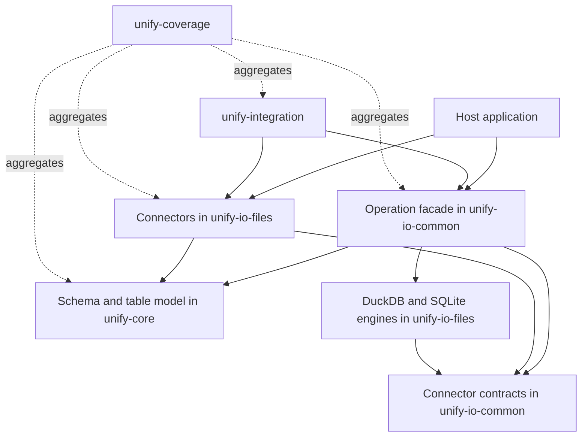
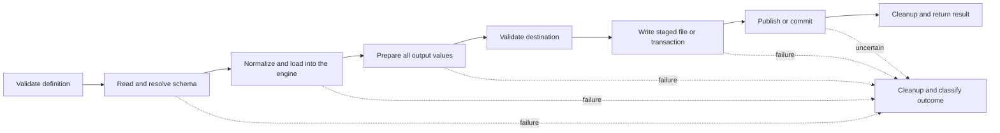

© Mark Andrew Ray-Smith Cityline Ltd 2025\
Version 0.2

# Unify Technical Design

Status: Draft derived from the functional design; revised by ADR-001  
Date: 2026-11-24 (version 0.1: 2026-11-22)  
Requirements baseline: [Unify Functional Design version 0.1](FUNCTIONAL_DESIGN.md)

## Design authority and implementation status

This design specifies the implementation of FR001 through FR024 and NFR001 through NFR007 in the functional design. Functional scope, value semantics, destination guarantees, and acceptance scenarios are defined there. A change to one of those contracts requires a functional design revision before an incompatible technical change.

The architecture and types below are proposed. Existing repository classes are identified explicitly; new type names and configuration examples are design interfaces, not currently available APIs, except where a section marks a type as implemented. This document does not claim that the implementation or its tests already conform to the target contract.

## Architecture decisions

### ADR-001 Working data lives in the selected execution engine

Status: Accepted, 2026-11-24.

**Decision.** Working data lives in the selected engine. Java holds schemas, value rules, bounded samples and handles to engine datasets, never whole datasets.

**Context.** The inherited model reads every source into an `ITable`, a mutable, row-oriented table held in Java memory, and writes every destination from one. Connectors exchange data through `IDataSource`, which moves values as text (`addRow(Map<String, String>)`, `String getValueAt(...)`), and JDBC query results are copied back into an `ITable`. The functional design instead selects SQLite or DuckDB as the execution backend and states that completion does not require copying the working dataset into Java memory (FR009). Keeping the in-memory table at the centre would:

- store every dataset twice, once in Java memory and once in the engine, capping data size at the Java heap and discarding DuckDB's larger-than-memory processing;
- implement the same rules twice (joins, filtering, null and type handling) in Java and in the engine, so results would depend on which path ran;
- load slowly: the current JDBC writers bind every value as text and insert one auto-committed row per statement.

**Consequences.**

- Readers produce a `RecordSource`: bounded `RecordBatch`es whose values are already checked against a `TableSchema`. No reader fills a table.
- Each engine has one loader. DuckDB uses its native appender. SQLite uses one prepared, typed INSERT executed in batches inside a single transaction, into a STRICT table.
- A loaded dataset is referenced by a `DatasetHandle` (engine, name, Unify schema, record count). The schema travels with the handle because an engine catalogue cannot always reproduce Unify logical types.
- Destinations consume query results as streamed `RecordSource`s.
- Java may hold schemas, value rules, one batch per open stream, previews and samples within configured limits, and handles. It never holds a whole source, intermediate or result dataset.
- Unify, not the engine, owns conversion and the null, missing and empty rules, and applies them before loading. Each engine adapts storage types and restores logical types from the schema when results are read.
- Engine SQL is an internal contract. Public portable SQL reaches an engine only after Apache Calcite has parsed, validated and translated it.
- Both engines must pass the same contract suite, which roughly doubles backend qualification work; ADR-002 records why both are kept.
- Memory budgeting moves from the Java heap to engine memory and temporary disk.
- The legacy `ITable`, `TableCore`, `OptimizedTableCore`, `Column`, `Row`, `Cell` and `TableBuilder` model is frozen (see Compatibility and migration). The programmatic table of UC01 is rebuilt later on the schema core as an in-memory source, not as working storage.

**Rejected alternative.** Harden `ITable`/`TableCore` into strict canonical storage with schema metadata, strict normalization and atomic mutations (version 0.1, stage 2). It would invest in a component the architecture no longer places on the data path and would make the double storage and duplicated rules permanent.

**Evidence.** The proof slice `LargerThanHeapSliceTest` streams a CSV file into DuckDB through the appender, runs a filter query, and streams the result to a CSV file, sampling the Java heap after garbage collection every 256 batches. Run on 2026-11-24 (Windows 11, DuckDB 1.5.6, Java heap capped at 64 MB):

| Measure | Result |
| --- | --- |
| CSV input | 1,024 MB, 24,247,795 records: 16 times the maximum heap |
| Load into DuckDB (appender) | 56.8 s |
| Filter query streamed to CSV | 3.0 s, 1,814,594 records |
| Java heap retained after GC | 4.1 MB to 5.5 MB across 100 checkpoints |
| Output checks | Record count, ID checksum, ordering and filter condition all match the generated data |

Rerun with `mvn -o test -pl unify-io-files -Dtest=LargerThanHeapSliceTest -DargLine="-Xmx64m -Dunify.slice.megabytes=1024"`. The load rate (about 430,000 records per second) is unoptimised: CSV parsing is character by character and the appender is called once per value. No throughput target is claimed (see Verification strategy).

### ADR-002 SQLite for small integrations, DuckDB for large and analytical work

Status: Accepted, 2026-11-24. The record-count thresholds in the selection guidance are provisional until TD09 evidence covers joins and aggregation.

**Decision.** SQLite is the recommended execution engine for small integrations: few records, simple pipelines, short-lived operations, and hosts that run many operations or must start quickly. DuckDB is the engine for large or analytical work: large inputs, multi-way joins, aggregation, and anything that may exceed memory. A host's explicitly configured default should be SQLite unless its workload is mostly large. Selection stays exactly as the functional design defines it: per operation, directly or through an explicitly configured default, resolved before source reads, and recorded with the engine's actual version.

**Context.** The functional design assigns SQLite to lightweight local processing and DuckDB to analytical and join-heavy work, but gives no basis for choosing between them. ADR-001 validated DuckDB for larger-than-heap streaming. It says nothing about the cost of a small operation, which is the most common kind of integration.

**Evidence.** A load-and-filter workload (load N records of four columns, then a filtered, ordered query streamed back) was measured on 2026-11-24 with the engines described in Execution engines. The test machine was an Intel Core i7-1255U (12 logical processors, 32 GB) running Windows 11 and Java 26, with in-memory databases. Figures are medians of five fresh JVM processes. Warm figures average five further cycles inside each process, after the native library is loaded.

| Measure | SQLite 3.42 | DuckDB 1.5.6 |
| --- | --- | --- |
| Open an engine, warm JVM | 0.4 to 0.6 ms | 14 to 22 ms |
| Open, load, query and close: 1,000 records, warm | 6.5 ms | 25.3 ms |
| Same cycle: 100,000 records, warm | 188 ms | 138 ms |
| Same cycle: 1,000,000 records, warm | 1,955 ms | 1,133 ms |
| First open in a fresh JVM (range over five runs) | 0.49 to 0.69 s | 0.69 to 0.96 s |
| Peak process memory at 1,000 records (a bare JVM: 42 MB) | 70 MB | 77 MB |
| Driver jar | 12.4 MB | 81.2 MB |
| Native library, Windows x64 (Linux x64) | 0.9 MB | 33.5 MB (58 MB) |

For this workload SQLite is faster up to somewhere between 1,000 and 100,000 records, and DuckDB is faster beyond that. Joins and aggregation were not measured. They are expected to favour DuckDB at smaller sizes, because DuckDB executes vectorised and in parallel while SQLite runs each query on one thread. First-open times are dominated by each driver unpacking its native library into the temporary directory, plus antivirus scanning of the new file, so they vary between runs.

**Consequences.**

- Both engines stay in the baseline and pass the same contract suite. This resolves the open question of whether SQLite as an execution engine, as distinct from SQLite as a connector, justifies the extra qualification work.
- Small operations pay about half a millisecond to open an engine instead of 15 to 20 ms, and complete about four times faster at 1,000 records.
- A host that only uses SQLite should not have to ship DuckDB's 81 MB driver, so the DuckDB engine becomes an optional dependency (see Execution engines).
- SQLite brings engineering obligations: a minimum version, a fixed-width temporal text form, a memory cap, and single-threaded execution (see SQLite engine requirements).
- Automatic selection by input size is not part of this baseline. Selection is resolved before source reads, when input size is usually unknown, and the functional design defines it as the host's explicit choice. An automatic policy would need a functional design revision.

**Rejected alternatives.** *DuckDB only:* qualification would be simpler, but every small operation would pay DuckDB's open cost, memory and packaging. *SQLite only:* it cannot serve large, analytical or larger-than-memory work; the ADR-001 evidence depends on DuckDB.

## Repository baseline

| Area | Existing implementation | Required technical change |
| --- | --- | --- |
| Tables | [`ITable`](../unify-core/src/main/java/dev/mars/jtable/core/model/ITable.java), [`TableCore`](../unify-core/src/main/java/dev/mars/jtable/core/table/TableCore.java), `Column`, `Row`, `Cell`, `TableBuilder`, `ColumnFactory`. Every dataset is held in Java memory. Columns hold only a name, Java class and default; null is always accepted; date and time defaults use the clock; missing-field defaults differ between `addRow(Map)` and `addRow(IRow)`/`TableBuilder`; columns can be added or replaced on a populated table; rows are stored by reference and new cells skip validation; double text depends on the platform locale or a per-row cache that can go stale | Freeze as the legacy compatibility surface (ADR-001). The new schema core (`TableSchema`, `ColumnDefinition`, `ValueNormalizer`, `RecordBatch`) carries types and value rules; working data moves to the execution engine. `LegacyTables` converts between the two. Rebuild UC01's programmatic table later on the schema core as an in-memory source |
| Alternative tables | `OptimizedTableCore`, `ProfiledOptimizedTableCore`, collection profiler | Frozen with the legacy model; no further qualification work |
| I/O contracts | [`IDataReader`](../unify-io-common/src/main/java/dev/mars/jtable/io/common/datasource/IDataReader.java), `IDataWriter`, `IDataSourceConnection`, table adapters. Readers fill an `ITable`; `IDataSource` moves every value as text | Replace with streamed, typed record batches (`RecordSource`, `RecordSink`) plus typed requests, lifecycle ownership, connector capabilities, and operation results. Legacy contracts are frozen |
| Execution engines | None. H2 and SQLite appear only as JDBC connectors and in demos | `ExecutionEngine` with DuckDB and SQLite implementations holds working data (ADR-001; see Execution engines) |
| Mappings | [`MappingConfiguration`](../unify-io-common/src/main/java/dev/mars/jtable/io/common/mapping/MappingConfiguration.java), `ColumnMapping`, JSON/YAML/JDBC serializers | Compile immutable validated mappings and introduce a versioned configuration envelope |
| CSV | Separate readers, writers, and mapping readers/writers | Share one parser and one mapping execution path; retain quote provenance |
| JSON | Jackson parsing with first-record inference; some errors are printed and swallowed | Use bounded parsing and the common normalization and result pipeline |
| XML | Regular-expression parsing and manual escaping | Replace with structured, namespace-aware parsing and writing |
| JDBC | Readers and writers with separate connection paths; mapping writer binds strings and executes inserts individually | Use one connection lease per write, typed binding, metadata checks, and an explicit transaction |
| HTTP | `RESTConnection` and `RESTReader`; separate simplified response parsing | Use the same JSON decoder as file input, finite timeouts, and explicit response cleanup |
| NoSQL | Placeholder connection and sample-record reader | Exclude from the supported connector registry |
| Integration | CSV-to-H2 and CSV-to-SQLite demos and tests. The module does not compile: `IntegrationBenchmarkDemo` and several tests call `MappingConfiguration.setColumnMappings` and `setOptions`, which have never existed | Restore compilation, then turn representative flows into acceptance coverage without making demos production orchestration |

The root [POM](../pom.xml) declares Java 23 properties but configures compiler source and target 17. The proposed baseline is Java 17 bytecode, expressed once using the compiler release setting. Implementation must first verify that the source and selected dependencies satisfy that baseline and align the README and module configuration. A different supported Java baseline is a documented technical decision, not an incidental compiler setting.

## Module architecture

Retain the existing Maven modules. `unify-io-files` continues to house JDBC and HTTP implementations despite its historical name; renaming artifacts is unnecessary for the functional baseline.



| Module | Target responsibility |
| --- | --- |
| `unify-core` | Logical types, schema, record batches, conversion, and validation; no connector dependencies and no working-data storage. Also holds the frozen legacy table model |
| `unify-io-common` | Record-stream and execution-engine contracts, immutable operation definitions, mapping compiler, orchestration, capabilities, credential-provider contract, lifecycle leases, results, configuration serialization, and the legacy-table converter |
| `unify-io-files` | Physical parsers and encoders as record sources and sinks, file publication, DuckDB and SQLite execution engines, JDBC dialects and transport, HTTP transport, and connector registration |
| `unify-integration` | Executable examples and acceptance workflows using public APIs |
| `unify-coverage` | Coverage aggregation; no production behavior |

The host supplies a connector registry to the operation facade through constructor injection. The common module never imports concrete connectors. No dependency-injection framework, database ORM, server, or background scheduler is required. Registries may be shared when immutable; cursors, connections, counters, and cancellation state are operation-scoped.

Keep logging through SLF4J. Logging bindings belong to the host or runnable demonstrations; production library modules should not force Logback on consumers. Update JPMS descriptors alongside package exports and dependency changes, including access needed for configuration serialization and public exception types.

## Core schema and table model

### Target types

The core describes data; it does not store working datasets (ADR-001). Types marked implemented exist in `dev.mars.jtable.core.schema`.

| Type | Contents and invariant | Status |
| --- | --- | --- |
| `LogicalType` | STRING, INT32, DOUBLE, BOOLEAN, DATE, TIME, LOCAL_DATETIME, each with one canonical Java class | Implemented |
| `ColumnDefinition` | Name (nonblank, case-sensitive, not trimmed), logical type, and nullability. Optional typed default, validation rules, and text conversion settings are added with the normalizer stages that apply them | Implemented: name, type, nullability |
| `TableSchema` | Immutable ordered column definitions plus an immutable name-to-index lookup; at least one column; unique names | Implemented |
| `ValueNormalizer` | The shared value rules: strict text conversion, typed-value checks, canonical text output | Implemented: conversion stages 4 to 6 below |
| `RecordBatch` | A bounded, immutable group of records checked against one schema. NULL is Java null; MISSING never reaches a batch | Implemented |
| `SourceValue` | Explicit MISSING, NULL, or SCALAR value; source scalar may retain its original lexical token | Proposed |
| `InMemoryTable` | The programmatic table of UC01: schema-fixed, bounded, with whole-record append and validated cell update. It is an in-memory source and sink that is loaded into the engine like any other, not working storage | Proposed (replaces `TableSnapshot` and `MutableTable`) |

Canonical Java representations are `String`, `Integer`, `Double`, `Boolean`, `LocalDate`, `LocalTime`, and `LocalDateTime`.

A record is checked whole before it is added to a batch, so a rejected record leaves the batch unchanged. "Atomic" in this design means all-or-nothing within one thread: a failed operation has no partial effect. It does not imply thread safety. `InMemoryTable` applies the same rule to append and cell update, copies records on insert, exposes only read-only views, and fixes its schema once records exist; changing the columns of populated data creates a new table.

Use ordered column vectors and a name-to-index lookup rather than repeatedly building column lists for indexed access. Begin with ordinary operation-confined collections. Concurrent collection selection is an implementation option only after correctness and workload measurements; it does not establish thread safety.

### Conversion and validation pipeline

One `ValueNormalizer` implements the following order for every connector and programmatic mutation:

1. Resolve MISSING using a prevalidated explicit default, or nullability. Preserve the distinction between NULL and SCALAR.
2. Apply an explicitly configured text trim operation to textual scalars.
3. Apply empty-as-null if enabled; do not apply the missing-value default to the resulting null.
4. Enforce nullability.
5. Convert to the declared logical type using the configured locale and temporal patterns.
6. Reject overflow, non-finite doubles, unrecognized booleans, unsupported values, and invalid temporal fields.
7. Apply inclusive numeric bounds, string length bounds measured in Unicode code points, and typed permitted-value checks.

Defaults are normalized and validated when compiling the configuration. Validation metadata itself must be consistent: minimum cannot exceed maximum, and rules must apply to the declared type. The pipeline never manufactures a date using the clock and never uses permissive boolean conversion that maps arbitrary tokens to false.

`ValueNormalizer` currently implements stages 4 to 6 for text input: nullability, conversion of the ISO and decimal text forms, and rejection of overflow, non-finite doubles, unrecognized booleans and invalid temporal fields. It never trims. Null tokens and empty-as-null are applied by the format source before conversion (the CSV source does both). Stages 1 to 3 and 7 arrive with defaults, trimming and validation rules in `ColumnDefinition`.

Typed values use one canonical, locale-independent text form on output: `Double.toString` for doubles (the shortest text that converts back to the same value, always with `.` as the separator, and exponent notation outside 10⁻³ to 10⁷), `true`/`false` for booleans, and ISO-8601 local forms for temporal values. Every canonical form converts back to the same value. The old per-row `originalDoubleStrings` behavior is not part of the new value contract. Any lexical compatibility behavior retained for legacy entry points stays in the legacy model.

### Inference algorithm

The schema resolver consumes at most the configured sample count, bounded by the read or preview record limit. Store sample records as raw `SourceValue` records and replay them through normalization after freezing the schema. Do not count sample replay as a second read or charge the same payload twice.

Infer names in encounter order across the sample, tracking missing or null fields as nullable. Headerless CSV requires a supplied positional definition. Classify non-null scalars as boolean, signed 32-bit integer, finite double, supported temporal value, or string. Integer-looking tokens outside INT32 and significant leading-zero tokens classify as string before fractional-number classification. Temporal inference uses the documented default patterns; custom input patterns require an explicit type.

The combination rules are: identical types remain unchanged; INT32 plus DOUBLE becomes DOUBLE; any other conflicting types become STRING; all-null columns become nullable STRING. Preserve original lexical tokens for string fallback, including large JSON integer tokens. After schema freeze, new unselected fields are ignored only when explicit projection allows it; otherwise a new field or incompatible value is a located record error. Empty input without schema follows FR002 rather than guessing a zero-column table.

## Mapping compilation

Compile configuration into an immutable `MappingPlan` before processing records. Each rule contains one validated selector, target index, target column definition, typed default, and normalization settings. Compile input and output mappings separately. An input plan produces the canonical table schema; an output plan produces the destination representation schema without mutating the source table.

Reject malformed selectors, duplicate target names, invalid positional definitions, unsupported option names, and incompatible capabilities. A well-formed selector for a field absent in an individual record produces MISSING and follows FR004; it is not itself a syntax error. For CSV, bind header names to positions once. Explicit mapping may intentionally ignore extra source fields, but CSV record width must still match its declared or header-established width.

Output conversion is checked for every accepted row before opening a destination for mutation. Requested type changes are explicit mapping operations. Encoders must not independently infer types or replace conversion failures with empty strings.

## Public execution API and connector contracts

The target facade has synchronous read, write, transfer, validate, and preview operations. These conceptual signatures describe the proposed API surface:

```java
ReadResult read(ReadRequest request, ExecutionContext context);
OperationResult write(WriteRequest request, ExecutionContext context);
OperationResult transfer(TransferRequest request, ExecutionContext context);
ValidationResult validate(OperationDefinition definition);
PreviewResult preview(PreviewRequest request, ExecutionContext context);
```

`ExecutionContext` contains the operation identifier, clock/deadline, cancellation signal, limits, credential provider, selected execution engine, and diagnostic policy. Requests are immutable snapshots. A write reads from an engine dataset or a record source, never from a table the host can still mutate.

`validate` checks configuration and declared capabilities without opening a destination for mutation. Source-aware validation occurs during preview or execution. Expected configuration, data, transport, and publication failures return typed results. `ReadResult` exposes, on successful completion only, a `DatasetHandle` (the records stay in the engine) and any bounded preview sample. A legacy exception-based facade may adapt failures to existing exceptions while retaining the structured result as context.

| Connector contract | Responsibility | Status |
| --- | --- | --- |
| `RecordSource` | Stream checked records in bounded `RecordBatch`es under a schema known before the first batch; single-use; closing releases owned resources | Implemented (`unify-io-common`) |
| `RecordSink` | Accept batches; publish only on `complete()`; closing without completing discards the output | Implemented (`unify-io-common`) |
| `ConnectorDescriptor` | Identifier, typed option schema, supported directions, types and shapes, verified products, ownership modes, and publication guarantee | Proposed |
| `SourceConnector` | Open an owned or borrowed `RecordSource` and expose source metadata. Each codec's raw-record scanner is internal to its source | Proposed |
| `DestinationConnector` | Validate representation and destination metadata, then create a `WriteSession` | Proposed |
| `WriteSession` | A `RecordSink` that also exposes publication state, aborts if possible, and supports commit-once destinations | Proposed |
| `ResourceLease` | Associate a resource with OWNED or BORROWED lifecycle policy | Proposed |
| `CredentialProvider` | Resolve a typed credential reference in memory without making it serializable configuration | Proposed |

`CsvRecordSource` and `CsvRecordSink` are the first implemented connectors on this contract. The source parses RFC 4180 incrementally against an explicit schema, reports errors by the line on which the failing record starts without echoing field contents, and distinguishes the unquoted null token, quoted literals, and empty text. The sink writes canonical text to a temporary file in the target directory and moves it to the target name only on completion, refusing an existing target; verified publication modes remain TD04.

The registry contains CSV, JSON, XML, H2 JDBC, SQLite JDBC, and HTTP JSON implementations when their required capabilities are implemented and verified. It must not register the current NoSQL sample reader as supported. Product verification metadata includes the driver and product versions exercised by release tests; generic JDBC availability is not proof of compatibility.

## Execution engines

An `ExecutionEngine` holds an operation's working data (ADR-001). Records enter through `load` and leave as streams through `query` and `scan`; Java never holds a whole dataset. An engine instance is operation-scoped and single-threaded. `DuckDbEngine` and `SqliteEngine` in `unify-io-files` implement the contract, sharing `JdbcEngine` for dataset creation, all-or-nothing loading, result streaming, and strict result conversion.

| Operation | Contract |
| --- | --- |
| `load(dataset, source)` | Creates a table from the source's schema and loads every record in one transaction. On any failure, including a source failing part-way, the table and its rows are rolled back and no dataset of that name remains. Returns a `DatasetHandle` |
| `query(sql, resultSchema, batchSize)` | Runs a read-only query and streams the result. Until Calcite validation supplies result types, the caller declares the result schema. Column count and labels must match it exactly, and every value must convert strictly to the declared type: integers must fit INT32, text is never coerced to numbers, and NULL in a non-nullable column fails. Errors name the result record |
| `scan(handle, batchSize)` | Streams a loaded dataset using the schema recorded in its handle |
| `drop(dataset)` | Removes a dataset; dropping a missing dataset does nothing |
| `name()`, `version()` | Backend identity and actual version, recorded in operation results (FR011) |

Identifiers are always quoted, so any dataset or column name, including reserved words and embedded quotes, is safe. The SQL accepted by `query` is backend SQL and is not exposed publicly: the public API accepts only portable SQL that Calcite has parsed, validated and translated for the selected backend. Read-only enforcement for engine queries arrives with that translation layer.

| Logical type | DuckDB column | SQLite STRICT column |
| --- | --- | --- |
| STRING | VARCHAR | TEXT |
| INT32 | INTEGER | INTEGER |
| DOUBLE | DOUBLE | REAL |
| BOOLEAN | BOOLEAN | INTEGER with CHECK (value IN (0, 1)) |
| DATE | DATE | TEXT, ISO-8601 `yyyy-MM-dd` |
| TIME | TIME | TEXT, fixed-width ISO-8601 (see SQLite engine requirements) |
| LOCAL_DATETIME | TIMESTAMP | TEXT, fixed-width ISO-8601 (see SQLite engine requirements) |

Non-nullable columns are declared NOT NULL, so the engine enforces nullability as well as the batch.

**DuckDB loader.** The native appender (`DuckDBAppender`) appends each checked value with its typed method inside the load transaction. Query results stream with `jdbc_stream_results`, so DuckDB does not materialize a whole result before the first batch. With a database file, DuckDB can spill intermediate work to disk; the caller owns and removes the file.

**SQLite loader.** One prepared INSERT with typed bindings, executed in statement batches of 1,000 inside the single load transaction. STRICT tables make SQLite itself reject a value of the wrong storage class; booleans and temporal values are restored from the dataset schema on read.

### Choosing an engine

ADR-002 sets the roles: SQLite for small integrations, DuckDB for large and analytical work. The host chooses per operation or through its explicitly configured default; the choice is resolved before source reads and recorded with the engine version.

| Choose | When |
| --- | --- |
| SQLite | Up to tens of thousands of records per operation (provisional); single-source or simple pipelines; many short operations in one host; command-line or one-shot processes where start-up time matters; small deployments that should not ship DuckDB |
| DuckDB | Around 100,000 records or more (provisional); joins over large inputs; aggregation and other analytical SQL; inputs that may exceed memory; operations that should use several cores |

The thresholds come from the load-and-filter measurements in ADR-002, where the crossover lies between 1,000 and 100,000 records. TD09 replaces them with figures from a repeatable benchmark that includes joins and aggregation. A pipeline that is portable under FR032 runs unchanged on either engine, so a host can change its default or override one operation without rewriting definitions.

### SQLite engine requirements

- **Minimum version 3.39.** RIGHT and FULL OUTER JOIN, which the join baseline requires, arrived in SQLite 3.39. STRICT tables need 3.37. The current driver (sqlite-jdbc 3.42.0.0) bundles SQLite 3.42. Release verification records the bundled SQLite version and fails below the minimum.
- **Fixed-width temporal text.** The current loader stores DATE, TIME and LOCAL_DATETIME using `java.time`'s `toString`, which omits zero seconds and varies the length of the fraction. Equal values still produce equal text, and text order matches time order. But a literal or parameter written differently, for example `'10:15:00'` against a stored `'10:15'`, does not compare equal. Before qualification, store fixed-width text: `yyyy-MM-dd`, `HH:mm:ss.nnnnnnnnn` and `yyyy-MM-ddTHH:mm:ss.nnnnnnnnn`. The Calcite translation must render temporal literals and parameters in the same form, and map portable temporal functions to SQLite's text-based date and time functions.
- **Memory cap.** An in-memory SQLite database grows until the process runs out of memory. Derive a limit from the operation's `LimitBudget` and enforce it with `PRAGMA hard_heap_limit` or a page-count limit. An operation that may exceed it uses a database file, or is a candidate for DuckDB.
- **Single-threaded execution.** SQLite runs each query on the calling thread with no parallelism. That suits small operations and is one reason large ones belong on DuckDB.
- **Cold start.** Both drivers unpack their native library into the temporary directory the first time a JVM loads them, which dominates first-open time. Long-running hosts pay this once. One-shot processes can point sqlite-jdbc at a pre-installed native library (`org.sqlite.lib.path`).

### Packaging

`unify-io-files` currently depends on both drivers. DuckDB becomes an optional dependency, declared optional in Maven and `requires static duckdb.jdbc` in the module descriptor, so a SQLite-only host does not ship 81 MB of driver and DuckDB loads only when selected. The SQLite driver remains a runtime dependency. Selecting an engine whose driver is absent fails validation with a clear error before any source is read.

**Open items.** Calcite integration and portable SQL translation; engine memory limits, temporary directories, and their place in `LimitBudget`; cancellation and deadlines during load and query; record-level rejection budgets during load (FR010); a larger-than-heap proof per connector and for SQLite with a database file; SQLite fixed-width temporal storage and memory cap; optional DuckDB packaging; and the TD09 engine-selection benchmark.

## Versioned configuration

Introduce a `schemaVersion` envelope. Version 1 is the proposed first strict contract; existing unversioned `MappingConfiguration` content is legacy input. Connector options are typed and reject unknown fields. JSON and YAML decode into the same validated intermediate definition; neither format may enable executable tags or arbitrary class instantiation.

The following proposed definition illustrates separate input and output mappings. It is not accepted by the existing serializers without implementation changes.

```json
{
  "schemaVersion": 1,
  "kind": "transfer",
  "source": {
    "connector": "csv",
    "location": "persondata.csv",
    "options": { "header": true, "encoding": "UTF-8", "nullToken": "\\N" }
  },
  "inputMapping": [
    { "source": { "name": "id" }, "target": "personId", "type": "INT32", "nullable": false },
    { "source": { "name": "name" }, "target": "fullName", "type": "STRING", "nullable": false },
    { "source": { "name": "age" }, "target": "age", "type": "INT32", "nullable": true }
  ],
  "destination": {
    "connector": "jdbc-sqlite",
    "location": "jdbc:sqlite:people.db",
    "options": { "table": "person_data", "mode": "APPEND" }
  },
  "outputMapping": [
    { "source": { "name": "personId" }, "target": "person_id", "type": "INT32", "nullable": false },
    { "source": { "name": "fullName" }, "target": "full_name", "type": "STRING", "nullable": false },
    { "source": { "name": "age" }, "target": "age", "type": "INT32", "nullable": true }
  ],
  "errorPolicy": { "mode": "FAIL_FAST" },
  "limits": { "maxRecords": 100000, "deadlineMillis": 300000 }
}
```

A definition may supply an explicit schema instead of deriving it from complete input mapping rules, or request inference. Ambiguous combinations fail validation. Settings not shown above inherit the functional defaults. An endpoint needing credentials stores `credentialRef`, never a password, bearer token, or secret-bearing URL.

Use explicit legacy migration code rather than unrestricted bean deserialization. Migration identifies ambiguous empty/default semantics, inferred timezone or type assumptions, inline secrets, and options that lack a target equivalent. It returns located migration issues and does not silently reinterpret them. A host must externalize any credentials before saving a strict definition.

Existing JDBC mapping persistence may remain available through the legacy compatibility surface. New JDBC-backed configuration persistence, if retained, stores the same versioned definition and preserves ordering; it must not invent a second operation schema. It is not required to add a new configuration database to run ordinary transfers.

## Execution lifecycle and publication state



Each stage checks cancellation and the deadline. Generate the operation identifier before validation so configuration failures also have an identifier. Close source resources after their records are loaded into the execution engine and before destination writes, including when source and destination use the same SQLite database or local file.

Preview stops after its sample limit and reports whether EOF was observed or sampling was capped. Schema inference during preview uses only that sample. Validation of later data is performed by a new full execution; preview does not cache a promise of source consistency.

The coordinator tracks completion separately from destination outcome:

| Event | Completion | Destination outcome | Confirmed written |
| --- | --- | --- | --- |
| Read or preview succeeds | SUCCESS or SUCCESS_WITH_REJECTIONS | Not applicable | Not applicable |
| Failure or cancellation before destination mutation starts | FAILED or CANCELLED | NOT_STARTED | 0 |
| Successful file publication or database commit | SUCCESS or SUCCESS_WITH_REJECTIONS | COMMITTED | Number of published records |
| Write fails and transaction rollback is confirmed | FAILED or CANCELLED | ROLLED_BACK | 0 |
| Commit acknowledgement or rollback outcome cannot be established | FAILED | UNKNOWN | Unknown, represented without an invented number |
| Cancellation arrives after confirmed publication | SUCCESS or SUCCESS_WITH_REJECTIONS with a late-cancellation warning | COMMITTED | Number of published records |

Discarding an unpublished temporary file leaves the destination NOT_STARTED. A database transaction that has begun and is then successfully aborted reports ROLLED_BACK, including zero-row transactions. A zero-row successful database write may commit a zero-row transaction after schema validation and report COMMITTED with zero written.

Track complete records read, accepted, rejected, attempted writes, and confirmed writes separately. A fatal failure after a complete record is read but before classification may leave an unclassified read record; report its location and do not force the completed-run count identity. An incomplete terminal record is reported separately and is not counted as read. The result includes first retained issues, total issue count, and a truncation flag. Multiple field issues may belong to one rejected record.

Only a record-local conversion or validation error with a known next-record boundary qualifies for SKIP_RECORD. Preserve diagnostics but stop immediately when the explicit rejection limit is exceeded. A malformed document, limit violation, transport failure, or destination error cannot be downgraded to a rejected row.

## File publication

Encode to a uniquely named temporary file in the destination directory after all value conversion has passed. Use a restrictive creation policy appropriate to the filesystem and close the encoder and file before publication. Force staged file content where supported. Never stream partial output directly over an existing destination.

CREATE_NEW requires an atomic operation that fails if the target exists. One proposed local-filesystem implementation publishes a hard link to the completed staged file using `Files.createLink`, then removes the temporary name. This is enabled only for providers verified to support the necessary same-filesystem behavior. Do not replace it with an existence check followed by a potentially overwriting move.

REPLACE uses a verified atomic replacement primitive on the same filesystem. The Java implementation can request atomic move and replacement, but provider semantics must be verified rather than assuming that a particular option combination guarantees replacement on every platform. If the provider cannot supply the requested guarantee, fail without changing the target; do not fall back to delete-then-move or copy-overwrite.

Filesystem capability checks are repeated at publication because permissions or the destination may have changed. Failure to delete a temporary name after confirmed publication becomes a cleanup warning. A pre-publication failure removes only that operation's temporary artifact. Never delete a target merely because publication raised an ambiguous error; classify its outcome as UNKNOWN if completion cannot be established.

Reject unsupported symbolic-link destination arrangements and require the host to provide a trusted destination directory. Independent CREATE_NEW attempts cannot overwrite one another. Concurrent explicit replacements require host coordination when last-writer behavior is unacceptable.

The guarantee covers process-visible complete publication, not power-loss durability or a distributed transaction. Crash recovery, directory fsync portability, and automatic stale-artifact deletion require a separate extension. Temporary artifacts use a recognizable ownership marker so operators can identify them without treating arbitrary files as disposable.

## JDBC implementation

### Reads

Use one prepared statement and result set per source read. A table read generates a select from separately represented schema and table identifiers. A custom query is a trusted host-supplied read query with bound value parameters; never interpolate record values into SQL. Do not infer safety by inspecting only the first keyword or rewrite user query text.

Read-only enforcement must include database permissions or a verified database read-only mode. A JDBC read-only hint alone is insufficient. The supported-product fixture must establish that the chosen source configuration rejects mutation, including mutating statements disguised as queries. If a read-only query contract cannot be established for a product, advertise only the narrower verified capability.

Result metadata supplies ordinal, label, logical type information, and nullability where available. Duplicate labels require caller-provided aliases. Read cells using typed access and preserve SQL null. For products such as SQLite with flexible storage, apply the declared schema and validate each actual value rather than trusting a declared column type alone.

### Destination preflight

Use a product dialect for identifier quoting, metadata interpretation, type compatibility, and typed parameter binding. Schema, table, and column names are separate identifier segments. Reject invalid control characters and quote identifiers using the tested dialect; identifiers cannot be bound as value parameters. Caller SQL remains trusted application configuration.

Inspect the existing destination table and validate all selected columns. Check omitted non-nullable columns for a database default or generation rule. Validate string lengths, numeric ranges, and temporal representations against available metadata and the dialect contract. Unknown or ambiguous compatibility fails explicitly instead of relying on database coercion.

For H2, verify native integer, double, boolean, date, time, and timestamp bindings. For SQLite, define and test integer/real/text bindings, boolean 0/1 representation, and local temporal text representation. Exact details belong to each dialect's executable compatibility contract. The destination must preserve the logical values allowed by FR023; narrowing or precision loss is rejected before insertion.

### Transaction algorithm

1. Acquire an OWNED connection from the configured factory or data source. The factory may be host-supplied; the leased connection is still owned by this operation.
2. Verify transaction support, deadline/cancellation capabilities, metadata, and destination compatibility. Require a fresh connection without an active external transaction.
3. Disable autocommit and prepare one typed INSERT statement.
4. Bind already prepared rows with the declared SQL types and explicit SQL null types. Execute bounded batches without committing between batches.
5. Check cancellation immediately before commit. Commit once after all batches succeed.
6. On a failure before a commit attempt, request rollback and report ROLLED_BACK only after rollback succeeds.
7. If commit throws, retain UNKNOWN unless product-specific evidence conclusively establishes the outcome. A later successful rollback does not prove that an earlier commit was not applied.
8. Close statements and release the connection. Post-commit cleanup failures become warnings and cannot turn a confirmed commit into a reported rollback.

Do not run DDL, truncate, upsert, or retry in this path. Batch size is a transport optimization, not a transaction boundary. A failure in a later batch must roll back inserts from earlier batches.

Borrowed caller connections are permitted for reads with no changes to transaction state. Reject borrowed connections for baseline writes rather than committing the caller's transaction or promising a durable result from a savepoint. A failed connection restoration or reset must cause an owned pooled connection to be invalidated according to the pool contract rather than returned as healthy.

## File decoders and encoders

### CSV codec

Implement one record scanner shared by ordinary and mapped CSV APIs. It returns decoded field text, whether the field was quoted, record ordinal, and physical line information. Retaining quote provenance is necessary to distinguish an unquoted null token from quoted literal text.

The scanner has explicit field-start, unquoted-field, quoted-field, and after-quote states. Delimiters and record separators have structural meaning only outside quotes. A doubled quote inside a quoted field represents one quote. A quote in an unquoted field or unexpected content after a closing quote is invalid. EOF in a quoted field is fatal; EOF elsewhere completes the final record when one exists. Handle LF and CRLF without splitting quoted multiline fields. Preserve trailing empty fields and reject inconsistent widths.

Validate delimiter and quote settings as distinct single characters that are not record separators. Decode with the specified charset and report malformed input rather than silently substituting replacement characters. UTF-8 input may contain an initial byte-order mark, which is consumed once before header parsing. A physical empty record is a one-field empty record, then subject to width and value validation.

The writer quotes values containing delimiters, quotes, CR/LF, or a literal null-token collision, and doubles internal quotes. A null uses the unquoted configured null token. Reject a null token containing a delimiter, quote, or line break because it cannot be emitted unquoted unambiguously. Without a null token, null output is a representation error found before publication. A lossless export does not add spreadsheet formula-escaping characters; any such host transformation must be explicit.

### JSON codec

Use Jackson for both file and HTTP JSON. Enable duplicate-member detection and bound nesting, scalar size, and total bytes. Accept a root array or one selected root-object member containing an array. Consume and validate the rest of the document, including trailing content, before declaring a full read successful.

Records must be objects. Preserve native null and scalar tokens; nested selected fields fail. Unselected nested fields may be skipped structurally, subject to the same depth and byte limits. Integer tokens must not be narrowed before schema inference or explicit conversion. Configure the parser without polymorphic type activation.

Use a JSON generator for output, emitting native numbers and booleans, formatted temporal strings, and explicit null. Emit fields in mapping order. Do not use a generic string accessor for every cell.

### XML codec

Use a namespace-aware JDK XML parser and writer, with StAX as the proposed implementation. Disable DTD and external entity support, install a resolver that refuses external access, and reject document-type events. Verify these properties against the actual parser provider in tests. Predefined XML character entities remain usable.

Match elements by namespace URI and local name. Keep an explicit root/row/field parser state, rejecting invalid selected nesting, mixed content, repeated selected fields, and malformed nil elements. Represent `xsi:nil="true"` or `xsi:nil="1"` as NULL; preserve an empty non-nil element as empty text. Apply FR004 when a child is absent.

Validate output element names and namespace bindings during preflight. A table column name that cannot be represented as a configured XML element name requires explicit renaming; do not sanitize it silently. Let the XML writer handle escaping and namespace declarations. Emit UTF-8 with a matching declaration. XML encoding declarations govern input decoding; conflicting explicit encoding settings fail validation.

## HTTP JSON connector

Keep HTTP transport separate from the JSON record decoder. The existing `HttpURLConnection` boundary can be retained with a new operation-scoped wrapper that disables redirects, configures finite connect/read timeouts, checks the overall deadline, and always closes the body and disconnects the connection. A shared connection object must not carry mutable per-operation headers or credentials.

Construct one logical GET request from typed endpoint settings and encoded query parameters. Reject disallowed methods and header overrides. Resolve credentials only when opening the request, use normal TLS certificate verification, and require explicit permission for non-loopback cleartext transport. Do not perform a preliminary probe request that duplicates the GET.

Accept only successful responses with a supported JSON media type and an actual JSON body. Reject redirects and non-success status with a sanitized issue. Read the body through byte-counting and progress-aware wrappers. Recompute the remaining operation budget when applying each blocking timeout and close the request when cancellation is signalled. No application-level retry is performed. Low-level transport behavior must be verified by request-counting protocol fixtures rather than assumed.

The baseline requests uncompressed content and rejects unsupported content encoding. A future decompression feature must enforce both encoded and decoded limits. Error bodies are drained only within a small configured diagnostic budget or closed immediately; they are not logged by default.

No pagination, token refresh, XML/CSV fallback parser, response-format guessing, or HTTP writes are introduced in this connector.

## Resource ownership and cleanup

| Resource | Ownership and release rule |
| --- | --- |
| Files and parsers opened by a connector | OWNED; close on every exit path |
| Temporary output file | OWNED; discard before publication or unlink staging name after publication |
| HTTP response and connection | OWNED; close body and disconnect on success, error, timeout, or cancellation |
| JDBC statements and result sets | OWNED even when their connection is borrowed; close before releasing connection |
| JDBC connection leased for an operation | OWNED; close or return/invalidate through its provider |
| Caller-provided read connection or stream | BORROWED; leave it open and preserve caller transaction state |
| Credential material | Operation-scoped; never serialize it or attach it to public diagnostic objects |

Use explicit closeable leases and structured cleanup, with suppressed cleanup failures attached internally to the primary failure. Report sanitized cleanup issues without losing the initial phase or error. Release locks and owned resources before returning a successful read or preview. A cleanup failure before successful read completion produces a failed read; after confirmed destination publication it produces a warning on the confirmed result.

## Limits cancellation and diagnostic safety

Use one `LimitBudget` per invocation. It enforces physical input bytes, complete records, columns, per-value UTF-8 bytes, aggregate loaded value bytes, retained issues, and the overall deadline. The functional design defines the initial values. Encoded input size and loaded-value size are different budgets; defaults, JSON unescaping, and projection can change their relationship.

Read incrementally: accepted records are loaded into the execution engine, not retained in Java (ADR-001). Java memory holds at most one batch per open stream, plus bounded inference and preview samples. Reject excessive headers, column counts, nesting, or scalar lengths before allocating unbounded buffers. Engine storage is governed by engine memory and temporary-disk limits, which join the `LimitBudget` (see Execution engines). Preparing output streams from the engine with the same deterministic plan; it never creates a copy in Java.

Check cancellation between records, batches, and immediately before publication. Use supported statement timeout/cancel APIs and transport timeouts for blocking calls. A deadline requests cooperative termination; it is not an in-process thread-kill guarantee when a driver ignores cancellation. After an overdue blocking call returns, do not begin publication. Qualify supported drivers with cancellation tests and document any maximum blocking interval. Never report rollback until it is confirmed.

Diagnostics use stable error codes and immutable issue objects containing phase, connector identity, source record ordinal, optional physical position, target/source field identifier, and sanitized message. Do not store raw endpoint URLs, SQL parameters, authorization headers, JDBC connection properties, response bodies, or record values by default. Keep internal causes out of default public serialization when driver messages might contain secrets.

An explicit value-diagnostics mode may include record values after host-controlled redaction and size limits. It never includes resolved credentials. The default logging event contains operation identifier, connector identifiers, elapsed time, phase, counts, completion, and destination outcome. Logging does not replace the programmatic result.

## Compatibility and migration

Introduce the strict facade and configuration version without silently changing current `ITable`, reader/writer, and serializer behavior. Characterize existing observable behavior before redirecting old entry points. Legacy APIs remain a clearly named compatibility surface during a documented deprecation period; they do not establish conformance with the strict functional baseline.

Where feasible, legacy adapters delegate to the strict path with an explicit legacy normalization or presentation policy. Keep changes requiring different semantics behind the strict API until a declared breaking release. Do not permit mixed strict and legacy mutation of the same execution snapshot.

The legacy table model (`ITable`, `TableCore`, `OptimizedTableCore`, `ProfiledOptimizedTableCore`, `Column`, `ColumnFactory`, `Row`, `Cell`, `TableBuilder`) and the text-based connector contracts (`IDataSource`, `IDataReader`, `IDataWriter`) are frozen by ADR-001: no new features, and fixes only for defects confirmed by characterization tests. `LegacyTables` (`unify-io-common`) bridges them to the strict path. `toRecordSource` streams an `ITable` into an engine or sink. `toTable` reads a record source into a new `ITable` but fails above a stated record limit, because a legacy table holds everything in Java memory; it is for previews and small results only. Converted columns are nullable, and only the seven Java types with a Unify logical type are accepted.

Unify ordinary and mapping readers/writers behind the same codec and mapping pipeline after their compatibility boundaries are explicit. Retire swallowed exceptions, implicit type inference in writers, and ad hoc connection creation in the strict path. Do not preserve the NoSQL sample output as a successful strict connector result.

Existing JDBC configuration serialization and experimental create-table or REST methods can remain available as legacy features. They are not automatically exposed in the supported strict registry. Migrations must distinguish this exclusion from removal of public methods.

## Verification strategy

Mockito and substitute mocking frameworks are prohibited. Use real implementations, protocol fixtures, purpose-built fakes for narrow internal contracts, and live integration environments where compatibility cannot be established locally.

| Verification layer | Required coverage |
| --- | --- |
| Core behavior | Whole-record batch acceptance, strict conversion, null/default distinctions, inference combination rules, schema order, validation, and limit arithmetic |
| Execution engines | One contract suite run against every engine: round trip of every logical type and null, rollback of a failed load, declared-schema enforcement on results, identifier quoting, and legacy conversion (`ExecutionEngineContractTest`). Larger-than-heap streaming with flat retained heap (`LargerThanHeapSliceTest`, ADR-001) |
| Property tests | Logical-value round trips under an explicit schema; mapping-order preservation; mutation failure leaves state unchanged |
| File fixtures | Actual encoded files with quoting, line breaks, Unicode, malformed encoding, null-token collisions, empty data, and mid-write failures |
| File publication | Actual temporary directories; CREATE_NEW races; replacement failures; unsupported-provider behavior; old-file preservation; cleanup |
| JSON and XML | Actual parser and generator behavior, duplicate members, depth/size boundaries, namespaces, nil, nested selected values, and refused external resolution |
| HTTP protocol | Local server asserting method, URL encoding, headers, request count, response handling, error status, redirect refusal, timeouts, cancellation, and closure |
| JDBC compatibility | Real H2 and SQLite; metadata, typed binding, nulls, temporal values, empty results, quoted identifiers, constraints, batch rollback, read-only access, and connection cleanup |
| Outcome classification | Publication succeeds then acknowledgement is lost; rollback fails; cleanup fails before and after commit |
| Configuration | JSON/YAML equivalence, ordered mappings, unknown fields and versions, legacy migrations, and secret exclusion |
| Full workflows | FD acceptance scenarios AC01 through AC18 through public APIs |

For uncertain-commit classification, a purpose-built JDBC connection decorator may delegate a real commit to a real database and then throw, allowing verification that the result remains UNKNOWN even when rows exist. This verifies coordinator semantics, not vendor transport compatibility. Use a protocol fault proxy or live environment when a release claim depends on a particular driver's network failure behavior. Lifecycle fakes cannot establish database compatibility.

Configure test discovery explicitly. Several existing JDBC test names end in `TestH2` or `TestSQLite`; verify that the effective test runner includes them rather than assuming the normal suffix patterns discover them. Fail release verification when a required connector suite runs no tests. Keep benchmarks separate from correctness tests.

Use `mvn test` for the defined local suite and `mvn verify` for complete configured acceptance and coverage checks. Publish product/driver versions and actual executed test counts with release verification. Coverage aggregation must include all intended production modules rather than only one package. Performance baselines are measured after correctness using recorded heap, dataset shape, parser options, and hardware; this design supplies no unmeasured throughput target.

## Requirement traceability

Technical sections below are named design areas; acceptance identifiers refer to the functional design.

| Requirement | Implementing design areas | Acceptance coverage |
| --- | --- | --- |
| FR001 | Core schema model; `InMemoryTable`; public execution API | AC01 |
| FR002 | Inference algorithm; bounded cursors | AC04 |
| FR003 | Conversion pipeline; typed encoders and JDBC binders | AC01, AC03, AC11, AC18 |
| FR004 | SourceValue states; normalization; format null codecs | AC03, AC11 |
| FR005 | Mapping compilation; separate input/output plans | AC03, AC14 |
| FR006 | Compiled validation rules; atomic row acceptance | AC01, AC03 |
| FR007 | Engine load; dataset handles; read result publication | AC06 |
| FR008 | File publication; preflight encoding | AC07, AC18 |
| FR009 | Execution lifecycle; output preparation | AC07, AC08, AC15 |
| FR010 | Record error classification; bounded rejection policy | AC04, AC08 |
| FR011 | Completion and destination state; independent counters | AC06, AC08, AC10, AC17 |
| FR012 | Versioned configuration; strict option validation; migration | AC05, AC12, AC14 |
| FR013 | Public preview; sample and EOF metadata | AC05 |
| FR014 | CSV scanner and encoder | AC02, AC03, AC18 |
| FR015 | Shared JSON codec | AC03, AC11, AC12 |
| FR016 | Namespace-aware XML codec and external-resolution refusal | AC03, AC11, AC12 |
| FR017 | JDBC read contract and metadata | AC09 |
| FR018 | Destination preflight; typed transactional append | AC09, AC10, AC18 |
| FR019 | HTTP JSON connector and protocol fixtures | AC13 |
| FR020 | Capability descriptors and supported registry | AC12 |
| FR021 | Resource leases; outcome-aware cleanup | AC13, AC15 |
| FR022 | Safe issues, redaction, and structured logging | AC14, AC17 |
| FR023 | Explicit output schema; representation preflight | AC02, AC11, AC18 |
| FR024 | LimitBudget; cancellation; publication state | AC13, AC15 |
| NFR001 | One normalization and mapping pipeline | AC03 |
| NFR002 | Incremental parsing; record streams; engine-resident working data (ADR-001) | AC15 |
| NFR003 | Typed configuration; prepared values; safe codecs | AC12 |
| NFR004 | Explicit commit and publication state machine | AC09, AC10 |
| NFR005 | Version envelope and legacy compatibility boundary | AC14 |
| NFR006 | Immutable registry/requests; operation-confined resources | AC16 |
| NFR007 | Actual files, HTTP fixtures, real databases, live tests as needed | AC09, AC13 |

## Implementation sequence

| Stage | Deliverable | Exit evidence |
| --- | --- | --- |
| 1 | Confirm functional scope; reconcile Java build; characterize existing compatibility | Reviewed FD decisions D01 through D06, effective build settings, executed-test inventory |
| 2a | Schema core, strict value rules, record-stream contract, DuckDB and SQLite engines with their loaders, streaming CSV source and sink, legacy converter, larger-than-heap proof slice | Done 2026-11-24: engine contract suite on both engines; ADR-001 evidence |
| 2b | SourceValue, defaults, trimming and validation rules in the normalizer, inference, `InMemoryTable` as a source | AC01, AC03, AC04 and core contract/property tests |
| 2c | SQLite engine requirements (fixed-width temporal text, memory cap, minimum-version check), optional DuckDB packaging, engine-selection benchmark | Engine contract suite on both engines; TD09 benchmark results; a SQLite-only build without the DuckDB driver |
| 3 | Strict requests, configuration envelope, mapping compiler, results, limits, ownership, preview | AC05, AC06, AC08, AC14, AC15, AC17 |
| 4 | Shared CSV/JSON/XML codecs and verified file publication | AC02, AC07, AC11, AC12, AC18 |
| 5 | H2/SQLite read contracts, metadata preflight, transactional write sessions | AC09, AC10, destination cases from AC18 |
| 6 | Single-response HTTP JSON using the shared decoder | AC13 |
| 7 | End-to-end qualification, concurrent independent operations, migration guides, capability documentation | AC01 through AC18, including AC16; accurate supported-connector matrix |

Stages add conformance to one functional baseline; incomplete connectors remain absent from the supported registry. Existing demos may continue through compatibility APIs while strict APIs are implemented.

## Technical decisions requiring implementation verification

| ID | Proposed decision | Required evidence before release |
| --- | --- | --- |
| TD01 | Java 17 release target with a single Maven compiler baseline | Clean compilation, dependency compatibility, and effective configuration |
| TD02 | Retain modules and use constructor-injected connector registration | Dependency direction and JPMS checks |
| TD03 | One canonical conversion pipeline and shared codec per format | Cross-connector contract tests and legacy characterization |
| TD04 | Same-directory staging with verified no-overwrite publication and atomic replacement | Tests on every advertised filesystem provider and operating system |
| TD05 | One owned JDBC transaction per append; no batch commits | Real database rollback, cleanup, and uncertain-outcome scenarios |
| TD06 | Shared Jackson JSON codec, JDK structured XML codec, explicit CSV scanner | Parser boundary, null, encoding, duplicate, and malformed-input fixtures |
| TD07 | No distributed transaction, automatic write retry, or production NoSQL connector in this baseline | Registry validation and public capability documentation |
| TD08 | Working data lives in the selected execution engine; Java holds schemas, value rules, bounded samples and handles (ADR-001) | Larger-than-heap streaming with flat retained heap for each engine and each supported connector; engine contract suite on DuckDB and SQLite |
| TD09 | SQLite is recommended for small integrations and DuckDB for large and analytical work (ADR-002) | A repeatable benchmark, kept separate from correctness tests, measuring open, load, filter, join and aggregation from 10³ to 10⁶ records on each supported operating system, with warm and cold figures and peak memory; the selection thresholds updated from its results |

Implementation feedback that requires changing a functional guarantee must identify the affected FR or NFR, revise the functional design, and update the corresponding traceability and acceptance coverage.
