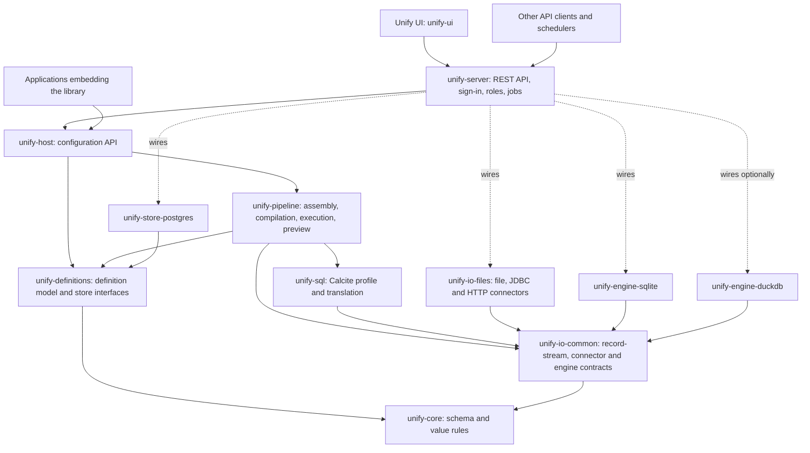
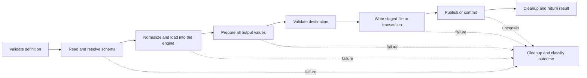

© Mark Andrew Ray-Smith Cityline Ltd 2025\
Version 0.4

# Unify Technical Design

Status: Draft derived from the functional design; revised by ADR-001 to ADR-005  
Date: 2026-11-24 (version 0.1: 2026-11-22)  
Requirements baseline: [Unify Functional Design version 0.14](FUNCTIONAL_DESIGN.md)

## Design authority and implementation status

This design specifies the implementation of FR001 through FR024 and NFR001 through NFR007 in the functional design. Functional scope, value semantics, destination guarantees, and acceptance scenarios are defined there. A change to one of those contracts requires a functional design revision before an incompatible technical change.

The architecture and types below are proposed. Existing repository classes are identified explicitly; new type names and configuration examples are design interfaces, not currently available APIs, except where a section marks a type as implemented. This document does not claim that the implementation or its tests already conform to the target contract.

## Architecture decisions

### ADR-001 Working data lives in the selected execution engine

Status: Accepted, 2026-11-24.

**Decision.** Working data lives in the selected engine. Java holds schemas, value rules, bounded samples and handles to engine datasets, never whole datasets.

**Context.** The inherited model reads every source into an `ITable`, a mutable, row-oriented table held in Java memory, and writes every destination from one. Connectors exchange data through `IDataSource`, which moves values as text (`addRow(Map<String, String>)`, `String getValueAt(...)`), and JDBC query results are copied back into an `ITable`. The functional design instead selects SQLite or DuckDB as the execution backend and states that completion does not require copying the working dataset into Java memory (FR009). Keeping the in-memory table at the centre would:

- store every dataset twice, once in Java memory and once in the engine, capping data size at the Java heap and discarding DuckDB's larger-than-memory processing;
- implement the same rules twice (joins, filtering, null and type handling) in Java and in the engine, so results would depend on which path ran;
- load slowly: the current JDBC writers bind every value as text and insert one auto-committed row per statement.

**Consequences.**

- Readers produce a `RecordSource`: bounded `RecordBatch`es whose values are already checked against a `TableSchema`. No reader fills a table.
- Each engine has one loader. DuckDB uses its native appender. SQLite uses one prepared, typed INSERT executed in batches inside a single transaction, into a STRICT table.
- A loaded dataset is referenced by a `DatasetHandle` (engine, name, Unify schema, record count). The schema travels with the handle because an engine catalogue cannot always reproduce Unify logical types.
- Destinations consume query results as streamed `RecordSource`s.
- Java may hold schemas, value rules, one batch per open stream, previews and samples within configured limits, and handles. It never holds a whole source, intermediate or result dataset.
- Unify, not the engine, owns conversion and the null, missing and empty rules, and applies them before loading. Each engine adapts storage types and restores logical types from the schema when results are read.
- Engine SQL is an internal contract. Public portable SQL reaches an engine only after Apache Calcite has parsed, validated and translated it.
- Both engines must pass the same contract suite, which roughly doubles backend qualification work; ADR-002 records why both are kept.
- Memory budgeting moves from the Java heap to engine memory and temporary disk.
- The legacy `ITable`, `TableCore`, `OptimizedTableCore`, `Column`, `Row`, `Cell` and `TableBuilder` model is frozen (see Compatibility and migration). The programmatic table of UC01 is rebuilt later on the schema core as an in-memory source, not as working storage.

**Rejected alternative.** Harden `ITable`/`TableCore` into strict canonical storage with schema metadata, strict normalization and atomic mutations (version 0.1, stage 2). It would invest in a component the architecture no longer places on the data path and would make the double storage and duplicated rules permanent.

**Evidence.** The proof slice `LargerThanHeapSliceTest` streams a CSV file into DuckDB through the appender, runs a filter query, and streams the result to a CSV file, sampling the Java heap after garbage collection every 256 batches. Run on 2026-11-24 (Windows 11, DuckDB 1.5.6, Java heap capped at 64 MB):

| Measure | Result |
| --- | --- |
| CSV input | 1,024 MB, 24,247,795 records: 16 times the maximum heap |
| Load into DuckDB (appender) | 56.8 s |
| Filter query streamed to CSV | 3.0 s, 1,814,594 records |
| Java heap retained after GC | 4.1 MB to 5.5 MB across 100 checkpoints |
| Output checks | Record count, ID checksum, ordering and filter condition all match the generated data |

Rerun with `mvn -o test -pl unify-io-files -Dtest=LargerThanHeapSliceTest -DargLine="-Xmx64m -Dunify.slice.megabytes=1024"`. The load rate (about 430,000 records per second) is unoptimised: CSV parsing is character by character and the appender is called once per value. No throughput target is claimed (see Verification strategy).

### ADR-002 SQLite for small integrations, DuckDB for large and analytical work

Status: Accepted, 2026-11-24. ADR-003 builds automatic selection on these roles from detailed use-case testing, which extends these measurements to every shape class, including joins and aggregation.

**Decision.** SQLite is the recommended execution engine for small integrations: few records, simple pipelines, short-lived operations, and hosts that run many operations or must start quickly. DuckDB is the engine for large or analytical work: large inputs, multi-way joins, aggregation, and anything that may exceed memory. A host's explicitly configured default should be SQLite unless its workload is mostly large. Selection stays exactly as the functional design defines it: per operation, directly or through an explicitly configured default, resolved before source reads, and recorded with the engine's actual version.

**Context.** The functional design assigns SQLite to lightweight local processing and DuckDB to analytical and join-heavy work, but gives no basis for choosing between them. ADR-001 validated DuckDB for larger-than-heap streaming. It says nothing about the cost of a small operation, which is the most common kind of integration.

**Evidence.** A load-and-filter workload (load N records of four columns, then a filtered, ordered query streamed back) was measured on 2026-11-24 with the engines described in Execution engines. The test machine was an Intel Core i7-1255U (12 logical processors, 32 GB) running Windows 11 and Java 26, with in-memory databases. Figures are medians of five fresh JVM processes. Warm figures average five further cycles inside each process, after the native library is loaded.

| Measure | SQLite 3.42 | DuckDB 1.5.6 |
| --- | --- | --- |
| Open an engine, warm JVM | 0.4 to 0.6 ms | 14 to 22 ms |
| Open, load, query and close: 1,000 records, warm | 6.5 ms | 25.3 ms |
| Same cycle: 100,000 records, warm | 188 ms | 138 ms |
| Same cycle: 1,000,000 records, warm | 1,955 ms | 1,133 ms |
| First open in a fresh JVM (range over five runs) | 0.49 to 0.69 s | 0.69 to 0.96 s |
| Peak process memory at 1,000 records (a bare JVM: 42 MB) | 70 MB | 77 MB |
| Driver jar | 12.4 MB | 81.2 MB |
| Native library, Windows x64 (Linux x64) | 0.9 MB | 33.5 MB (58 MB) |

For this workload SQLite is faster up to somewhere between 1,000 and 100,000 records, and DuckDB is faster beyond that. Joins and aggregation were not measured. They are expected to favour DuckDB at smaller sizes, because DuckDB executes vectorised and in parallel while SQLite runs each query on one thread. First-open times are dominated by each driver unpacking its native library into the temporary directory, plus antivirus scanning of the new file, so they vary between runs.

**Consequences.**

- Both engines stay in the baseline and pass the same contract suite. This resolves the open question of whether SQLite as an execution engine, as distinct from SQLite as a connector, justifies the extra qualification work.
- Small operations pay about half a millisecond to open an engine instead of 15 to 20 ms, and complete about four times faster at 1,000 records.
- A host that only uses SQLite should not have to ship DuckDB's 81 MB driver, so the DuckDB engine becomes an optional dependency (see Execution engines).
- SQLite brings engineering obligations: a minimum version, a fixed-width temporal text form, a memory cap, and single-threaded execution (see SQLite engine requirements).
- Hosts need not encode these roles themselves: ADR-003 selects the engine automatically from measured use cases.

**Rejected alternatives.** *DuckDB only:* qualification would be simpler, but every small operation would pay DuckDB's open cost, memory and packaging. *SQLite only:* it cannot serve large, analytical or larger-than-memory work; the ADR-001 evidence depends on DuckDB.

### ADR-003 Automatic engine selection from measured use cases

Status: Accepted, 2026-11-24. Requires Functional Design 0.12 (FR011, FR019, FR030, FR031, D12; AC59 to AC62).

**Decision.** An operation's engine is chosen in one of three modes: explicit, configured default, or automatic. In automatic mode a deterministic selector matches the operation against the use cases of a versioned selection profile and takes that use case's engine. The profile is derived from detailed testing of both engines across many integration use cases, each measured on every FR030 metric. Every selector input is known before any source record is read. In particular, source size is never unknown: every source reports its size, and a source that cannot is staged locally and measured first. Unify ships a profile derived from its own use-case testing; a host may supply its own, derived the same way. The selection and its inputs are recorded in the operation result. An explicit choice always wins.

**Context.** ADR-002 shows that the better engine depends on the operation: SQLite wins small operations by a wide margin, DuckDB wins large ones, and the crossover moves with pipeline shape. Leaving every host to encode this by hand repeats the measurement work and goes stale as engines change. Functional Design 0.11 forbade selection from an unmeasured threshold and any engine switching mid-operation; both rules still hold.

**Consequences.**

- Every connector implements a size probe (see Engine selection). HTTP JSON stages its response body before selection, which also releases the connection earlier.
- The selector is a pure function of its inputs and the profile, so the same operation always gets the same engine. Run history is not a selector input. It may suggest new use cases to test, never decide an individual selection.
- The use-case tests are a release artifact. A shipped profile must cite tested evidence for each use case, and a release whose test results contradict a use case must regenerate the profile (TD09).
- Selection changes performance and resource use only. It relies on both engines producing identical logical results under the portable baseline (AC35, AC37), so automatic selection is limited to portable pipelines.
- A source that delivers more than its reported size allows fails as a source change. A selected engine exceeding its budget is a located failure that records the selector inputs and so points at a profile defect. Neither case switches engines.

**Rejected alternatives.** *Explicit selection only:* simple, but pushes measurement onto every host. *History-based selection:* the first run has no history, and the same operation could get different engines on different days. *Sampling records before selection:* that is a source read before selection, and a sample does not bound the total size. *Switching engines mid-operation:* doubles reads, cannot work for sources that cannot be re-read, and breaks the no-silent-switch rule. *Selection inside a fixed size limit:* using the operation's maximum budget as the assumed size would send almost every operation to DuckDB.

### ADR-004 A Unify service and UI, built on the embedded library

Status: Accepted, 2026-11-24, revised the same day. Implements Functional Design 0.14 D01 and D13 to D16, and FR038 and FR043 to FR046.

**Decision.** Unify is delivered as a service with an HTTP API and its own UI, and as an embedded Java library that applications can use directly. The library's configuration API, `unify-host`, is the single implementation of every capability. The service, `unify-server`, exposes it as a REST API described by OpenAPI. It adds:

- sign-in through an external OpenID Connect identity provider;
- Unify roles granted to identity-provider groups, which implement the library's `AccessPolicy`;
- background execution jobs on a bounded worker pool, shared through PostgreSQL across instances.

The UI, `unify-ui`, uses only the REST API; its technology is not yet chosen (D16). Unify has no built-in scheduler. The code base is split into modules along these lines (see Module architecture), which revises TD02.

**Context.** The mockup depends on a large management surface: organisations, namespaces, design workspaces, drafts, catalogue search, connections, previews, executions and run history. Delivering only a library would leave every host to build its own UI, API, sign-in, permissions and job handling, and to do so consistently.

**Consequences.**

- There is one implementation. The service adds transport, identity, roles and jobs, never business rules, so the library and the service behave identically (AC71).
- No capability exists only in the UI. The UI and every other client use the same published API.
- Unify now owns authentication and authorisation for the service: token validation, role grants and their audit. An embedding application still supplies its own principal and `AccessPolicy`.
- The service runs background threads for job workers and housekeeping. The library alone still needs none.
- The definition store, SQL planning, pipeline compilation, each engine, the service and the UI become separate modules with one-way dependencies. The DuckDB engine moves to its own artifact, which also delivers ADR-002's optional packaging.

**Rejected alternatives.** *Library only:* every host would rebuild the same UI, API and job handling. *Service only, with an internal Java API:* it would remove direct embedding for applications that need it, with no saving, because the service needs that API anyway. *Storage-level integration, where clients read and write the definition tables directly:* it bypasses versioning, conflict detection and access control.

### ADR-005 Unify semantics as engine-native SQL

Status: Accepted, 2026-11-24.

**Decision.** Calcite plans every portable query and every compiled stage, and SQLite or DuckDB executes the SQL generated from that plan. Wherever an engine's native behaviour differs from Unify's rules (FR003, FR032), Calcite's translation for that engine emits native SQL that produces Unify's result. This covers strict conversions, overflow, division by zero, non-finite numbers, ASCII-only case conversion and null ordering. Unify registers no Java functions in either engine. A rule violation does not raise an error mid-statement. Instead, the statement computes a per-record error code, and Unify fails the stage from the first coded record after the statement completes.

**Context.** The two engines measurably differ from the profile and from each other (see SQL profile and Calcite). Both drivers can host Java functions, but native SQL keeps execution entirely inside each engine's optimiser and vectorised execution. SQLite also has no built-in way to raise an error from a query, which the error-code approach avoids.

**Consequences.**

- Each rule has two native implementations, one per engine dialect. A single conformance corpus, run on both engines, must match Unify's Java rules (`ValueNormalizer`) value for value and failure for failure. That corpus is the guard against the two drifting apart (TD16).
- SQLite has no `REGEXP` function, so its strict checks use `GLOB` patterns plus length and range comparisons. DuckDB uses `regexp_full_match` and `TRY_CAST`.
- Error codes give every failure a record location, consistent with rejections (FR010, FR022).
- Where a failing expression sits in a predicate, join condition or grouping key, it is computed in a preceding materialised step, so a filter cannot hide the failure.

**Rejected alternatives.** *Registered Java functions on both engines:* one implementation, but every value crosses into Java, and SQLite's calls are made one value at a time. *Calcite executing queries itself in Java:* single semantics, but data would flow through Java memory, contrary to ADR-001 and FR030.

## Repository baseline

| Area | Existing implementation | Required technical change |
| --- | --- | --- |
| Tables | [`ITable`](../unify-core/src/main/java/dev/mars/jtable/core/model/ITable.java), [`TableCore`](../unify-core/src/main/java/dev/mars/jtable/core/table/TableCore.java), `Column`, `Row`, `Cell`, `TableBuilder`, `ColumnFactory`. Every dataset is held in Java memory. Columns hold only a name, Java class and default; null is always accepted; date and time defaults use the clock; missing-field defaults differ between `addRow(Map)` and `addRow(IRow)`/`TableBuilder`; columns can be added or replaced on a populated table; rows are stored by reference and new cells skip validation; double text depends on the platform locale or a per-row cache that can go stale | Freeze as the legacy compatibility surface (ADR-001). The new schema core (`TableSchema`, `ColumnDefinition`, `ValueNormalizer`, `RecordBatch`) carries types and value rules; working data moves to the execution engine. `LegacyTables` converts between the two. Rebuild UC01's programmatic table later on the schema core as an in-memory source |
| Alternative tables | `OptimizedTableCore`, `ProfiledOptimizedTableCore`, collection profiler | Frozen with the legacy model; no further qualification work |
| I/O contracts | [`IDataReader`](../unify-io-common/src/main/java/dev/mars/jtable/io/common/datasource/IDataReader.java), `IDataWriter`, `IDataSourceConnection`, table adapters. Readers fill an `ITable`; `IDataSource` moves every value as text | Replace with streamed, typed record batches (`RecordSource`, `RecordSink`) plus typed requests, lifecycle ownership, connector capabilities, and operation results. Legacy contracts are frozen |
| Execution engines | None. H2 and SQLite appear only as JDBC connectors and in demos | `ExecutionEngine` with DuckDB and SQLite implementations holds working data (ADR-001; see Execution engines) |
| Mappings | [`MappingConfiguration`](../unify-io-common/src/main/java/dev/mars/jtable/io/common/mapping/MappingConfiguration.java), `ColumnMapping`, JSON/YAML/JDBC serializers | Compile immutable validated mappings and introduce a versioned configuration envelope |
| CSV | Separate readers, writers, and mapping readers/writers | Share one parser and one mapping execution path; retain quote provenance |
| JSON | Jackson parsing with first-record inference; some errors are printed and swallowed | Use bounded parsing and the common normalization and result pipeline |
| XML | Regular-expression parsing and manual escaping | Replace with structured, namespace-aware parsing and writing |
| JDBC | Readers and writers with separate connection paths; mapping writer binds strings and executes inserts individually | Use one connection lease per write, typed binding, metadata checks, and an explicit transaction |
| HTTP | `RESTConnection` and `RESTReader`; separate simplified response parsing | Use the same JSON decoder as file input, finite timeouts, and explicit response cleanup |
| NoSQL | Placeholder connection and sample-record reader | Exclude from the supported connector registry |
| Integration | CSV-to-H2 and CSV-to-SQLite demos and tests, plus MySQL and PostgreSQL processors and demos for products outside the supported connector set (D02). Compilation was restored on 2026-11-24: callers drifted from the API, so `MappingConfiguration.setColumnMappings`/`setOptions` and `DbConnection.getConnection()` (a new connection the caller owns) were added, and the remaining callers were corrected | Turn representative flows into acceptance coverage without making demos production orchestration; decide whether the MySQL and PostgreSQL demos stay |

The root [POM](../pom.xml) declares Java 23 properties but configures compiler source and target 17. The proposed baseline is Java 17 bytecode, expressed once using the compiler release setting. Implementation must first verify that the source and selected dependencies satisfy that baseline and align the README and module configuration. A different supported Java baseline is a documented technical decision, not an incidental compiler setting.

## Module architecture

The existing modules stay. ADR-004 adds modules for the definition model and store, SQL planning, pipeline execution, the host API, and one module per engine. `unify-io-files` continues to house the file, JDBC and HTTP connectors despite its historical name. The engines currently in `unify-io-files` move to their own modules.



An embedding application wires the store, connectors and engines itself, exactly as `unify-server` does.

| Module | Target responsibility |
| --- | --- |
| `unify-core` | Logical types, schema, record batches, conversion, and validation; no connector dependencies and no working-data storage. Also holds the frozen legacy table model |
| `unify-io-common` | Record-stream, connector and execution-engine contracts, capabilities, credential-provider contract, lifecycle leases, configuration serialization, and the legacy-table converter |
| `unify-io-files` | File, JDBC and HTTP connectors as record sources and sinks, size probes, file publication, JDBC dialects and transport, and HTTP transport |
| `unify-engine-sqlite` | `SqliteEngine` and its loader; SQLite engine requirements |
| `unify-engine-duckdb` | `DuckDbEngine` and its loader. Optional: a host that does not include it does not ship the DuckDB driver |
| `unify-definitions` | The stored-definition model (kinds, envelopes, references, versions), validation of each kind, and the store interfaces: definitions, structure, drafts, catalogue queries and run records |
| `unify-store-postgres` | The PostgreSQL 19 implementation of the store interfaces, with its schema migrations |
| `unify-sql` | The Unify SQL profile on Apache Calcite: parsing, validation, result-type derivation, and translation to each engine |
| `unify-pipeline` | Operation assembly and binding resolution, pipeline compilation, stage and join execution in the engine, preview, engine selection, results, limits, progress, and the operation facade |
| `unify-host` | The configuration API (ADR-004): `HostContext`, `AccessPolicy`, and the structure, definition, catalogue, connection, design, preview, operation, run-history and bundle services. Usable directly by embedding applications |
| `unify-server` | The Unify service: the REST API and its OpenAPI document, OpenID Connect token validation, role grants as an `AccessPolicy`, background job workers, progress streaming, design-session affinity, health endpoints, and the wiring of store, connectors and engines |
| `unify-ui` | The Unify user interface, a client of the REST API only. Technology not yet chosen (D16); the HTML mockup is its design reference |
| `unify-integration` | Executable examples and acceptance workflows using public APIs |
| `unify-coverage` | Coverage aggregation; no production behavior |

Dependencies point one way, as drawn. Nothing below `unify-pipeline` depends on Calcite or PostgreSQL, and no module imports a concrete connector, engine or store: the host wires them in through constructor injection. The library modules need no dependency-injection framework, database ORM, server or background threads; `unify-server` adds an HTTP server and its worker threads, but still no scheduler. Registries may be shared when immutable; cursors, connections, counters, and cancellation state are operation-scoped.

Keep logging through SLF4J. Logging bindings belong to the host or runnable demonstrations; production library modules should not force Logback on consumers. Update JPMS descriptors alongside package exports and dependency changes, including access needed for configuration serialization and public exception types.

## Core schema and table model

### Target types

The core describes data; it does not store working datasets (ADR-001). Types marked implemented exist in `dev.mars.jtable.core.schema`.

| Type | Contents and invariant | Status |
| --- | --- | --- |
| `LogicalType` | STRING, INT32, DOUBLE, BOOLEAN, DATE, TIME, LOCAL_DATETIME, each with one canonical Java class | Implemented |
| `ColumnDefinition` | Name (nonblank, case-sensitive, not trimmed), logical type, and nullability. Optional typed default, validation rules, and text conversion settings are added with the normalizer stages that apply them | Implemented: name, type, nullability |
| `TableSchema` | Immutable ordered column definitions plus an immutable name-to-index lookup; at least one column; unique names | Implemented |
| `ValueNormalizer` | The shared value rules: strict text conversion, typed-value checks, canonical text output | Implemented: conversion stages 4 to 6 below |
| `RecordBatch` | A bounded, immutable group of records checked against one schema. NULL is Java null; MISSING never reaches a batch | Implemented |
| `SourceValue` | Explicit MISSING, NULL, or SCALAR value; source scalar may retain its original lexical token | Proposed |
| `InMemoryTable` | The programmatic table of UC01: schema-fixed, bounded, with whole-record append and validated cell update. It is an in-memory source and sink that is loaded into the engine like any other, not working storage | Proposed (replaces `TableSnapshot` and `MutableTable`) |

Canonical Java representations are `String`, `Integer`, `Double`, `Boolean`, `LocalDate`, `LocalTime`, and `LocalDateTime`.

A record is checked whole before it is added to a batch, so a rejected record leaves the batch unchanged. "Atomic" in this design means all-or-nothing within one thread: a failed operation has no partial effect. It does not imply thread safety. `InMemoryTable` applies the same rule to append and cell update, copies records on insert, exposes only read-only views, and fixes its schema once records exist; changing the columns of populated data creates a new table.

Use ordered column vectors and a name-to-index lookup rather than repeatedly building column lists for indexed access. Begin with ordinary operation-confined collections. Concurrent collection selection is an implementation option only after correctness and workload measurements; it does not establish thread safety.

### Conversion and validation pipeline

One `ValueNormalizer` implements the following order for every connector and programmatic mutation:

1. Resolve MISSING using a prevalidated explicit default, or nullability. Preserve the distinction between NULL and SCALAR.
2. Apply an explicitly configured text trim operation to textual scalars.
3. Apply empty-as-null if enabled; do not apply the missing-value default to the resulting null.
4. Enforce nullability.
5. Convert to the declared logical type using the configured locale and temporal patterns.
6. Reject overflow, non-finite doubles, unrecognized booleans, unsupported values, and invalid temporal fields.
7. Apply inclusive numeric bounds, string length bounds measured in Unicode code points, and typed permitted-value checks.

Defaults are normalized and validated when compiling the configuration. Validation metadata itself must be consistent: minimum cannot exceed maximum, and rules must apply to the declared type. The pipeline never manufactures a date using the clock and never uses permissive boolean conversion that maps arbitrary tokens to false.

`ValueNormalizer` currently implements stages 4 to 6 for text input: nullability, conversion of the ISO and decimal text forms, and rejection of overflow, non-finite doubles, unrecognized booleans and invalid temporal fields. It never trims. Null tokens and empty-as-null are applied by the format source before conversion (the CSV source does both). Stages 1 to 3 and 7 arrive with defaults, trimming and validation rules in `ColumnDefinition`.

Typed values use one canonical, locale-independent text form on output: `Double.toString` for doubles (the shortest text that converts back to the same value, always with `.` as the separator, and exponent notation outside 10⁻³ to 10⁷), `true`/`false` for booleans, and ISO-8601 local forms for temporal values. Every canonical form converts back to the same value. The old per-row `originalDoubleStrings` behavior is not part of the new value contract. Any lexical compatibility behavior retained for legacy entry points stays in the legacy model.

### Inference algorithm

The schema resolver consumes at most the configured sample count, bounded by the read or preview record limit. Store sample records as raw `SourceValue` records and replay them through normalization after freezing the schema. Do not count sample replay as a second read or charge the same payload twice.

Infer names in encounter order across the sample, tracking missing or null fields as nullable. Headerless CSV requires a supplied positional definition. Classify non-null scalars as boolean, signed 32-bit integer, finite double, supported temporal value, or string. Integer-looking tokens outside INT32 and significant leading-zero tokens classify as string before fractional-number classification. Temporal inference uses the documented default patterns; custom input patterns require an explicit type.

The combination rules are: identical types remain unchanged; INT32 plus DOUBLE becomes DOUBLE; any other conflicting types become STRING; all-null columns become nullable STRING. Preserve original lexical tokens for string fallback, including large JSON integer tokens. After schema freeze, new unselected fields are ignored only when explicit projection allows it; otherwise a new field or incompatible value is a located record error. Empty input without schema follows FR002 rather than guessing a zero-column table.

## Mapping compilation

Compile configuration into an immutable `MappingPlan` before processing records. Each rule contains one validated selector, target index, target column definition, typed default, and normalization settings. Compile input and output mappings separately. An input plan produces the canonical table schema; an output plan produces the destination representation schema without mutating the source table.

Reject malformed selectors, duplicate target names, invalid positional definitions, unsupported option names, and incompatible capabilities. A well-formed selector for a field absent in an individual record produces MISSING and follows FR004; it is not itself a syntax error. For CSV, bind header names to positions once. Explicit mapping may intentionally ignore extra source fields, but CSV record width must still match its declared or header-established width.

Output conversion is checked for every accepted row before opening a destination for mutation. Requested type changes are explicit mapping operations. Encoders must not independently infer types or replace conversion failures with empty strings.

## Public execution API and connector contracts

The target facade has synchronous read, write, transfer, validate, and preview operations. These conceptual signatures describe the proposed API surface:

```java
ReadResult read(ReadRequest request, ExecutionContext context);
OperationResult write(WriteRequest request, ExecutionContext context);
OperationResult transfer(TransferRequest request, ExecutionContext context);
ValidationResult validate(OperationDefinition definition);
PreviewResult preview(PreviewRequest request, ExecutionContext context);
```

`ExecutionContext` contains the operation identifier, clock/deadline, cancellation signal, limits, credential provider, selected execution engine, and diagnostic policy. Requests are immutable snapshots. A write reads from an engine dataset or a record source, never from a table the host can still mutate.

`validate` checks configuration and declared capabilities without opening a destination for mutation. Source-aware validation occurs during preview or execution. Expected configuration, data, transport, and publication failures return typed results. `ReadResult` exposes, on successful completion only, a `DatasetHandle` (the records stay in the engine) and any bounded preview sample. A legacy exception-based facade may adapt failures to existing exceptions while retaining the structured result as context.

| Connector contract | Responsibility | Status |
| --- | --- | --- |
| `RecordSource` | Stream checked records in bounded `RecordBatch`es under a schema known before the first batch; single-use; closing releases owned resources | Implemented (`unify-io-common`) |
| `RecordSink` | Accept batches; publish only on `complete()`; closing without completing discards the output | Implemented (`unify-io-common`) |
| `ConnectorDescriptor` | Identifier, typed option schema, supported directions, types and shapes, verified products, ownership modes, and publication guarantee | Proposed |
| `SourceConnector` | Open an owned or borrowed `RecordSource` and expose source metadata. Each codec's raw-record scanner is internal to its source | Proposed |
| `DestinationConnector` | Validate representation and destination metadata, then create a `WriteSession` | Proposed |
| `WriteSession` | A `RecordSink` that also exposes publication state, aborts if possible, and supports commit-once destinations | Proposed |
| `ResourceLease` | Associate a resource with OWNED or BORROWED lifecycle policy | Proposed |
| `CredentialProvider` | Resolve a typed credential reference in memory without making it serializable configuration | Proposed |

`CsvRecordSource` and `CsvRecordSink` are the first implemented connectors on this contract. The source parses RFC 4180 incrementally against an explicit schema, reports errors by the line on which the failing record starts without echoing field contents, and distinguishes the unquoted null token, quoted literals, and empty text. The sink writes canonical text to a temporary file in the target directory and moves it to the target name only on completion, refusing an existing target; verified publication modes remain TD04.

The registry contains CSV, JSON, XML, H2 JDBC, SQLite JDBC, and HTTP JSON implementations when their required capabilities are implemented and verified. It must not register the current NoSQL sample reader as supported. Product verification metadata includes the driver and product versions exercised by release tests; generic JDBC availability is not proof of compatibility.

## Execution engines

An `ExecutionEngine` holds an operation's working data (ADR-001). Records enter through `load` and leave as streams through `query` and `scan`; Java never holds a whole dataset. An engine instance is operation-scoped and single-threaded. `DuckDbEngine` and `SqliteEngine` implement the contract (currently in `unify-io-files`, moving to `unify-engine-duckdb` and `unify-engine-sqlite` under ADR-004), sharing `JdbcEngine` for dataset creation, all-or-nothing loading, result streaming, and strict result conversion.

| Operation | Contract |
| --- | --- |
| `load(dataset, source)` | Creates a table from the source's schema and loads every record in one transaction. On any failure, including a source failing part-way, the table and its rows are rolled back and no dataset of that name remains. Returns a `DatasetHandle` |
| `query(sql, resultSchema, batchSize)` | Runs a read-only query and streams the result. The SQL refers to datasets by their generated engine names from the `DatasetHandle`. Until Calcite validation supplies result types, the caller declares the result schema. Result columns are matched to it by position, and engine labels are ignored because engine tables use generated names: the column count must match, and every value must convert strictly to the declared type: integers must fit INT32, text is never coerced to numbers, and NULL in a non-nullable column fails. Errors name the result record |
| `scan(handle, batchSize)` | Streams a loaded dataset using the schema recorded in its handle |
| `drop(dataset)` | Removes a dataset; dropping a missing dataset does nothing |
| `name()`, `version()` | Backend identity and actual version, recorded in operation results (FR011) |

Identifiers are always quoted, so any dataset or column name, including reserved words and embedded quotes, is safe. The SQL accepted by `query` is backend SQL and is not exposed publicly: the public API accepts only portable SQL that Calcite has parsed, validated and translated for the selected backend. Read-only enforcement for engine queries arrives with that translation layer.

| Logical type | DuckDB column | SQLite STRICT column |
| --- | --- | --- |
| STRING | VARCHAR | TEXT |
| INT32 | INTEGER | INTEGER |
| DOUBLE | DOUBLE | REAL |
| BOOLEAN | BOOLEAN | INTEGER with CHECK (value IN (0, 1)) |
| DATE | DATE | TEXT, ISO-8601 `yyyy-MM-dd` |
| TIME | TIME | TEXT, fixed-width ISO-8601 (see SQLite engine requirements) |
| LOCAL_DATETIME | TIMESTAMP | TEXT, fixed-width ISO-8601 (see SQLite engine requirements) |

Non-nullable columns are declared NOT NULL, so the engine enforces nullability as well as the batch.

**DuckDB loader.** The native appender (`DuckDBAppender`) appends each checked value with its typed method inside the load transaction. Query results stream with `jdbc_stream_results`, so DuckDB does not materialize a whole result before the first batch. With a database file, DuckDB can spill intermediate work to disk; the caller owns and removes the file.

**SQLite loader.** One prepared INSERT with typed bindings, executed in statement batches of 1,000 inside the single load transaction. STRICT tables make SQLite itself reject a value of the wrong storage class; booleans and temporal values are restored from the dataset schema on read.

### Engine selection

ADR-002 sets the engines' roles and ADR-003 makes selection automatic. Selection runs after the operation is validated and every source has reported its size, and before any source record is read. The result is fixed for the operation.

| Mode | Behaviour |
| --- | --- |
| Explicit | The operation names an engine. It is validated (installed, supported version, any engine-specific extensions) and overrides every other mode |
| Configured default | The host's default engine, used when the operation names none and does not request automatic selection |
| Automatic | The selector picks the engine from the selection profile. Only portable pipelines qualify; an engine-specific extension pins its engine |

#### Selector inputs

| Input | Where it comes from | Content |
| --- | --- | --- |
| Pipeline shape | The validated, compiled pipeline plan | A shape class, plus the features behind it: source and stage counts, joins by count and kind, aggregation, DISTINCT, ordering, SQL stages |
| Source sizes | Each source's size probe | A size per source with its unit and method, normalised to record and byte estimates |
| Resource budgets | The operation's `LimitBudget` | Engine memory, temporary disk, and deadline |
| Engine state | The host process | Whether each engine is already initialised (warm) or would start cold |
| Installed engines | Driver discovery | The engines present and their versions |

The shape class is the first that applies, in this order: `MULTI_JOIN` (two or more joins), `JOIN_AGGREGATE` (a join plus aggregation or DISTINCT), `AGGREGATE`, `JOIN`, `SORT`, `SCAN` (load, filter, project, map, convert). The benchmark measures each class, and every pipeline falls into exactly one.

#### Size probes

Every connector reports a source size before any of its records are read. Source size is never unknown.

| Source | Probe | Method recorded |
| --- | --- | --- |
| Local CSV, JSON or XML file | Exact byte size from file-system metadata | `file-bytes` |
| HTTP JSON response | Body staged to a temporary file within the input size limit, then measured; decoding reads the staged copy | `staged-bytes` |
| JDBC table or query | `SELECT COUNT(*) FROM (SELECT 1 FROM (source query) LIMIT K)`, where K is one more than the profile's largest record boundary, so the cost is bounded by K rows. A result below K is exact; K means "above the largest boundary". Where the product supports it, probe and read share one read-only transaction | `exact-count` or `bounded-count` |
| Supplied in-memory table | Exact record count | `supplied-count` |
| Published view | The probes of the sources it reads | As for those sources |

Sizes are normalised to a record estimate and a byte estimate. A measured value is used directly. Otherwise it is converted conservatively, towards the engine that tolerates more data:

- For a file, the record estimate is the byte size divided by the schema's minimum encoded record width, which is an upper bound.
- For a counted source, the byte estimate uses declared column widths where the source declares them, and otherwise the profile's measured average width for each logical type.

The operation size is the sum over its sources.

The loader counts what each source delivers. An exact probe must match exactly, and a bounded probe must stay within the matched use case's range. Otherwise the operation fails before publication as a source change, without switching engines.

#### Use-case testing

The automatic-mode configuration, the selection profile, is derived from Unify's detailed testing of both engines across many integration use cases. A tested use case is a concrete, repeatable integration: its sources and connectors, a pipeline of one shape class, a schema and record width, a data size, and the engine state. Each runs on both engines with real connectors and the full portable pipeline behaviour (FR030), on each supported operating system.

The use-case catalogue covers:

| Coverage | Tested use cases include |
| --- | --- |
| Data size | 10³, 10⁴, 10⁵, 10⁶ and 10⁷ records, with further use cases around each size where the better engine changes |
| Record width | Narrow (4 columns), medium (16), and wide (64, with long text) |
| Pipeline shape | Every shape class: `SCAN`, `SORT`, `JOIN` (inner and outer), `AGGREGATE`, `JOIN_AGGREGATE`, `MULTI_JOIN` |
| Sources | One, two and four sources, mixing files, JDBC and staged HTTP |
| Engine state | Cold (first use in the process) and warm |
| Budget | The default and a constrained engine memory budget |

Every tested use case records every FR030 metric on both engines:

- startup time, cold and warm;
- execution time from open to published output, p50 and p95 over at least five runs;
- Java heap retained after GC;
- native memory (process peak minus the bare-JVM baseline);
- peak temporary disk;
- any budget failure;
- the data shape and engine version.

The engine for each tested use case is decided as follows:

1. Only engines that completed within every budget in every run are eligible.
2. The eligible engine with the lower p95 execution time is selected.
3. If the two are within the tie margin (default 10%), the one with less native memory is selected.
4. A single eligible engine is selected outright. A use case where neither is eligible is unsupported at that budget, and operations that match it fail before source reads with a budget diagnostic.

The ADR-002 measurements are the first such results (`SCAN`, warm and cold, 10³ to 10⁶ records): SQLite is selected at 10³, and DuckDB at 10⁵ and above.

#### Selection profile

The selection profile turns the test results into rules the selector applies to any operation. It is a versioned document. Unify ships one, derived from its own use-case testing, and a host may configure its own, derived the same way from testing on its hardware and workloads.

Each profile use case covers a group of tested use cases with the same shape class, source mix and engine state. Its size range runs across consecutive tested sizes that select the same engine. A boundary lies at the largest tested size at which the smaller-size engine is still selected; untested sizes between that and the next tested size go to the engine selected at the larger size. A profile use case cites the tested use cases behind it, so every rule traces back to its measurements.

A profile contains:

- its identifier and version, the test run it was derived from, and the operating systems and engine version ranges tested;
- the decision rule and tie margin used;
- its use cases. Each has an identifier, a description, conditions over the selector inputs (installed engines, shape class, source mix, record and byte ranges, budget conditions, engine state), the engine it selects, and the tested use cases with their per-metric results.

Two use cases always exist alongside the tested groups. When only one engine is installed, that engine is selected if the operation fits its budgets. When an operation's estimated working size exceeds SQLite's memory budget, DuckDB is selected, with a database file if DuckDB's memory budget is also exceeded.

Loading a profile validates it. Every combination of inputs must match exactly one use case, every use case must cite tested evidence for every metric, and the installed engine versions must fall within the tested ranges. An invalid profile is rejected before any operation uses it. Because use cases cannot overlap, their order does not matter.

#### Recording and testing

Every executed operation records an `EngineSelection` in its result: the mode, the engine and its actual version, and for automatic selection the profile identifier and version, the use case, the shape class and its features, each source's size with its unit and method, the normalised estimates, the budgets, the engine state, and the installed engines (FR011).

Selector tests are generated from the profile so they stay in step with it: one case per profile use case, plus cases on each side of every boundary (AC59). Profile validation is tested with overlapping, incomplete, unevidenced and out-of-range profiles (AC60). Each connector's size probe is tested, including HTTP staging and the source-change failure (AC61). Every release reruns the use-case tests and compares the results with the shipped profile; any contradicted use case blocks the release until the profile is regenerated (AC62, TD09).

A pipeline that is portable under FR032 runs unchanged on either engine, so a host can change its default, override one operation, or replace the profile without rewriting definitions.

### SQLite engine requirements

- **Minimum version 3.39.** RIGHT and FULL OUTER JOIN, which the join baseline requires, arrived in SQLite 3.39. STRICT tables need 3.37. The current driver (sqlite-jdbc 3.42.0.0) bundles SQLite 3.42. Release verification records the bundled SQLite version and fails below the minimum.
- **Fixed-width temporal text (implemented 2026-11-24).** DATE, TIME and LOCAL_DATETIME are stored as fixed-width text: `yyyy-MM-dd`, `HH:mm:ss.nnnnnnnnn` and `yyyy-MM-ddTHH:mm:ss.nnnnnnnnn`. `java.time`'s `toString`, used before, omits zero seconds and varies the fraction length, so a literal such as `'10:15:00'` did not equal a stored `'10:15'`. Equal values now always have equal text, and text order is time order for years 0000 to 9999. The Calcite translation must render temporal literals and parameters in the same form, and map portable temporal functions to SQLite's text-based date and time functions.
- **Memory cap.** An in-memory SQLite database grows until the process runs out of memory. Derive a limit from the operation's `LimitBudget` and enforce it with `PRAGMA hard_heap_limit` or a page-count limit. An operation that may exceed it uses a database file, or is a candidate for DuckDB.
- **Single-threaded execution.** SQLite runs each query on the calling thread with no parallelism. That suits small operations and is one reason large ones belong on DuckDB.
- **Cold start.** Both drivers unpack their native library into the temporary directory the first time a JVM loads them, which dominates first-open time. Long-running hosts pay this once. One-shot processes can point sqlite-jdbc at a pre-installed native library (`org.sqlite.lib.path`).

### Packaging

`unify-io-files` currently depends on both drivers. Each engine moves to its own module (ADR-004), so a host includes `unify-engine-duckdb` only if it wants DuckDB, and a SQLite-only host does not ship 81 MB of driver. The engine registry lists only the engines the host wired in; engine selection (ADR-003) treats an absent engine as not installed. Explicitly selecting an engine that is not installed fails validation with a clear error before any source is read.

**Open items.** Implementing the Calcite translation and semantic shims; engine memory limits, temporary directories, and their place in `LimitBudget`; cancellation and deadlines during load and query; record-level rejection budgets during load (FR010); a larger-than-heap proof per connector and for SQLite with a database file; the SQLite memory cap; optional DuckDB packaging; the TD09 benchmark and the first evidenced selection profile; the selector and profile validator; size probes for every connector, including HTTP staging; and the `EngineSelection` result record.

## Host configuration API

The configuration API in `unify-host` is the only way the Unify service, or an application embedding the library, uses Unify's capabilities (FR038, ADR-004). The caller (the service, or the embedding application) builds one `UnifyHost` at start-up from its dependencies, then calls its services with a `HostContext` on every request.

```java
UnifyHost host = UnifyHost.builder()
        .store(postgresStore)              // unify-store-postgres
        .connectors(connectorRegistry)     // unify-io-files and any others
        .engines(engineRegistry)           // unify-engine-sqlite, optionally unify-engine-duckdb
        .credentials(credentialProvider)
        .accessPolicy(accessPolicy)
        .selectionProfile(profile)         // shipped or host-supplied (ADR-003)
        .limits(defaultLimits)
        .build();

HostContext context = new HostContext(organisationId, namespaceId, workspaceId, principal);
Result<CataloguePage> page = host.catalogue().search(context, query);
```

`HostContext` names the organisation, namespace and, for design actions, the design workspace, together with an opaque `Principal` (an identifier and display name supplied by the host). There is no ambient or thread-local context; a call without a namespace cannot read or write namespace resources.

| Service | Responsibility | Mockup area it serves |
| --- | --- | --- |
| `StructureService` | Create, list, rename, describe and delete organisations, namespaces and design workspaces, with the FR037 guards | Manage structure; context bar |
| `DefinitionService` | Save, find, list, load, revise and retire every stored definition kind; dependency and version listings | Definition library; configuration workspaces |
| `CatalogueService` | Register providers, publish views, search and page the catalogue, inspect contracts and dependency graphs | Catalogue (cards and list) |
| `ConnectionService` | Save connections, validate settings, and run an explicit live test (FR040) | Connections |
| `DesignService` | Pipeline drafts per workspace and namespace: bindings, stages, outputs and execution settings; save version; discard; design-time samples (FR041) | Pipelines workbench; Pipeline data |
| `PreviewService` | Stage and pipeline previews (FR013), with progress (FR042) | Preview panels; result tabs |
| `OperationService` | Validate and execute operations; the operation facade from Public execution API | Execute and publish actions |
| `RunHistoryService` | List, inspect and repeat runs (FR039) | Runs |
| `BundleService` | Export and import configuration bundles (FR012) | Export design |

**Results.** Every service method returns a `Result<T>`: `Ok(value)`, `Invalid(issues)` for validation failures with located issues, `Denied(action, resource)`, `Conflict(current)` for a concurrent revision or stale draft, or `Unavailable(reason)` when the store or an endpoint cannot be reached. Exceptions are reserved for programming errors. Issues follow the diagnostic rules in Limits cancellation and diagnostic safety.

**Access policy.** The host implements `AccessPolicy`:

```java
public interface AccessPolicy {
    Decision decide(Principal principal, Action action, ResourceRef resource);
    CatalogueVisibility visibility(Principal principal, NamespaceRef namespace);
}
```

Actions are `DISCOVER`, `INSPECT`, `BIND`, `SAVE`, `PUBLISH`, `EXECUTE`, `USE_CONNECTION`, `TEST_CONNECTION`, `VIEW_HISTORY` and `ADMINISTER_STRUCTURE`. Every service method calls `decide` before doing anything. Binding resolution and execution call it again for each provider, view and connection used, so an entry that was visible when a pipeline was saved cannot be used after access is withdrawn (FR036). `visibility` returns which categories, capabilities and entries a principal may discover. The catalogue applies it inside its database query, so paging and counts include only visible entries, and `decide` still guards each inspection and binding. A denial changes nothing. There is no implicit default: development and tests use the explicitly named `AccessPolicy.allowAll()`. The Unify service supplies `RoleGrantPolicy`, built from role grants (see Unify service); an embedding application supplies its own.

**Threading and identity.** Services are stateless and thread-safe. Each write is one store transaction. Preview and execution run on the caller's thread, take a cancellation token and an optional progress listener, and return their FR011 result. The principal's identifier is recorded on saved versions, drafts and run records; Unify never authenticates it.

## Unify service

`unify-server` runs Unify as a service (FR043 to FR046, ADR-004). It wires the configuration API exactly as an embedding application would, and adds transport, identity, roles and jobs, never business rules.

### REST API

The API is resource-oriented JSON over HTTPS, described by an OpenAPI 3.1 document that the build generates and publishes. Clients, including `unify-ui`, are generated from that document. Paths are versioned (`/api/v1`) and scoped by organisation and namespace, for example `/api/v1/orgs/{org}/namespaces/{ns}/definitions/{id}/versions/{version}`. Each resource corresponds to one configuration-API service, so the API adds no capability of its own.

| Convention | Rule |
| --- | --- |
| Revisions | Every saved resource returns its version or revision as an `ETag`. A change must send `If-Match`; a stale value returns 412, and a definition-level conflict returns 409 with the current version |
| Errors | `application/problem+json` (RFC 9457), with a stable error code and the located, sanitised issues of FR022: 400 or 422 for validation, 401 without a valid token, 403 for a denial, 404 when missing, 409 or 412 for a conflict, 503 when the store or an endpoint is unavailable |
| Paging | Keyset cursors with a stable order, as in Provider catalogue; page sizes are bounded |
| Record values | Returned only by preview, sample and download responses (FR043) |
| Long operations | `POST …/executions` returns 202 with the run resource. `GET …/runs/{id}/events` streams progress as Server-Sent Events, and `POST …/runs/{id}/cancel` cancels |

### Sign-in

The service is an OAuth 2.0 resource server. Each request's bearer token is validated before any other processing (FR044): its signature against the issuer's published keys (refreshed on key rotation), issuer, audience, expiry and not-before time. Several issuers may be configured. The token's subject becomes the `Principal` identifier; configured claims supply its display name and groups. The UI signs in through the identity provider with the authorization-code flow and PKCE, and holds tokens only in memory. Services use client credentials. Tokens are never written to the store, run records, diagnostics or logs.

### Roles and grants

Grants live in the definition store:

- `role_grant`: organisation, optional namespace, group identifier, role, revision;
- `role_grant_audit`: every change, with its principal and time.

`RoleGrantPolicy` implements `AccessPolicy` from them:

- A principal's roles in a namespace are the union of the grants on its groups, at that namespace or its organisation. Each role's permitted actions follow FR045.
- `visibility` returns the namespaces and categories a principal may discover, so catalogue queries filter inside the database (TD12).
- Grants are read from the store and cached per instance for at most a few seconds, so a grant change takes effect across instances almost at once. Group membership comes from each new token.
- Removing or demoting an organisation's last Administrator grant is rejected in the same transaction.
- Initial grants come from the service configuration on first start.

### Background jobs

Executions run as jobs (FR046). Submission writes a run record with status `QUEUED` and returns 202. Each instance runs a bounded worker pool that claims jobs from PostgreSQL in submission order:

```sql
SELECT id FROM run_record WHERE status = 'QUEUED' ORDER BY submitted_at
 FOR UPDATE SKIP LOCKED LIMIT 1
```

The claim sets `status = 'RUNNING'`, the claiming instance and a lease expiry, in the same transaction, so a job runs on exactly one instance.

- **Leases.** While running, the worker renews its lease and records the current phase, at most once every few seconds. On start-up, and periodically, any instance marks runs whose lease has expired as `ABANDONED`. The destination outcome comes from the last recorded phase: `NOT_STARTED` if publication had not begun, otherwise `UNKNOWN`. Abandoned jobs are never restarted automatically; a user may repeat them.
- **Cancellation.** A cancel request sets a flag on the run record. The worker sees it at its next lease renewal or cancellation check and signals the operation's cancellation token.
- **Previews** run within their HTTP request on the receiving instance, bounded by the preview limits and a configured deadline.

### Progress across instances

The instance running a job publishes progress events (see Progress and cancellation events) locally. It also writes the latest event to the run record at a capped rate, so `GET …/runs/{id}/events` can stream from any instance: the running instance streams locally, and other instances poll the run record at the same rate.

### Design sessions

A design session's samples live in memory on one instance (FR041). The service issues the session identifier in a cookie, and the deployment routes requests carrying it to the same instance (session affinity). If that instance stops, the session and its samples are lost; the user supplies the samples again. Drafts are unaffected because they are stored.

### Deployment and operations

The service is one executable Java application, also packaged as a container image. It is configured through environment variables or a configuration file: database connection, identity providers, initial grants, worker pool size, limits, preview deadline, selection profile, and installed engines. Instances share state only through PostgreSQL, apart from in-memory design sessions and the jobs they are running. Liveness and readiness are reported separately. Readiness waits for the definition store checks (version, migration level and extensions) and the identity provider's keys. Logs are structured, never contain tokens, credentials or record values (FR022), and carry the operation identifier.

### User interface

`unify-ui` is a client of the REST API only, served by the service as static files under the same origin. Its technology is open (D16). Whatever is chosen, its tests drive the same acceptance scenarios through the API, and the HTML mockup remains the design reference until the production UI covers it.

## Definition store

The definition store keeps every stored definition, the organisation structure, design drafts and run records in PostgreSQL 19 (FR025). `unify-definitions` defines the store interfaces and the definition model. `unify-store-postgres` implements them, and is the only module that knows SQL table layouts.

**Connection and compatibility.** The host supplies a `javax.sql.DataSource`; pooling, TLS and database credentials are the host's concern. At start-up the store checks `server_version_num` (major version 19 is required), the `pg_trgm` extension used by catalogue search, and the schema migration level. Any mismatch makes the store `Unavailable` with a specific reason (AC34). There is no fallback to another store, local files or memory.

**Schema.**

| Table | Key columns | Notes |
| --- | --- | --- |
| `organisation` | `id`, `name` (unique), `revision` | |
| `namespace` | `id`, `organisation_id`, `name`, `is_default`, `revision` | Unique `(organisation_id, name)`; exactly one default per organisation (partial unique index) |
| `design_workspace` | `id`, `organisation_id`, `name`, `current_namespace_id`, `revision` | Unique `(organisation_id, name)` |
| `definition` | `id`, `namespace_id`, `kind`, `name`, `latest_version`, `revision`, `retired_at`; for catalogue kinds also `category`, `capability`, `connector` | Unique `(namespace_id, kind, name)` |
| `definition_version` | `(definition_id, version)`, `envelope_version`, `payload` (JSONB), `content_sha256`, `note`, `created_at`, `created_by` | Immutable |
| `definition_dependency` | `(definition_id, version, target_id, target_version)` | Every exact reference a version makes |
| `draft` | `(workspace_id, namespace_id, subject)`, `payload` (JSONB), `base_definition_id`, `base_version`, `revision`, `updated_at`, `updated_by` | See Ownership, design workspaces and drafts |
| `workspace_preferences` | `(workspace_id, namespace_id)`, `document` (JSONB, size-limited) | Opaque host-UI state, such as catalogue view mode and filters; never interpreted by Unify |
| `run_record`, `run_dependency` | `id`, `namespace_id`, … | See Run history (FR039) and Background jobs |
| `role_grant`, `role_grant_audit` | `id`, `organisation_id`, `namespace_id` (optional), `group`, `role`, `revision` | Service only; see Roles and grants (FR045) |

Composite foreign keys carry `organisation_id` on drafts and workspace preferences, so a draft can never pair a workspace with another organisation's namespace.

**Definition kinds.** `SCHEMA`, `MAPPING`, `TRANSFORMATION`, `SQL_QUERY`, `JOIN_PLAN`, `STAGE`, `PIPELINE`, `READER_PROVIDER`, `WRITER_PROVIDER`, `VIEW`, `CONNECTION`, `EXECUTION_SETTINGS` and `SELECTION_PROFILE`. Connections are versioned definitions too, so a run can record exactly which connection settings it used. Their payload holds settings and a credential reference, never a credential value.

**Payloads.** Each version stores a JSONB envelope `{envelopeVersion, kind, body}`. Each kind's body is validated in Java before saving against that kind's versioned schema, as described in Versioned configuration: unknown fields are rejected, and fields designated secret cannot hold values. Stored versions are never rewritten. An older envelope version is upgraded in memory when loaded, by a migration function for each kind and version.

**Versions and concurrency.** Creating a definition inserts the `definition` row and version 1 in one transaction; an existing name in the same namespace and kind is a `Conflict`. Revising passes the version the caller started from:

```sql
UPDATE definition SET latest_version = latest_version + 1, revision = revision + 1
 WHERE id = ? AND latest_version = ?          -- the caller's base version
RETURNING latest_version;
```

No row returned means another session revised it first. The caller gets `Conflict` with the current latest version, and nothing is written (FR025). Otherwise the new version row and its dependency rows are inserted in the same transaction. A revision whose content hash equals the latest version's returns that version unchanged. A failed save leaves every earlier version intact. Version rows are protected from change twice over: the application role has no UPDATE or DELETE privilege on `definition_version`, and a trigger rejects updates.

**References and isolation.** References are exact `(definition id, version)` pairs. A save checks, in its transaction, that every referenced version exists in the same namespace. Recursive queries over `definition_dependency` reject cycles for views and pipelines. Name lookups are always `(namespace, kind, name)`, with no fallback to another namespace or organisation (FR037). Every query includes the namespace predicate.

**Retirement and deletion.** A definition can be retired. It then disappears from listings and the catalogue but stays resolvable by exact version for existing references, drafts and runs. Versions are deleted only when no dependency, draft or retained run refers to them, which happens when an empty namespace is deleted.

**Open decision.** Whether to require the `pg_trgm` extension for catalogue search, and whether to use Flyway for migrations, is deferred (TD11). The text below assumes both. The alternatives are PostgreSQL's built-in full-text search, which matches words rather than substrings, and Liquibase or plain versioned SQL scripts.

**Migrations.** Flyway migrations ship in `unify-store-postgres`. By default the store only validates the migration level. Applying migrations requires the host to enable it explicitly, so the library never changes a production schema on its own.

**Testing.** Store tests run against real PostgreSQL 19, using Testcontainers or a provided instance. In-memory or substitute databases are not acceptable (FR025, AC33).

## Ownership, design workspaces and drafts

`StructureService` and `DesignService` implement FR037 on the store above.

**Structure.** Creating an organisation creates its `default` namespace and one design workspace in the same transaction. Renames change names only; identifiers, and so all references, are stable. The default namespace cannot be renamed or deleted. A non-default namespace can be deleted only when it has no definitions, including retired ones, and no drafts in any workspace; workspaces whose current namespace it was return to `default`. A design workspace can be deleted only after each of its drafts is saved or explicitly discarded. An organisation can be deleted only when all its namespaces are empty and no drafts remain. At least one organisation, and one design workspace per organisation, always remain. Every structure change is conditional on the row's revision, so concurrent administrators get `Conflict` rather than a silent overwrite.

**Drafts.** A draft is the working copy of one pipeline in one workspace and namespace. Its subject is `pipeline:<definition id>` for an existing pipeline or `new:<uuid>` for one not yet saved. The payload holds bindings with pinned versions and non-secret parameter values, stage and join configuration, output settings, and the execution settings reference. It never holds design-time samples, credential values or business records. Every apply in the UI updates the draft, conditional on the draft's own revision, so two views of the same workspace cannot silently overwrite each other. Because drafts are stored, unsaved work survives switching namespace or workspace and restarting the host.

Saving reusable resources, such as readers, connections, schemas and queries, writes straight to the namespace as new definition versions; they are not drafts.

**Saving a pipeline version.** The draft records the version it was based on. Saving checks that the base is still the latest version, inside the same transaction as the revision update. If another session saved first, the result is a `Conflict` naming the newer version. The user reopens the latest version, which starts a new draft, and reapplies their changes; Unify never merges them silently. A successful save creates the new pipeline version and rebases the draft on it.

**Migration into `default`.** An importer reads existing configuration (JSON and YAML mapping configurations and the legacy JDBC mapping store) and creates definitions in the organisation's `default` namespace, reporting anything it cannot convert (AC55).

## Provider catalogue

The catalogue (FR034, FR037) is a query over provider and view definitions; it is not a separate store. Registering a provider saves a `READER_PROVIDER` or `WRITER_PROVIDER` definition, and publishing a view saves a `VIEW` definition (FR035, designed with views).

**Contract.** A provider version holds its category-qualified name (`Files.Holdings`, where `Files` is the category), description and documentation, capability, connector kind, parameter declarations, schema mode, and exact dependencies. Each parameter has a name, logical type, whether it is required, a description, an optional non-secret default, and whether it is a connection reference. In schema mode `DECLARED` the provider lists its columns; in `RESOURCE_DEPENDENT` mode it declares only that the schema depends on the selected resource, and a binding must choose a schema or request bounded inference.

**Search and paging.** The save transaction keeps the catalogue columns on `definition` (`category`, `capability`, `connector`) up to date for the latest version. `CatalogueService.search` takes:

- free text, matched case-insensitively as a substring of the name and description, using `pg_trgm` GIN indexes;
- capability (read, write or view), connector, and category filters;
- a page size (default 50, maximum 200) and, for each category, a cursor.

It returns, for each category, the number of matching entries and one page of them ordered by name, then identifier. Paging uses keyset cursors (`WHERE (name, id) > (?, ?)`), so pages stay stable while entries are added. Search covers every category and page whatever the UI shows as collapsed. The policy's `CatalogueVisibility` becomes part of the same query, so counts and pages never include entries the principal may not discover. Retired entries are excluded unless requested.

**Inspection.** `inspect` returns one exact version's full contract and, for views, its dependency graph from `definition_dependency`. It calls `decide(INSPECT)` first. Neither discovery nor inspection opens a connector or engine; neither reads a business record.

**Scale.** Designed for tens of thousands of entries per namespace. The mockup exercises 1,200, and the acceptance scenario uses thousands (AC58).

## Connections and credentials

A connection (FR036) holds where and how to reach an endpoint. It never holds what to read, and never holds a secret. Connections are versioned `CONNECTION` definitions in their namespace, so a run can record exactly which settings it used.

**Connection settings.** Each connector's `ConnectorDescriptor` declares a typed option schema for its connections:

| Connector | Connection settings |
| --- | --- |
| CSV, JSON, XML files | A base directory, and whether the connection may be used for reading, writing or both. Bindings name files relative to it |
| JDBC (H2, SQLite) | The JDBC URL without credentials, the product, and an allow-listed set of driver properties |
| HTTP JSON | The base endpoint URL, permitted request headers (names only), connect, read and overall timeouts, and whether cleartext is permitted for a non-loopback host |

All connectors also carry a credential reference (optional where the endpoint needs none) and a description.

**Saving a connection.** The option schema is enforced, and settings that could carry a secret are rejected:

- a URL with user information (`user:password@`);
- a JDBC property or URL parameter outside the allow-list, which deliberately excludes `password` and similar;
- a header value, since only header names are stored.

JDBC connections are accepted only for products the connector registry marks as verified (FR020).

**Credential references.** A reference is an opaque path such as `workspace/rates-reader`. Unify checks only its form: segments of letters, digits, dots, underscores and hyphens, separated by `/`. The host implements the credential provider:

```java
public interface CredentialProvider {
    Optional<Credential> resolve(HostContext context, CredentialRef reference, ConnectorKind connector);
}
```

A `Credential` is a typed, closeable value: a user name and password, a bearer token, or an API key with its header name. It holds secret characters in an array that is cleared on close. Unify resolves a credential only when it opens the endpoint, within an operation or a connection test, and closes it when the operation ends. It never caches a credential beyond the operation. Credentials never appear in definitions, drafts, bundles, run records, diagnostics or logs (FR022). The provider receives the `HostContext`, so the host can apply its own rules on which principal may use which secret.

**File paths.** A file binding's name is resolved against the connection's base directory and normalised. An absolute path, a `..` that escapes the base directory, or a symbolic link leading outside it is rejected. This is consistent with the trusted-directory rule in File publication.

**Validating settings (FR040).** `ConnectionService.validate` checks the option schema, syntax, credential-reference form and secret rules, and performs no I/O at all: no DNS lookup, file-system check or network connection. Its result is reported as settings validation, never as a connection outcome.

**Testing a connection (FR040).** `ConnectionService.test` requires `TEST_CONNECTION` and resolves the credential. It runs the connector's `ConnectionTester` within a host-configured deadline (default 10 seconds):

| Connector | Test |
| --- | --- |
| Files | Checks the base directory exists, is a directory, and is readable and, if the connection allows output, writable. No file contents are read |
| JDBC | Opens a fresh connection (never a pooled one), calls `isValid`, and reads the product name and version and driver version from the metadata, then closes it. No table or query is touched |
| HTTP JSON | By default, resolves the host and completes the TCP and TLS handshake without sending a request. Sends the configured GET only when the caller explicitly confirms it. Even then it reads only the status and headers and closes the body unread |

The result is `REACHABLE`, `AUTHENTICATION_FAILED`, `UNREACHABLE`, `TIMED_OUT`, `REJECTED` (for example, a TLS failure or a refused cleartext connection) or `NOT_PERMITTED`. It carries the product and version where known, the elapsed time and sanitised issues. Test results are returned, not stored, and no operation requires one beforehand.

## Bindings and operation assembly

A binding (FR036) puts one dataset into a pipeline under a logical name. Assembly turns a pipeline into a fixed, fully resolved operation before any record is read.

**Binding kinds.**

| Kind | Content |
| --- | --- |
| Provider input | Unique alias; pinned provider version; connection reference; typed parameter values; schema selection; optional mapping and transformation references |
| View input | Unique alias; pinned view version; typed parameter values |
| Inline input | Unique alias; connector, connection and options for a one-off source that is not registered (FR036) |
| Supplied table | Unique alias and schema; the host supplies the records as a `RecordSource` at execution |
| Output | A pinned writer-provider version or an inline destination; connection; output schema and mapping references; publication mode (CREATE_NEW or REPLACE for files, APPEND for JDBC) |

Earlier-stage results are not bindings. Stages refer to them by result name (see the pipeline design).

**Aliases.** An alias must be unique within its pipeline, and it is case-sensitive and safe as a SQL identifier. Schema selection is one of three modes: the provider's declared schema; an exact schema-definition reference; or a request for bounded inference, which is allowed only for resource-dependent providers. Pinning an immutable provider version is what "keeps the captured contract" in the mockup. A binding never moves to a newer provider version unless the user changes it.

**Parameters.** Parameter values are checked against their declarations with the shared value rules (`ValueNormalizer`). A missing required value, an unknown parameter or a type error is `Invalid`. A parameter declared `sensitive` is never saved: its value is supplied in the execution or preview request, held only for the operation, and redacted from results and diagnostics (FR032).

**Validation without reading.** Applying a binding in a draft validates it without reading data: parameters, alias uniqueness, schema mode, and whether the connection's connector and direction suit the provider. Saving a pipeline validates all its bindings the same way.

**Assembly.** Preview and execution both assemble the operation in this order. Steps 1 to 7 read no business records.

1. Load the pipeline version, or the draft for a preview, and resolve every reference transitively to exact versions in its namespace.
2. Check access: `EXECUTE` for the operation, and `BIND` and `USE_CONNECTION` for every provider, view and connection used (FR036, TD12).
3. Resolve each connection to its latest version, or the pinned version if one is set, and record it. Changing a connection never changes a provider or schema pin.
4. Merge saved parameter values with runtime values, and type-check them. Sensitive values must come from the request.
5. Validate the stage graph statically: result names, the earlier-result scope, cycles, and types wherever schemas are already known.
6. Probe every source's size, then select the engine (ADR-003).
7. Freeze the result as an immutable `ResolvedOperation`: every exact definition and connection version, the parameter values (sensitive ones as in-memory handles), the engine and its selection record, and the limits. The run record is made from it, and nothing is re-resolved later in the operation (FR025).
8. Read each source once and load it into the engine. A binding with inferred schema samples, freezes and replays its records at the start of its own read (Inference algorithm). Checks that depend on an inferred schema complete before any consuming stage runs.

**Query scope.** Each loaded binding becomes an engine dataset with an internal, operation-unique name (for example `b3`), never its alias. The stage compiler gives each stage a mapping from the logical names it declared to those internal names, and only those. Calcite plans each SQL stage against a schema containing exactly its declared inputs. As a result, a stage cannot reach an undeclared binding, a later stage's result, an output, another operation's datasets or the definition store (FR036, AC52). Engines never attach other databases, and output bindings never become datasets (AC53). A binding is loaded once and reused by every stage that declares it, with no implicit re-read (FR027).

## Pipelines and stages

A pipeline (FR029) is a directed acyclic graph of stages. Each stage has an identifier, a name, declared inputs (binding aliases or earlier result names), pinned definition references, and a named result with an explicit or derived schema. `unify-pipeline` compiles a `ResolvedOperation` into an execution plan and runs it in the selected engine.

| Stage kind | Definitions used | Result |
| --- | --- | --- |
| `MAP` | A mapping | Selected, renamed, reordered and converted fields (FR005) |
| `TRANSFORM` | A transformation: ordered operators (FR026) | The same records with changed values |
| `VALIDATE` | Validation rules (FR006) | Accepted records; rejected records leave the stage |
| `JOIN` | A join plan (FR027, FR028) | Generated records; see Joins |
| `SQL` | A SQL query (FR032) | The query result; see SQL profile and Calcite |
| `VIEW` | A published view (FR035) | The view's result; see Published views |

**Execution plan.** Stages run in topological order. Where several orders are possible, the pipeline's declared order decides. Whether a stage's result is materialised as its own engine table (`CREATE TABLE s<n> AS SELECT …`) depends on the pipeline. The compiler decides per stage. It materialises a result when:

- more than one later stage consumes it;
- the stage can reject records or computes error codes;
- the stage is a join, which needs the exact pre-count in Joins, or an input to one;
- the stage is being previewed, or is the final result.

Otherwise it merges the stage into the statement of its single consumer. A merged stage's counts still come out exact: its input count and produced count are computed alongside the consuming statement, so every count, diagnostic and failure location is identical to materialising it (FR011, FR030). Materialised results are never modified, so several later stages can read one result without seeing different data (FR029). The pipeline names its final result, which the output binding consumes.

**Operators as engine expressions.** Each transformation operator compiles to an expression with the same meaning on both engines. The value rules are Unify's (`ValueNormalizer`), not the engines', and the measurements in SQL profile and Calcite show that native engine behaviour differs:

| Operator | Engine form |
| --- | --- |
| Trim | `trim(x, ' ')` on both engines: ordinary spaces only, as FR032 defines |
| Lower and upper case | ASCII letters only. SQLite's `lower`/`upper` already are; DuckDB's are Unicode-aware, so DuckDB uses `translate(x, 'ABC…Z', 'abc…z')` and the reverse |
| Empty to null | `NULLIF(x, '')` |
| Type conversion | Engine-native strict conversion (ADR-005): a check expression that sets an error code, plus the conversion itself. On DuckDB, `regexp_full_match` and `TRY_CAST`; on SQLite, `GLOB` patterns with length and range comparisons, since SQLite has no `REGEXP`. Never a bare native CAST, which trims spaces and, in SQLite, turns `'abc'` into 0 |
| Temporal formats | Native pattern checks and parsing for each engine, under the same error-code rule |

One shared corpus of inputs covers every operator: valid and invalid values, null, empty, whitespace, non-ASCII text and range boundaries. Each engine's results on it must equal `ValueNormalizer`'s, value for value and failure for failure. Because each engine has its own native implementation, this corpus is what keeps them identical (ADR-005, TD16).

**Rejections inside the engine.** A `VALIDATE` stage, or any stage with checks that can fail per record, computes one extra column: the code of the first failing rule in declared order, or NULL. One pass then splits the result into an accepted table and a rejection table holding record identity (see Record identity, ordering and lineage), binding, column and rule code, never the value itself. Under fail-fast (FR010) the first rejection by record order fails the stage with a located error. Under the skip policy, rejections count against one rejection budget for the whole operation (FR010), and only accepted records reach later stages (FR011). Profile errors use the same mechanism (ADR-005): a strict conversion, overflow, division by zero or non-finite result sets an error code instead of raising an error mid-statement. After the statement completes, the record with the lowest ordinal and a code fails the stage with a located error. A failure the engine itself raises, such as running out of memory, becomes a stage failure without a record location.

**Counts, cancellation and cleanup.** After each stage, counts come from the materialised tables: input, accepted, rejected and produced. The cancellation token and deadline are checked between stages and between load batches. A watchdog calls `Statement.cancel()` on the running statement when the token fires or the deadline passes; both drivers translate this into the engine's interrupt. The operation's engine and its tables are released when the operation ends, whatever the outcome (FR021).

## Record identity, ordering and lineage

SQL engines neither keep row order nor distinguish column names by case. Unify needs both, so these rules apply to every dataset and stage result in an engine.

**Physical names.** Engine tables and columns use generated names. Datasets are `b<n>`, stage results `s<n>`, and columns `c1` … `c<k>` in schema order. The `DatasetHandle` maps logical names to physical ones. This is required, not cosmetic: both engines reject a table with columns `"Name"` and `"name"` even when quoted, though FR001 makes them distinct. That was measured on SQLite 3.42 and DuckDB 1.5.6. The engines now use generated names for loaded datasets (`b<n>`, `c1` …) and an ordinal column `o`, and scans order by it (implemented 2026-11-24, `ExecutionEngineContractTest`). Generated names also remove any risk from reserved words and quoting. Logical names reappear only in results, previews and diagnostics.

**Record identity.** The loader adds an ordinal column `o` to every dataset: the 1-based encounter ordinal of the record within its binding, excluding headers. This is the record ordinal of FR022. File sources also keep the physical position of the record's start, for diagnostics.

**Lineage.** Every stage result carries the ordinals of the records it came from:

- A stage that keeps one output record per input record (map, transform, validate) carries the input ordinal through.
- A join carries one ordinal column per contributing binding (`o_b1`, `o_b2`, …). A side with no match has NULL there.
- An aggregate row carries a contributor count instead of a single origin, so no origin is invented.

Lineage is operation metadata. Previews and diagnostics use it, for example to show a record's origin. It never reaches an output unless the user explicitly selects it (FR028).

**Order.** Every materialised result gets a fresh ordinal, `row_number()` over the stage's defined order, so the next stage always has a total order to work from:

| Stage | Defined order |
| --- | --- |
| Map, transform, validate | Input ordinal |
| Inner, left outer and full outer join | Left ordinal, then right ordinal. For a full outer join, unmatched right records follow in right order |
| Right outer join | Right ordinal, then left ordinal |
| SQL with ORDER BY | The query's order, with nulls first ascending and last descending, rendered explicitly as `NULLS FIRST` or `NULLS LAST`, because DuckDB's default puts nulls last. Equal sort keys are ordered by the input ordinal so the result is repeatable; FR032 does not promise any order among them |
| SQL without ORDER BY | Unspecified. The result is marked unordered, and comparisons treat it as a multiset (FR032) |

Every read from an engine, including scans, writes to outputs and previews, uses `ORDER BY o`, because neither engine guarantees scan order. This is how record encounter order is kept through an engine-resident pipeline (FR001, FR028).

## Joins

A join plan (FR027, FR028) compiles to one engine statement per join step, joining materialised inputs.

**Matching.** Key pairs compile to equality conditions joined by `AND`. Validation requires each pair to have the same logical type, so the engine never converts a value implicitly. SQL equality never matches NULL, which is exactly FR028's rule, including composite keys with a null component. Both engines compare text with binary collation by default, so matching is case-sensitive and keeps whitespace. The engine's collation is set explicitly anyway, and the shared corpus covers it.

**Projection and padding.** Projected fields are qualified by input alias until the plan gives them unique result names. A name collision is a validation error, never a silent overwrite. Fields from the unmatched side of an outer join are explicit NULLs, and the result schema marks them nullable unless a stricter schema is selected, in which case a `VALIDATE` step follows.

**Relationship assertions.** Before the join executes, each declared assertion becomes a uniqueness query on the side or sides it constrains:

```sql
SELECT min(o) FROM (SELECT o, count(*) OVER (PARTITION BY k1, k2) AS n FROM b1
                     WHERE k1 IS NOT NULL AND k2 IS NOT NULL) WHERE n > 1
```

A result means the assertion fails. The error names the binding and the first offending record ordinal, never the key value (FR022).

**Generated-record budget.** A join cannot be stopped part-way through, so its output size is computed exactly before it runs:

```sql
SELECT sum(l.n * r.n) FROM
  (SELECT k1, k2, count(*) n FROM b1 WHERE k1 IS NOT NULL AND k2 IS NOT NULL GROUP BY k1, k2) l
  JOIN
  (SELECT k1, k2, count(*) n FROM b2 WHERE k1 IS NOT NULL AND k2 IS NOT NULL GROUP BY k1, k2) r
  USING (k1, k2)
```

For outer joins, the retained unmatched records are added from the same grouped counts. The total is charged against the operation's cumulative generated-record budget, shared by declarative and SQL joins, before any record is generated (FR024). If the budget would be exceeded, the step fails without running. The same counts give the matched, unmatched-left, unmatched-right and generated figures in the result. They are checked against the materialised table after the join, and a mismatch is an internal error.

**Preview.** In a preview, unmatched counts and uniqueness are marked provisional when any contributing input was capped (FR013).

## SQL profile and Calcite

`unify-sql` implements the Unify SQL profile (FR032) on Apache Calcite (FR033). User SQL text never reaches an engine: Calcite parses and validates it, builds a relational plan, and Unify generates each engine's SQL from that plan.

**Parsing.** The parser is configured for the profile:

- double-quoted identifiers;
- unquoted and quoted identifiers keep their case, and matching is case-sensitive (FR001);
- a custom conformance that admits LIMIT and OFFSET and nothing outside the profile.

Exactly one statement is accepted. Its kind must be SELECT, a WITH query or UNION ALL. DML, DDL, other set operations, multiple statements and transaction or configuration commands fail at parse time with a located error (FR032, AC41).

**Validation.** Each SQL stage is validated against a Calcite schema built from that stage's declared inputs only (see Bindings and operation assembly), with logical types mapped to Calcite types. The validator is configured so that the profile's rules win over Calcite's defaults:

- implicit type coercion is disabled;
- the default null collation is LOW, so nulls sort first ascending;
- identifiers are expanded;
- the operator table contains only the profile's operators and functions, so any other function, including a native file or network function, is an unknown-function error;
- star expansion that produces duplicate names is rejected;
- standard grouping validity applies.

Each positional `?` parameter is wrapped in a CAST to its declared type before validation, so parameter types come from declarations rather than inference.

**Result types.** The validated row type becomes the stage's Unify schema under FR032's rules:

- COUNT becomes INT32, overflow-checked;
- SUM keeps its argument's type, overflow-checked;
- AVG becomes DOUBLE;
- decimal literals become DOUBLE;
- MIN and MAX keep their argument's type;
- any other type is a validation error.

Because Calcite now derives result types, `ExecutionEngine.query` no longer needs a caller-declared schema. The declared-schema check stays as a safety net against translation defects.

**Plan and translation.** The validated query becomes a Calcite relational plan, which is the plan of record: budgets, view field origins and diagnostics are derived from it. Only rewrite rules that cannot change results are applied. Each engine has a Unify `SqlDialect` (`UnifySqliteDialect`, `UnifyDuckDbDialect`) used with Calcite's relational-to-SQL converter. The dialect renders physical table and column names and applies the semantic shims below. Parameters stay bound JDBC parameters; values are never written into SQL text.

**Semantic shims.** The engines' own semantics differ from the profile and from each other. Measured on SQLite 3.42 and DuckDB 1.5.6:

| Behaviour | SQLite | DuckDB | Profile | Translation |
| --- | --- | --- | --- | --- |
| INT32 `/` INT32 | `7/2` = 3; `-7/2` = −3 | `7/2` = 3.5; `-7 // 2` = −3 | Integer result, truncated toward zero | SQLite `/`; DuckDB `//`. Both truncate toward zero (measured) |
| Division by zero | NULL | Infinity, or NULL for `//` | Error | `CASE WHEN d = 0 THEN NULL ELSE … END`, with the error code set when `d = 0` |
| INT32 overflow | Silently widens to 64-bit | Overflow error | Error | Range check on the 64-bit result sets the error code, on both engines. DuckDB arithmetic is first widened to BIGINT so it never raises mid-statement |
| Non-finite DOUBLE (`1e308 * 10`) | Infinity | Infinity | Error | Finite check sets the error code. DuckDB uses `isfinite`; SQLite compares against ±9e999, which it reads as infinity |
| `CAST('abc' AS INTEGER)` | 0 | Error | Error | Native strict conversion: check expression, error code, then conversion (see Pipelines and stages) |
| `CAST(' 5' AS INTEGER)` | 5 | 5 | Error (no trimming) | As above; the check rejects leading or trailing spaces |
| `UPPER('é')` | Unchanged | `'É'` | ASCII only | DuckDB uses `translate` with the ASCII alphabet; SQLite's native functions are already ASCII-only |
| Ascending order of NULL | First | Last | First | Always rendered as explicit `NULLS FIRST` or `NULLS LAST` |

All shims are native SQL generated by each engine's Unify dialect (ADR-005). No Java code runs inside either engine, and no rule raises an error mid-statement: violations set the per-record error code described in Pipelines and stages. One conformance corpus (AC40, AC43, AC45) runs every profile construct and every shim on both engines against explicit expected values and failures.

**Joins inside SQL.** The generated-record budget applies to joins in SQL stages too. Each equality join in the plan whose inputs are not plain table scans has those inputs materialised as intermediate tables first. Its output size is then pre-computed exactly as in Joins, and unmatched outer records count before any later filter, aggregation or LIMIT.

**Engine hardening.** After set-up, the DuckDB connection runs `SET enable_external_access = false` and `SET lock_configuration = true`, so even generated SQL cannot read files, attach databases or load extensions. SQLite extension loading stays disabled, and Unify never generates ATTACH. Diagnostics record the Calcite version, the profile version and the engine version (FR033).

## Published views

A view (FR035) is a `VIEW` definition whose payload holds:

- its query (a pinned `SQL_QUERY` version) and profile version;
- typed parameters;
- its declared result schema;
- named source requirements, each a pinned provider version that a binding of the view must supply a connection and parameter values for;
- any preparation stages;
- the exact versions of every schema, mapping, transformation, query, provider and nested view it uses.

**Publishing.** Publishing compiles the view through Calcite against its declared inputs and checks the derived result schema against the declared one. It confirms through `definition_dependency` that the dependency graph has no cycle, and that every name the query uses is produced by a declared input or preparation stage, so a transient result from another operation can never become a dependency. Column origins from Calcite's metadata are stored with the version for inspection ("result-field origins where derivable"). Publishing reads no business records. Republishing a name creates a new version, and existing bindings keep theirs.

**Invocation.** At assembly, a view binding is expanded into its preparation stages and query stage, inserted into the consuming pipeline with fresh internal names and the binding's parameters. The view's result is then checked against its captured result schema, even if a referenced schema has since been revised. A mismatch fails the stage. A view runs on whichever engine the operation selected, under the same contracts as any SQL stage.

## Preview and design-time samples

**Preview.** Preview (FR013) uses the same assembly and execution path as an execution, with preview limits:

- a per-source sample cap (default 100, maximum 1,000);
- a separate cap on the final result;
- per-source caps for joins.

Readers stop after their cap and report whether they reached the end of the source. Because sizes are probed from the capped reads, automatic selection (ADR-003) normally picks SQLite for previews. A stage preview compiles only the selected stage and the stages it depends on.

**Sampling marks.** Each dataset handle carries a sampling mark: whether the input was capped and whether the end was seen. Marks carry through every dependent stage. A result with any capped input is marked as sampled, and joins over capped inputs mark their unmatched counts and uniqueness as provisional. A preview returns the stage schemas, a bounded batch of records with their lineage (for the row-origin view), counts, sampling marks and diagnostics. It never publishes. For an output stage it returns the prepared records under the output schema and mapping.

**Preview download (FR013).** `PreviewService.download` re-runs nothing. It encodes the prepared preview records of a file output stage with that stage's own connector and format settings, using the same record sink as execution (`CsvRecordSink` and its JSON and XML equivalents). It writes to an in-memory or temporary buffer, never to the destination. The response carries a file name marked as a preview sample, and its size is bounded by the preview caps. JDBC outputs have no download; their preview shows the prepared rows. Tests compare each download byte for byte with what the sink writes for the same records (AC75).

**Design-time samples (FR041).** A host opens a `DesignSession` for a design workspace and closes it when the user's session ends; Unify also closes idle sessions after a host-configured timeout. `DesignService.supplySample` accepts uploaded bytes, pasted text, or a built-in example identifier, for a reader being configured or for a binding. Samples are held only in memory:

- keyed by session, binding alias, connection and a hash of the parameter values;
- limited to the preview limits (by default 1 MiB, and 1,000 records for JSON and XML);
- never written to the store, drafts, bundles or run records;
- discarded when the session closes.

Each sample is parsed by the same reader as execution, run over the in-memory bytes. JDBC and HTTP samples are a recorded result or response, decoded by the same JSON decoder.

**Reloading a sample.** Reloading a sample for a binding uses the binding's pinned provider version and parameter values. A sample that fails validation leaves the previously accepted sample in place. While a binding has an accepted sample, previews read the sample instead of the endpoint and mark the result as "design sample".

## Run history

Every execution and every preview has one run record (FR039) in its namespace. An execution's record is created when it is submitted and updated as it progresses. A preview's record is written when the preview finishes.

| Column | Content |
| --- | --- |
| `id`, `namespace_id` | The operation identifier and owning namespace |
| `kind` | `PREVIEW` or `EXECUTION` |
| `pipeline_id`, `pipeline_version` | Null for an inline one-off operation |
| `status`, `destination_outcome` | `QUEUED`, `RUNNING`, then the FR011 completion status or `ABANDONED` (FR046); the destination outcome |
| `instance`, `lease_expires_at`, `phase`, `cancel_requested`, `latest_progress` | Job state while queued or running (see Background jobs) |
| `submitted_at`, `started_at`, `ended_at`, `principal` | Timing, and the principal that submitted it |
| `resolved` (JSONB) | Every exact definition and connection version, and the execution settings, taken from the `ResolvedOperation` |
| `selection` (JSONB) | The `EngineSelection` record (ADR-003) |
| `counts` (JSONB) | Counts per binding and per stage |
| `issues` (JSONB) | Sanitised, located diagnostics, size-limited |
| `repeat_of` | The run this one repeated, if any |

A separate `run_dependency` table indexes the versions each run used, so retirement and deletion can see which versions retained runs depend on. Run records never hold business records, samples, credentials or sensitive parameter values. Record values appear only when the host has enabled value diagnostics, after the same redaction (FR022).

**Writing.** In the service, an execution's record moves through `QUEUED`, `RUNNING` and a final status, and running records carry the job state used by Background jobs. A record whose instance stopped is marked `ABANDONED` there. An application embedding the library, which has no job queue, creates the record as `RUNNING` when the operation starts and completes it at the end. If updating the record fails after publication was confirmed, the operation's result still reports the confirmed outcome, with a warning; history never changes what happened to the destination.

**Querying and repeating.** `RunHistoryService` lists runs by pipeline, status and time, using an index on `(namespace_id, pipeline_id, started_at)`, and returns one run with its stages and diagnostics. Repeating a run rebuilds the operation from the pinned versions and recorded settings in `resolved`. The host supplies credentials and sensitive values again. The repeat is a new run with `repeat_of` set; the original record is never changed.

**Retention.** Retention is set per namespace as a period or a number of runs, separately for previews and executions. Unify has no background scheduler, so each run-record write also deletes a bounded batch of expired records in that namespace, and `RunHistoryService.purgeExpired` lets the host purge on its own schedule.

## Progress and cancellation events

**Progress (FR042).** Preview and execution accept an optional `ProgressListener`. The executing thread publishes events into a single latest-value slot without waiting:

- the phase (assembly, probing, loading, a stage, output, publication);
- the current stage, and completed and total stages;
- per-binding and per-stage counts so far.

A dispatcher on a host-supplied `Executor` delivers the latest event at no more than the configured rate (default four per second), dropping intermediate ones. A slow listener therefore never delays the operation. A listener that throws is disabled for that operation, and the failure is logged once. Counts come from load batches and from the materialised stage tables. Progress inside a single long engine statement is not reported.

**Cancellation.** The `CancellationToken` passed with the request is checked between load batches, between stages, before publication and immediately before a JDBC commit. A watchdog thread cancels the running engine or source statement when the token fires or the deadline passes, as described in Pipelines and stages.

## Configuration bundles

`BundleService` (FR012) exports and imports configuration as a versioned JSON document.

**Export.** The caller names definitions, and optionally exact versions; otherwise the latest version is used. Unify computes the closure of exact dependencies from `definition_dependency`. The bundle holds:

- the bundle format version and export time;
- the source namespace's name (not its identifier);
- for each definition, its original identifier, kind and name, plus each needed version with its envelope and content hash.

Only the versions the closure needs are included, not whole histories. Connections are included with their settings and credential references, which are names, never secrets. Bundles never contain drafts, design-time samples, run records or business records.

**Import.** `import` into a target namespace runs in one transaction. Each version's hash and envelope are verified first. If any definition name already exists in the target for the same kind, nothing is imported, and the result is a `Conflict` listing every clashing name; nothing is overwritten (FR012). The caller may retry with a rename map, from original name to new name for each clashing definition. The import proceeds only if every clash is renamed and no new name clashes; it is still all-or-nothing. References are by identifier, so renaming changes no reference. Otherwise each definition gets a new identifier in the target, and references inside payloads are remapped to those identifiers. All other content stays exactly as exported, and version numbers are preserved, so exact references keep their meaning; numbering gaps are allowed for imported definitions. The import records the bundle's hashes and the identifier mapping in its result.

## Versioned configuration

Introduce a `schemaVersion` envelope. Version 1 is the proposed first strict contract; existing unversioned `MappingConfiguration` content is legacy input. Connector options are typed and reject unknown fields. JSON and YAML decode into the same validated intermediate definition; neither format may enable executable tags or arbitrary class instantiation.

The following proposed definition illustrates separate input and output mappings. It is not accepted by the existing serializers without implementation changes.

```json
{
  "schemaVersion": 1,
  "kind": "transfer",
  "source": {
    "connector": "csv",
    "location": "persondata.csv",
    "options": { "header": true, "encoding": "UTF-8", "nullToken": "\\N" }
  },
  "inputMapping": [
    { "source": { "name": "id" }, "target": "personId", "type": "INT32", "nullable": false },
    { "source": { "name": "name" }, "target": "fullName", "type": "STRING", "nullable": false },
    { "source": { "name": "age" }, "target": "age", "type": "INT32", "nullable": true }
  ],
  "destination": {
    "connector": "jdbc-sqlite",
    "location": "jdbc:sqlite:people.db",
    "options": { "table": "person_data", "mode": "APPEND" }
  },
  "outputMapping": [
    { "source": { "name": "personId" }, "target": "person_id", "type": "INT32", "nullable": false },
    { "source": { "name": "fullName" }, "target": "full_name", "type": "STRING", "nullable": false },
    { "source": { "name": "age" }, "target": "age", "type": "INT32", "nullable": true }
  ],
  "errorPolicy": { "mode": "FAIL_FAST" },
  "limits": { "maxRecords": 100000, "deadlineMillis": 300000 }
}
```

This inline form describes a one-off transfer. Saved pipelines instead refer to stored definitions through the binding model in Bindings and operation assembly; both forms assemble into the same `ResolvedOperation`.

A definition may supply an explicit schema instead of deriving it from complete input mapping rules, or request inference. Ambiguous combinations fail validation. Settings not shown above inherit the functional defaults. An endpoint needing credentials stores `credentialRef`, never a password, bearer token, or secret-bearing URL.

Use explicit legacy migration code rather than unrestricted bean deserialization. Migration identifies ambiguous empty/default semantics, inferred timezone or type assumptions, inline secrets, and options that lack a target equivalent. It returns located migration issues and does not silently reinterpret them. A host must externalize any credentials before saving a strict definition.

Existing JDBC mapping persistence may remain available through the legacy compatibility surface. New JDBC-backed configuration persistence, if retained, stores the same versioned definition and preserves ordering; it must not invent a second operation schema. It is not required to add a new configuration database to run ordinary transfers.

## Execution lifecycle and publication state



Each stage checks cancellation and the deadline. Generate the operation identifier before validation so configuration failures also have an identifier. Close source resources after their records are loaded into the execution engine and before destination writes, including when source and destination use the same SQLite database or local file.

Preview stops after its sample limit and reports whether EOF was observed or sampling was capped. Schema inference during preview uses only that sample. Validation of later data is performed by a new full execution; preview does not cache a promise of source consistency.

The coordinator tracks completion separately from destination outcome:

| Event | Completion | Destination outcome | Confirmed written |
| --- | --- | --- | --- |
| Read or preview succeeds | SUCCESS or SUCCESS_WITH_REJECTIONS | Not applicable | Not applicable |
| Failure or cancellation before destination mutation starts | FAILED or CANCELLED | NOT_STARTED | 0 |
| Successful file publication or database commit | SUCCESS or SUCCESS_WITH_REJECTIONS | COMMITTED | Number of published records |
| Write fails and transaction rollback is confirmed | FAILED or CANCELLED | ROLLED_BACK | 0 |
| Commit acknowledgement or rollback outcome cannot be established | FAILED | UNKNOWN | Unknown, represented without an invented number |
| Cancellation arrives after confirmed publication | SUCCESS or SUCCESS_WITH_REJECTIONS with a late-cancellation warning | COMMITTED | Number of published records |

Discarding an unpublished temporary file leaves the destination NOT_STARTED. A database transaction that has begun and is then successfully aborted reports ROLLED_BACK, including zero-row transactions. A zero-row successful database write may commit a zero-row transaction after schema validation and report COMMITTED with zero written.

Track complete records read, accepted, rejected, attempted writes, and confirmed writes separately. A fatal failure after a complete record is read but before classification may leave an unclassified read record; report its location and do not force the completed-run count identity. An incomplete terminal record is reported separately and is not counted as read. The result includes first retained issues, total issue count, and a truncation flag. Multiple field issues may belong to one rejected record.

Only a record-local conversion or validation error with a known next-record boundary qualifies for SKIP_RECORD. Preserve diagnostics but stop immediately when the explicit rejection limit is exceeded. A malformed document, limit violation, transport failure, or destination error cannot be downgraded to a rejected row.

## File publication

Encode to a uniquely named temporary file in the destination directory after all value conversion has passed. Use a restrictive creation policy appropriate to the filesystem and close the encoder and file before publication. Force staged file content where supported. Never stream partial output directly over an existing destination.

CREATE_NEW requires an atomic operation that fails if the target exists. One proposed local-filesystem implementation publishes a hard link to the completed staged file using `Files.createLink`, then removes the temporary name. This is enabled only for providers verified to support the necessary same-filesystem behavior. Do not replace it with an existence check followed by a potentially overwriting move.

REPLACE uses a verified atomic replacement primitive on the same filesystem. The Java implementation can request atomic move and replacement, but provider semantics must be verified rather than assuming that a particular option combination guarantees replacement on every platform. If the provider cannot supply the requested guarantee, fail without changing the target; do not fall back to delete-then-move or copy-overwrite.

Filesystem capability checks are repeated at publication because permissions or the destination may have changed. Failure to delete a temporary name after confirmed publication becomes a cleanup warning. A pre-publication failure removes only that operation's temporary artifact. Never delete a target merely because publication raised an ambiguous error; classify its outcome as UNKNOWN if completion cannot be established.

Reject unsupported symbolic-link destination arrangements and require the host to provide a trusted destination directory. Independent CREATE_NEW attempts cannot overwrite one another. Concurrent explicit replacements require host coordination when last-writer behavior is unacceptable.

The guarantee covers process-visible complete publication, not power-loss durability or a distributed transaction. Crash recovery, directory fsync portability, and automatic stale-artifact deletion require a separate extension. Temporary artifacts use a recognizable ownership marker so operators can identify them without treating arbitrary files as disposable.

## JDBC implementation

### Reads

Use one prepared statement and result set per source read. A table read generates a select from separately represented schema and table identifiers. A custom query is a trusted host-supplied read query with bound value parameters; never interpolate record values into SQL. Do not infer safety by inspecting only the first keyword or rewrite user query text.

Read-only enforcement must include database permissions or a verified database read-only mode. A JDBC read-only hint alone is insufficient. The supported-product fixture must establish that the chosen source configuration rejects mutation, including mutating statements disguised as queries. If a read-only query contract cannot be established for a product, advertise only the narrower verified capability.

Result metadata supplies ordinal, label, logical type information, and nullability where available. Duplicate labels require caller-provided aliases. Read cells using typed access and preserve SQL null. For products such as SQLite with flexible storage, apply the declared schema and validate each actual value rather than trusting a declared column type alone.

### Destination preflight

Use a product dialect for identifier quoting, metadata interpretation, type compatibility, and typed parameter binding. Schema, table, and column names are separate identifier segments. Reject invalid control characters and quote identifiers using the tested dialect; identifiers cannot be bound as value parameters. Caller SQL remains trusted application configuration.

Inspect the existing destination table and validate all selected columns. Check omitted non-nullable columns for a database default or generation rule. Validate string lengths, numeric ranges, and temporal representations against available metadata and the dialect contract. Unknown or ambiguous compatibility fails explicitly instead of relying on database coercion.

For H2, verify native integer, double, boolean, date, time, and timestamp bindings. For SQLite, define and test integer/real/text bindings, boolean 0/1 representation, and local temporal text representation. Exact details belong to each dialect's executable compatibility contract. The destination must preserve the logical values allowed by FR023; narrowing or precision loss is rejected before insertion.

### Transaction algorithm

1. Acquire an OWNED connection from the configured factory or data source. The factory may be host-supplied; the leased connection is still owned by this operation.
2. Verify transaction support, deadline/cancellation capabilities, metadata, and destination compatibility. Require a fresh connection without an active external transaction.
3. Disable autocommit and prepare one typed INSERT statement.
4. Bind already prepared rows with the declared SQL types and explicit SQL null types. Execute bounded batches without committing between batches.
5. Check cancellation immediately before commit. Commit once after all batches succeed.
6. On a failure before a commit attempt, request rollback and report ROLLED_BACK only after rollback succeeds.
7. If commit throws, retain UNKNOWN unless product-specific evidence conclusively establishes the outcome. A later successful rollback does not prove that an earlier commit was not applied.
8. Close statements and release the connection. Post-commit cleanup failures become warnings and cannot turn a confirmed commit into a reported rollback.

Do not run DDL, truncate, upsert, or retry in this path. Batch size is a transport optimization, not a transaction boundary. A failure in a later batch must roll back inserts from earlier batches.

Borrowed caller connections are permitted for reads with no changes to transaction state. Reject borrowed connections for baseline writes rather than committing the caller's transaction or promising a durable result from a savepoint. A failed connection restoration or reset must cause an owned pooled connection to be invalidated according to the pool contract rather than returned as healthy.

## File decoders and encoders

### CSV codec

Implement one record scanner shared by ordinary and mapped CSV APIs. It returns decoded field text, whether the field was quoted, record ordinal, and physical line information. Retaining quote provenance is necessary to distinguish an unquoted null token from quoted literal text.

The scanner has explicit field-start, unquoted-field, quoted-field, and after-quote states. Delimiters and record separators have structural meaning only outside quotes. A doubled quote inside a quoted field represents one quote. A quote in an unquoted field or unexpected content after a closing quote is invalid. EOF in a quoted field is fatal; EOF elsewhere completes the final record when one exists. Handle LF and CRLF without splitting quoted multiline fields. Preserve trailing empty fields and reject inconsistent widths.

Validate delimiter and quote settings as distinct single characters that are not record separators. Decode with the specified charset and report malformed input rather than silently substituting replacement characters. UTF-8 input may contain an initial byte-order mark, which is consumed once before header parsing. A physical empty record is a one-field empty record, then subject to width and value validation.

Record selection (FR014) works on physical record positions from the scanner, never on line numbers. The header record position and the first and last data-record positions are configured. Records before the header and outside the data range are scanned for structure, so a broken quote in a preamble is still an error, but are not converted. They are counted as skipped by configuration. When the input ends before the configured header or first record, that is a located error. The record ordinal in diagnostics stays the data-record ordinal of FR022, with the physical position as additional information.

The writer quotes values containing delimiters, quotes, CR/LF, or a literal null-token collision, and doubles internal quotes. A null uses the unquoted configured null token. Reject a null token containing a delimiter, quote, or line break because it cannot be emitted unquoted unambiguously. Without a null token, null output is a representation error found before publication. A lossless export does not add spreadsheet formula-escaping characters; any such host transformation must be explicit.

### JSON codec

Use Jackson for both file and HTTP JSON. Enable duplicate-member detection and bound nesting, scalar size, and total bytes. Accept a root array or one selected root-object member containing an array. Consume and validate the rest of the document, including trailing content, before declaring a full read successful.

Records must be objects. Preserve native null and scalar tokens; nested selected fields fail. Unselected nested fields may be skipped structurally, subject to the same depth and byte limits. Integer tokens must not be narrowed before schema inference or explicit conversion. Configure the parser without polymorphic type activation. A record range (FR015) selects array entries by position. Entries outside it are still parsed for well-formedness, duplicate members and limits, but are skipped without conversion and counted as skipped.

Use a JSON generator for output, emitting native numbers and booleans, formatted temporal strings, and explicit null. Emit fields in mapping order. Do not use a generic string accessor for every cell.

### XML codec

Use a namespace-aware JDK XML parser and writer, with StAX as the proposed implementation. Disable DTD and external entity support, install a resolver that refuses external access, and reject document-type events. Verify these properties against the actual parser provider in tests. Predefined XML character entities remain usable.

Match elements by namespace URI and local name. Keep an explicit root/row/field parser state, rejecting invalid selected nesting, mixed content, repeated selected fields, and malformed nil elements. Represent `xsi:nil="true"` or `xsi:nil="1"` as NULL; preserve an empty non-nil element as empty text. Apply FR004 when a child is absent. A record range (FR016) selects row elements by position under the same rules as JSON: rows outside it are parsed for structure but skipped and counted.

Validate output element names and namespace bindings during preflight. A table column name that cannot be represented as a configured XML element name requires explicit renaming; do not sanitize it silently. Let the XML writer handle escaping and namespace declarations. Emit UTF-8 with a matching declaration. XML encoding declarations govern input decoding; conflicting explicit encoding settings fail validation.

## HTTP JSON connector

Keep HTTP transport separate from the JSON record decoder. The existing `HttpURLConnection` boundary can be retained with a new operation-scoped wrapper that disables redirects, configures finite connect/read timeouts, checks the overall deadline, and always closes the body and disconnects the connection. A shared connection object must not carry mutable per-operation headers or credentials.

Construct one logical GET request from typed endpoint settings and encoded query parameters. Reject disallowed methods and header overrides. Resolve credentials only when opening the request, use normal TLS certificate verification, and require explicit permission for non-loopback cleartext transport. Do not perform a preliminary probe request that duplicates the GET.

Accept only successful responses with a supported JSON media type and an actual JSON body. Reject redirects and non-success status with a sanitized issue. Read the body through byte-counting and progress-aware wrappers into a staged temporary file, within the input size limit, before engine selection (FR019, FR031). The staged byte size is the source's size probe; the connection is closed once staging completes, and the JSON decoder reads the staged copy. The staged file is operation-owned and removed during cleanup. Recompute the remaining operation budget when applying each blocking timeout and close the request when cancellation is signalled. No application-level retry is performed. Low-level transport behavior must be verified by request-counting protocol fixtures rather than assumed.

The baseline requests uncompressed content and rejects unsupported content encoding. A future decompression feature must enforce both encoded and decoded limits. Error bodies are drained only within a small configured diagnostic budget or closed immediately; they are not logged by default.

No pagination, token refresh, XML/CSV fallback parser, response-format guessing, or HTTP writes are introduced in this connector.

## Resource ownership and cleanup

| Resource | Ownership and release rule |
| --- | --- |
| Files and parsers opened by a connector | OWNED; close on every exit path |
| Temporary output file | OWNED; discard before publication or unlink staging name after publication |
| HTTP response and connection | OWNED; close body and disconnect on success, error, timeout, or cancellation |
| JDBC statements and result sets | OWNED even when their connection is borrowed; close before releasing connection |
| JDBC connection leased for an operation | OWNED; close or return/invalidate through its provider |
| Caller-provided read connection or stream | BORROWED; leave it open and preserve caller transaction state |
| Credential material | Operation-scoped; never serialize it or attach it to public diagnostic objects |

Use explicit closeable leases and structured cleanup, with suppressed cleanup failures attached internally to the primary failure. Report sanitized cleanup issues without losing the initial phase or error. Release locks and owned resources before returning a successful read or preview. A cleanup failure before successful read completion produces a failed read; after confirmed destination publication it produces a warning on the confirmed result.

## Limits cancellation and diagnostic safety

Use one `LimitBudget` per invocation. It enforces physical input bytes, complete records, columns, per-value UTF-8 bytes, aggregate loaded value bytes, retained issues, and the overall deadline. The functional design defines the initial values. Encoded input size and loaded-value size are different budgets; defaults, JSON unescaping, and projection can change their relationship.

Read incrementally: accepted records are loaded into the execution engine, not retained in Java (ADR-001). Java memory holds at most one batch per open stream, plus bounded inference and preview samples. Reject excessive headers, column counts, nesting, or scalar lengths before allocating unbounded buffers. Engine storage is governed by engine memory and temporary-disk limits, which join the `LimitBudget` (see Execution engines). Preparing output streams from the engine with the same deterministic plan; it never creates a copy in Java.

Check cancellation between records, batches, and immediately before publication. Use supported statement timeout/cancel APIs and transport timeouts for blocking calls. A deadline requests cooperative termination; it is not an in-process thread-kill guarantee when a driver ignores cancellation. After an overdue blocking call returns, do not begin publication. Qualify supported drivers with cancellation tests and document any maximum blocking interval. Never report rollback until it is confirmed.

Diagnostics use stable error codes and immutable issue objects containing phase, connector identity, source record ordinal, optional physical position, target/source field identifier, and sanitized message. Do not store raw endpoint URLs, SQL parameters, authorization headers, JDBC connection properties, response bodies, or record values by default. Keep internal causes out of default public serialization when driver messages might contain secrets.

An explicit value-diagnostics mode may include record values after host-controlled redaction and size limits. It never includes resolved credentials. The default logging event contains operation identifier, connector identifiers, elapsed time, phase, counts, completion, and destination outcome. Logging does not replace the programmatic result.

## Compatibility and migration

Introduce the strict facade and configuration version without silently changing current `ITable`, reader/writer, and serializer behavior. Characterize existing observable behavior before redirecting old entry points. Legacy APIs remain a clearly named compatibility surface during a documented deprecation period; they do not establish conformance with the strict functional baseline.

Where feasible, legacy adapters delegate to the strict path with an explicit legacy normalization or presentation policy. Keep changes requiring different semantics behind the strict API until a declared breaking release. Do not permit mixed strict and legacy mutation of the same execution snapshot.

The legacy table model (`ITable`, `TableCore`, `OptimizedTableCore`, `ProfiledOptimizedTableCore`, `Column`, `ColumnFactory`, `Row`, `Cell`, `TableBuilder`) and the text-based connector contracts (`IDataSource`, `IDataReader`, `IDataWriter`) are frozen by ADR-001: no new features, and fixes only for defects confirmed by characterization tests. `LegacyTables` (`unify-io-common`) bridges them to the strict path. `toRecordSource` streams an `ITable` into an engine or sink. `toTable` reads a record source into a new `ITable` but fails above a stated record limit, because a legacy table holds everything in Java memory; it is for previews and small results only. Converted columns are nullable, and only the seven Java types with a Unify logical type are accepted.

Unify ordinary and mapping readers/writers behind the same codec and mapping pipeline after their compatibility boundaries are explicit. Retire swallowed exceptions, implicit type inference in writers, and ad hoc connection creation in the strict path. Do not preserve the NoSQL sample output as a successful strict connector result.

Existing JDBC configuration serialization and experimental create-table or REST methods can remain available as legacy features. They are not automatically exposed in the supported strict registry. Migrations must distinguish this exclusion from removal of public methods.

## Verification strategy

Mockito and substitute mocking frameworks are prohibited. Use real implementations, protocol fixtures, purpose-built fakes for narrow internal contracts, and live integration environments where compatibility cannot be established locally.

| Verification layer | Required coverage |
| --- | --- |
| Core behavior | Whole-record batch acceptance, strict conversion, null/default distinctions, inference combination rules, schema order, validation, and limit arithmetic |
| Execution engines | One contract suite run against every engine: round trip of every logical type and null, rollback of a failed load, declared-schema enforcement on results, identifier quoting, and legacy conversion (`ExecutionEngineContractTest`). Larger-than-heap streaming with flat retained heap (`LargerThanHeapSliceTest`, ADR-001) |
| Property tests | Logical-value round trips under an explicit schema; mapping-order preservation; mutation failure leaves state unchanged |
| File fixtures | Actual encoded files with quoting, line breaks, Unicode, malformed encoding, null-token collisions, empty data, and mid-write failures |
| File publication | Actual temporary directories; CREATE_NEW races; replacement failures; unsupported-provider behavior; old-file preservation; cleanup |
| JSON and XML | Actual parser and generator behavior, duplicate members, depth/size boundaries, namespaces, nil, nested selected values, and refused external resolution |
| HTTP protocol | Local server asserting method, URL encoding, headers, request count, response handling, error status, redirect refusal, timeouts, cancellation, and closure |
| JDBC compatibility | Real H2 and SQLite; metadata, typed binding, nulls, temporal values, empty results, quoted identifiers, constraints, batch rollback, read-only access, and connection cleanup |
| Outcome classification | Publication succeeds then acknowledgement is lost; rollback fails; cleanup fails before and after commit |
| Configuration | JSON/YAML equivalence, ordered mappings, unknown fields and versions, legacy migrations, and secret exclusion |
| Definition store | Real PostgreSQL 19: version immutability, concurrent revision conflicts, reference and cycle checks, namespace isolation, retirement, migration-level and server-version checks, unavailable-store results (AC33, AC34) |
| Connections and bindings | Secret rejection at save; settings validation with no I/O (asserted by a file-system and network guard); real file, JDBC and local-HTTP connection tests for every outcome; path containment; binding validation without reads; assembly freezing exact versions; query-scope violations rejected (AC48, AC49, AC52, AC53, AC65) |
| Host API and policy | Every service through `HostContext`: a denial for each action leaves nothing changed; policy-filtered catalogue paging and counts; recorded principals; stale-draft conflicts; structure deletion guards (AC55 to AC58, AC63) |
| Pipelines and joins | Shared operator corpus equal to `ValueNormalizer` on both engines; rejections and fail-fast locations; ordering and lineage through multi-stage pipelines; logical names differing only in case; every join type with duplicates, nulls and empty inputs; assertions; generated-record pre-count exactly matching the materialised join (AC21 to AC32, AC70) |
| SQL conformance | One corpus of profile queries and semantic shims run on both engines against explicit expected values and failures: integer division, division by zero, overflow, non-finite results, CAST, ASCII case, null ordering, grouping, UNION ALL, parameters; rejected statements and functions; engine hardening (AC40 to AC46) |
| Views, preview and samples | View publication and dependency checks, captured result contracts, field origins; preview caps and sampling marks through every stage; design samples never reaching the store, bundles or history (AC50 to AC52, AC66) |
| Unify service | The REST API against the library for every AC63 action, with problem responses, ETag conflicts and paging (AC71); token validation for every rejection case against a real OpenID Connect provider in a container (AC72); every role and scope against every action, grant audit, the last-Administrator rule (AC73); two instances sharing PostgreSQL: exactly-once job claims, lease expiry to `ABANDONED`, cancellation, progress from the other instance (AC74); readiness before the store and identity provider are ready |
| History, progress and bundles | Run records without records or secrets; repeat and retention; progress coalescing with slow and failing listeners; watchdog cancellation; bundle export closure, all-or-nothing import with conflicts, reference remapping and hash checks (AC64, AC67, AC68) |
| Full workflows | FD acceptance scenarios AC01 through AC70 through the host configuration API and public operation facade |

For uncertain-commit classification, a purpose-built JDBC connection decorator may delegate a real commit to a real database and then throw, allowing verification that the result remains UNKNOWN even when rows exist. This verifies coordinator semantics, not vendor transport compatibility. Use a protocol fault proxy or live environment when a release claim depends on a particular driver's network failure behavior. Lifecycle fakes cannot establish database compatibility.

Configure test discovery explicitly. Several existing JDBC test names end in `TestH2` or `TestSQLite`; verify that the effective test runner includes them rather than assuming the normal suffix patterns discover them. Fail release verification when a required connector suite runs no tests. Keep benchmarks separate from correctness tests.

Use `mvn test` for the defined local suite and `mvn verify` for complete configured acceptance and coverage checks. Publish product/driver versions and actual executed test counts with release verification. Coverage aggregation must include all intended production modules rather than only one package. Performance baselines are measured after correctness using recorded heap, dataset shape, parser options, and hardware; this design supplies no unmeasured throughput target.

## Requirement traceability

Technical sections below are named design areas; acceptance identifiers refer to the functional design. Every functional requirement, FR001 to FR046, is traced.

| Requirement | Implementing design areas | Acceptance coverage |
| --- | --- | --- |
| FR001 | Core schema model; `InMemoryTable`; public execution API | AC01 |
| FR002 | Inference algorithm; bounded cursors | AC04 |
| FR003 | Conversion pipeline; typed encoders and JDBC binders | AC01, AC03, AC11, AC18 |
| FR004 | SourceValue states; normalization; format null codecs | AC03, AC11 |
| FR005 | Mapping compilation; separate input/output plans | AC03, AC14 |
| FR006 | Compiled validation rules; atomic row acceptance | AC01, AC03 |
| FR007 | Engine load; dataset handles; read result publication | AC06 |
| FR008 | File publication; preflight encoding | AC07, AC18 |
| FR009 | Execution lifecycle; output preparation | AC07, AC08, AC15 |
| FR010 | Record error classification; bounded rejection policy | AC04, AC08 |
| FR011 | Completion and destination state; independent counters; `EngineSelection` record | AC06, AC08, AC10, AC17, AC59 |
| FR012 | Versioned configuration; strict option validation; migration; configuration bundles with rename on import | AC05, AC12, AC14, AC67, AC76 |
| FR013 | Preview and design-time samples: preview limits, sampling marks, stage preview, preview download | AC05, AC28, AC32, AC44, AC75 |
| FR014 | CSV scanner and encoder; record selection | AC02, AC03, AC18, AC69 |
| FR015 | Shared JSON codec; record range | AC03, AC11, AC12, AC69 |
| FR016 | Namespace-aware XML codec and external-resolution refusal; record range | AC03, AC11, AC12, AC69 |
| FR017 | JDBC read contract and metadata | AC09 |
| FR018 | Destination preflight; typed transactional append | AC09, AC10, AC18 |
| FR019 | HTTP JSON connector and protocol fixtures; response staging | AC13, AC61 |
| FR020 | Capability descriptors and supported registry | AC12 |
| FR021 | Resource leases; outcome-aware cleanup | AC13, AC15 |
| FR022 | Safe issues, redaction, and structured logging | AC14, AC17 |
| FR023 | Explicit output schema; representation preflight | AC02, AC11, AC18 |
| FR024 | LimitBudget; cancellation; publication state | AC13, AC15 |
| FR025 | Definition store: schema, versions and concurrency, references and isolation, migrations | AC19, AC20, AC33, AC34 |
| FR026 | Pipelines and stages: operators as engine expressions and the shared corpus | AC21, AC22, AC70 |
| FR027 | Bindings and operation assembly (each source prepared once); Joins | AC23, AC24, AC26, AC27 |
| FR028 | Joins: matching, assertions, generated-record budget; Record identity, ordering and lineage | AC25, AC28 |
| FR029 | Pipelines and stages: execution plan, materialised results, rejections inside the engine | AC29, AC30, AC31, AC32 |
| FR030 | Execution engines; engine contract suite; use-case testing | AC35, AC36, AC62 |
| FR031 | Engine selection; selection profile and validator; size probes; `EngineSelection` record | AC37, AC38, AC39, AC59, AC60, AC61 |
| FR032 | SQL profile and Calcite: parsing, validation, result types, semantic shims | AC40, AC41, AC42, AC43, AC44 |
| FR033 | SQL profile and Calcite: plan of record, engine dialects, engine hardening | AC45, AC46 |
| FR034 | Provider catalogue: contract, search and paging, inspection; access-policy visibility | AC47, AC48, AC54, AC58 |
| FR035 | Published views | AC50, AC51, AC52 |
| FR036 | Bindings and operation assembly; query scope; connections kept separate from providers and bindings | AC48, AC49, AC52, AC53, AC54 |
| FR037 | Ownership, design workspaces and drafts; namespace isolation in the definition store | AC55, AC56, AC57, AC58 |
| FR038 | Host configuration API; `HostContext`; `AccessPolicy`; typed results | AC63, AC71 |
| FR039 | Run history; job states in Background jobs | AC64, AC74 |
| FR040 | Connections and credentials: settings validation and connection testing | AC65 |
| FR041 | Preview and design-time samples | AC66 |
| FR042 | Progress and cancellation events | AC68 |
| FR043 | Unify service: REST API, deployment and operations, user interface | AC71 |
| FR044 | Unify service: sign-in | AC72 |
| FR045 | Unify service: roles and grants; `RoleGrantPolicy` | AC73 |
| FR046 | Unify service: background jobs, progress across instances | AC74 |
| NFR001 | One normalization and mapping pipeline | AC03 |
| NFR002 | Incremental parsing; record streams; engine-resident working data (ADR-001) | AC15 |
| NFR003 | Typed configuration; prepared values; safe codecs | AC12 |
| NFR004 | Explicit commit and publication state machine | AC09, AC10 |
| NFR005 | Version envelope and legacy compatibility boundary | AC14 |
| NFR006 | Immutable registry/requests; operation-confined resources | AC16 |
| NFR007 | Actual files, HTTP fixtures, real databases, live tests as needed | AC09, AC13 |

## Implementation sequence

| Stage | Deliverable | Exit evidence |
| --- | --- | --- |
| 1 | Confirm functional scope; reconcile Java build; characterize existing compatibility | Reviewed FD decisions D01 through D06, effective build settings, executed-test inventory |
| 2a | Schema core, strict value rules, record-stream contract, DuckDB and SQLite engines with their loaders, streaming CSV source and sink, legacy converter, larger-than-heap proof slice | Done 2026-11-24: engine contract suite on both engines; ADR-001 evidence |
| 2b | SourceValue, defaults, trimming and validation rules in the normalizer, inference, `InMemoryTable` as a source | AC01, AC03, AC04 and core contract/property tests |
| 2c | SQLite engine requirements (fixed-width temporal text, memory cap, minimum-version check), optional DuckDB packaging | Engine contract suite on both engines; a SQLite-only build without the DuckDB driver |
| 2d | Size probes for file, JDBC and supplied sources; selector, profile format and validator; `EngineSelection` recording; the use-case test catalogue and the profile derived from it | AC59, AC60, AC62; TD09 and TD10 evidence (HTTP staging follows in stage 6, AC61) |
| 3a | Module split (ADR-004), host configuration API skeleton with `HostContext`, `AccessPolicy` and typed results; PostgreSQL definition store; structure, drafts and stale-draft conflicts; provider catalogue search | AC33, AC34, AC55 to AC58, AC63 |
| 3b | Strict requests, configuration envelope, mapping compiler, results, limits, preview | AC05, AC06, AC08, AC14, AC15, AC17 |
| 3c | Connections with secret rules, credential provider, settings validation and connection testing; bindings, parameters and `ResolvedOperation` assembly; query scope | AC48, AC49, AC52, AC53, AC65 |
| 3d | Generated physical names and record ordinals in the engines; pipeline compilation with materialised stage results; operators and the shared corpus; rejections in the engine; joins with assertions and the generated-record pre-count | AC21 to AC32, AC70 |
| 3e | `unify-sql`: Calcite parsing and validation for the profile, result types, engine dialects and semantic shims, SQL-join budgets, engine hardening; published views | AC40 to AC46, AC50 to AC53 |
| 3f | Preview with sampling marks and stage preview; design sessions and design-time samples | AC05, AC28, AC32, AC44, AC66 |
| 3g | Run history with retention and repeat; progress events and watchdog cancellation; configuration bundles with rename on import; preview download | AC64, AC67, AC68, AC75, AC76 |
| 3h | `unify-server`: REST API and OpenAPI document, OpenID Connect sign-in, role grants, background jobs with leases, progress streaming, design-session affinity, health endpoints, container image | AC71 to AC74 |
| 3i | `unify-ui` once its technology is chosen (D16), driven through the REST API; the mockup updated beforehand as the design reference | UI acceptance through the same scenarios |
| 4 | Shared CSV/JSON/XML codecs with record selection, and verified file publication | AC02, AC07, AC11, AC12, AC18, AC69 |
| 5 | H2/SQLite read contracts, metadata preflight, transactional write sessions | AC09, AC10, destination cases from AC18 |
| 6 | Single-response HTTP JSON using the shared decoder | AC13 |
| 7 | End-to-end qualification through the host configuration API, concurrent independent operations, migration guides, capability documentation | AC01 through AC70, including AC16 and AC39; accurate supported-connector matrix |

Stages add conformance to one functional baseline; incomplete connectors remain absent from the supported registry. Existing demos may continue through compatibility APIs while strict APIs are implemented.

## Technical decisions requiring implementation verification

| ID | Proposed decision | Required evidence before release |
| --- | --- | --- |
| TD01 | Java 17 release target with a single Maven compiler baseline | Clean compilation, dependency compatibility, and effective configuration |
| TD02 | Retain the existing modules and add the ADR-004 modules; use constructor-injected registration of connectors, engines and the store | Dependency direction and JPMS checks; a build without `unify-engine-duckdb` |
| TD03 | One canonical conversion pipeline and shared codec per format | Cross-connector contract tests and legacy characterization |
| TD04 | Same-directory staging with verified no-overwrite publication and atomic replacement | Tests on every advertised filesystem provider and operating system |
| TD05 | One owned JDBC transaction per append; no batch commits | Real database rollback, cleanup, and uncertain-outcome scenarios |
| TD06 | Shared Jackson JSON codec, JDK structured XML codec, explicit CSV scanner | Parser boundary, null, encoding, duplicate, and malformed-input fixtures |
| TD07 | No distributed transaction, automatic write retry, or production NoSQL connector in this baseline | Registry validation and public capability documentation |
| TD08 | Working data lives in the selected execution engine; Java holds schemas, value rules, bounded samples and handles (ADR-001) | Larger-than-heap streaming with flat retained heap for each engine and each supported connector; engine contract suite on DuckDB and SQLite |
| TD09 | SQLite serves small integrations and DuckDB large and analytical work (ADR-002), selected automatically from a measured, versioned profile (ADR-003) The use-case test catalogue in Engine selection, kept separate from correctness tests, measuring every FR030 metric on both engines on each supported operating system; a shipped profile whose every use case cites its tested evidence; a release rerun that blocks on any contradicted use case (AC59, AC62) |
| TD10 | Every source reports its size before engine selection: file metadata, bounded counts, supplied counts, or staging (ADR-003) | Probe tests for every connector, HTTP staging within the input limit with early connection release, and source-change failure (AC61) |
| TD11 | PostgreSQL 19 definition store with immutable JSONB versions and conditional-update concurrency. Deferred decision: `pg_trgm` catalogue search and Flyway migrations (applied only when enabled), or their alternatives | Real PostgreSQL 19 tests for conflicts, immutability, isolation and migration checks; catalogue query plans and latency at tens of thousands of entries |
| TD12 | The access policy (in the service, `RoleGrantPolicy` from role grants) enforced at every configuration-API entry and again at binding resolution and execution, with catalogue visibility applied inside the database query | A denial test for every action; policy-filtered paging and counts; withdrawn access blocking a saved pipeline |
| TD13 | Credentials resolved by the host only when an endpoint is opened, held in closeable cleared values, never cached or stored; connections reject secret-bearing settings | Tests that search every stored row, bundle, run record, diagnostic and log for planted secret values |
| TD14 | Operations are assembled into an immutable `ResolvedOperation` before any record is read; stages see only their declared inputs through internal dataset names | Assembly tests with revised definitions and connections mid-run; query-scope tests (AC52, AC53) |
| TD15 | Engine tables use generated physical names and carry a record ordinal; every stage result is materialised with a fresh ordinal and lineage, and every engine read is ordered by it | Case-only name differences on both engines; order and lineage through multi-stage pipelines and every join type |
| TD16 | Unify value and SQL semantics are imposed on both engines by engine-native SQL from each Unify dialect, with per-record error codes instead of mid-statement errors (ADR-005) | The shared operator corpus and SQL conformance corpus equal on both engines and equal to `ValueNormalizer`, value for value and failure for failure, including failure locations |
| TD17 | Join output size is pre-computed from grouped key counts and charged to the generated-record budget before the join runs, including joins inside SQL stages | Pre-count equals the materialised count for every join type, with duplicates and nulls; budget exceeded without generating records |
| TD18 | User SQL is parsed and validated by Calcite with the profile configuration; engine SQL is generated only from the validated plan through Unify dialects; DuckDB external access is disabled | Rejection corpus for statements, functions and coercions; no user text in engine SQL; hardening settings verified |
| TD19 | Executions have a run record from submission (`QUEUED`, `RUNNING`, final status or `ABANDONED`); previews are recorded at completion; bounded purging on write and a callable purge | Records after success, failure, cancellation, abandonment and a failed history update; retention boundaries |
| TD20 | Progress is published to a latest-value slot and delivered on a host executor at a capped rate; cancellation is checked between batches and stages and enforced by a statement watchdog | Slow and throwing listeners leave timing and results unchanged; cancellation latency within one batch or one statement cancel |
| TD21 | The service is an OAuth 2.0 resource server validating OpenID Connect access tokens from configured issuers; no passwords or tokens stored | Every rejection case against a real identity provider in a container; key rotation; no token in store, records or logs (AC72) |
| TD22 | Role grants on identity-provider groups, cached per instance for seconds, implement the access policy; last-Administrator protection in the grant transaction | Role-by-action matrix tests at both scopes; grant changes visible across instances within the cache period (AC73) |
| TD23 | Executions are jobs claimed from `run_record` with `FOR UPDATE SKIP LOCKED`, leased and renewed; expired leases become `ABANDONED` and are never restarted automatically | Two-instance tests for exactly-once claims, lease expiry, cancellation and abandoned outcomes (AC74) |
| TD24 | REST API conventions: OpenAPI 3.1, `/api/v1`, ETag and If-Match for revisions, RFC 9457 problem responses, keyset paging, Server-Sent Events for progress; design sessions pinned to one instance by affinity | API contract tests generated from the OpenAPI document; parity with the library for every action (AC71) |

Implementation feedback that requires changing a functional guarantee must identify the affected FR or NFR, revise the functional design, and update the corresponding traceability and acceptance coverage.
